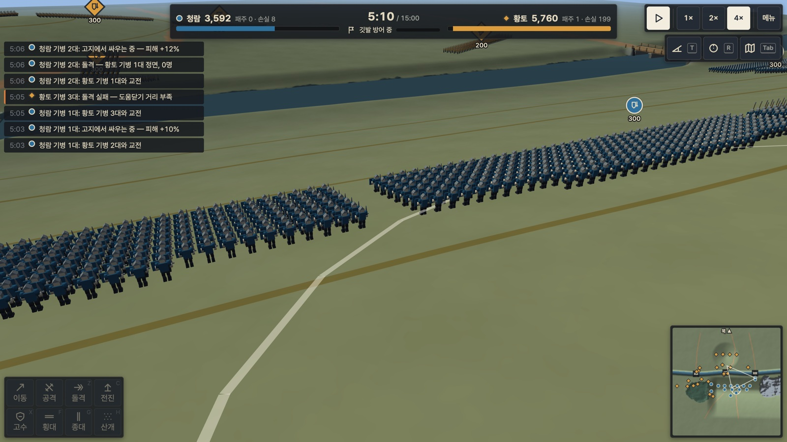
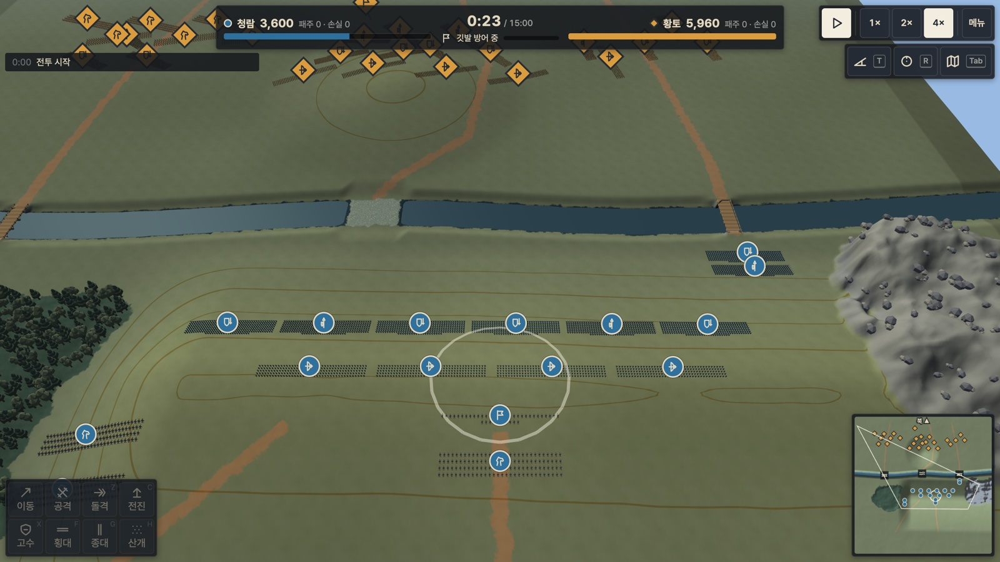
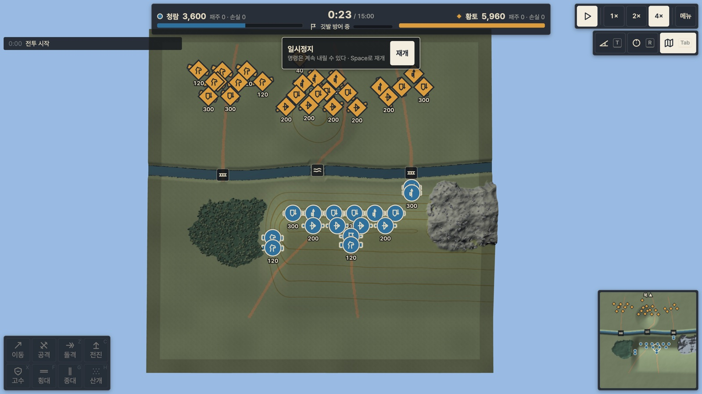
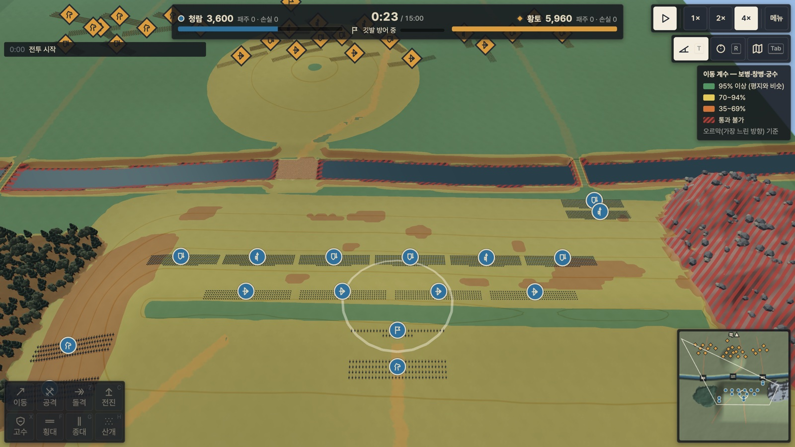
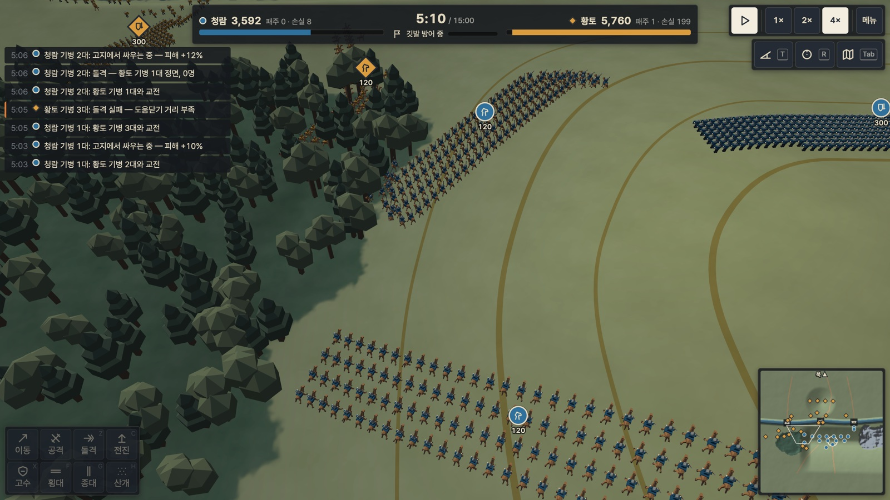

# Heroes — 갈대 여울 전투

수천 명의 군대를 지휘해 언덕과 숲과 강을 읽고, 배치와 기동으로 적의 대열을 무너뜨리는 3D 실시간 전술 게임입니다. TypeScript와 three.js로 만들었고, 브라우저에서 실행됩니다.

플레이어는 칼을 휘두르는 영웅이 아니라 전장을 내려다보는 지휘관입니다. 한 판에서 하는 일은 어디에 설지 고르고(배치), 언제 어디를 칠지 정하고(기동), 적이 무너질 때까지 버티는 것(사기 싸움)입니다.

**▶ 브라우저에서 바로 플레이: https://gyuha.github.io/heroes/**
(데스크톱 브라우저와 마우스를 권장합니다. AI끼리 싸우는 관전 모드: https://gyuha.github.io/heroes/?aivai&autostart)



> 현재 상태: **MVP 개발 중.** 맵 1개에서 한 판이 배치부터 결과까지 끝까지 돌아갑니다. 균형 조정과 목표 기기 성능 검증이 남아 있습니다(아래 [알려진 문제](#알려진-문제) 참고).

## 스크린샷

| | |
|---|---|
|  |  |
| **전장 전경.** 강 남쪽 매봉 능선에 청람군이 2열로 섰고, 깃발 구역(원)과 등고선이 보입니다. 오른쪽은 통과할 수 없는 동쪽 벼랑입니다. | **전술 지도(Tab).** 끝까지 축소하면 병사 대신 부대 아이콘으로 바뀝니다. 다리 2개와 여울 1개가 강을 건너는 유일한 길입니다. |
|  |  |
| **경사 오버레이(T).** 선택한 병종이 그 지형을 얼마나 빨리 지나는지 색으로 보여 줍니다. 초록은 평지와 비슷하고, 노랑·주황은 느리고, 빨간 빗금은 통과할 수 없습니다. | **검은숲 가장자리의 기병 교전.** 숲 안의 부대는 40m 안의 적에게만 보이고, 기병은 숲에서 돌격할 수 없습니다. 왼쪽 로그가 지형이 결과를 바꾼 이유를 알려 줍니다. |

## 게임의 핵심

이 게임의 디자인 기둥은 세 가지입니다(자세한 규칙은 [`docs/GDD.md`](docs/GDD.md)).

1. **지형이 곧 무기다.** 화면에 보이는 높이, 경사, 숲, 강은 모두 숫자로 작동하는 규칙입니다.
   - 고지에서 싸우면 근접 피해가 최대 22.5% 늘어납니다.
   - 궁수는 20m 높은 곳에서 쏘면 사거리가 160m에서 193m로 늘고, 낮은 곳에서 위로 쏘면 96m로 줄어듭니다.
   - 능선은 직사 화살과 시야를 가리고, 숲은 부대를 숨깁니다.
2. **전멸이 아니라 패주로 이긴다.** 부대는 마지막 한 명까지 싸우지 않습니다. 측면이나 후방을 맞거나, 돌격을 받거나, 옆 부대가 무너지면 사기가 꺾여 달아납니다.
3. **결과의 이유가 보인다.** 왜 느려졌는지, 왜 화살이 닿지 않는지, 왜 부대가 무너졌는지를 오버레이와 이벤트 로그가 설명합니다.

병종은 4종이고, 상성은 배율표가 아니라 방향·자세·속도 같은 상황에서 나옵니다.

| 병종 | 역할 | 강한 상대 | 약한 상대 |
|---|---|---|---|
| 보병 | 방패벽으로 전열 유지, 화살에 강함 | 창병 | 기병의 측면 돌격 |
| 창병 | 멈춰 서서 창을 세우면(Brace) 기병 돌격을 막음 | 기병 | 보병, 궁수 |
| 궁수 | 고지에서 멀리 쏘고, 능선 너머로 곡사 | 창병 | 기병 |
| 기병 | 도움닫기 돌격, 측면·후방 타격 | 궁수 | 창병 |

## MVP 맵: 갈대 여울

방어군 **청람**(3,600명)이 강 남쪽 능선과 깃발을 지키고, 공격군 **황토**(5,960명)가 강을 건너 깃발을 빼앗으려 합니다. 양쪽 합계 9,560명이 한 맵에서 싸웁니다. 진영 이름과 세계관은 가제입니다.

한 판은 브리핑과 진영 선택으로 시작해, 배치 구역 안에 부대를 세운 뒤 전투로 넘어갑니다. 전투 중에는 언제든 일시정지하고 명령할 수 있습니다. 아래 셋 중 하나가 먼저 일어나면 결과 화면으로 넘어갑니다.

- 공격군이 깃발을 60초 동안 점령한다 → 황토 승리
- 방어군이 제한 시간 15분을 버틴다 → 청람 승리
- 한쪽 군대가 붕괴한다 → 상대 승리

```
브리핑·진영 선택 → 배치 → 전투(일시정지·1×/2×/4×) → 결과 → 다시 하기
                              ↓ 깃발 점령 / 시간 종료 / 붕괴
                            결과 화면
```

## 실행 방법

필요한 것은 Node.js(22.12 이상의 22.x, 24.x, 또는 26 이상)와 pnpm 10입니다.

```bash
pnpm install
pnpm dev          # 개발 서버 http://localhost:5173
```

| 명령 | 설명 |
|---|---|
| `pnpm dev` | 개발 서버 실행 |
| `pnpm build` | 타입 검사 후 프로덕션 빌드(`dist/`) |
| `pnpm build:pages` | GitHub Pages용 빌드(기준 경로 `/heroes/`) |
| `pnpm preview` | 빌드 결과 미리보기 |
| `pnpm test` | 단위 테스트(Vitest) |
| `pnpm test:slow` | 오래 걸리는 AI 대 AI 결정론 검사까지 포함 |
| `pnpm typecheck` | 타입 검사. 게임 규칙 코드가 three.js·브라우저 API를 쓰지 않는지도 검사 |
| `pnpm sim:headless --games 4 --plan A` | 화면 없이 AI 대 AI 전투를 돌려 승패·병력·틱 시간을 출력 |

개발용 URL 옵션도 있습니다.

| 옵션 | 효과 |
|---|---|
| `?aivai` | AI 대 AI 관전 |
| `?autostart` | 브리핑을 건너뛰고 바로 전투 |
| `?speed=4` | 시작 배속 |
| `?seed=N` | 난수 시드(같은 시드면 같은 결과) |
| `?stats` | FPS, 틱 시간, 삼각형 수 표시 |
| `?scale=0.5` | 성능 측정용으로 부대당 병사 수만 배율 조정 |
| `?lod=0` | 원거리 저폴리 모델(LOD1) 끄기 |

예: `http://localhost:5173/?aivai&autostart&speed=4`

### 배포

`main`에 push하면 GitHub Actions(`.github/workflows/deploy-pages.yml`)가 테스트를 돌리고 `pnpm build:pages`로 빌드해 GitHub Pages에 배포합니다. 테스트가 실패하면 배포하지 않습니다.

```
main push → pnpm install → pnpm test → pnpm build:pages → GitHub Pages 배포
                              ↓ 실패
                          배포 중단
```

## 조작법

| 분류 | 입력 | 동작 |
|---|---|---|
| 선택 | 좌클릭 / Shift+좌클릭 / 드래그 | 부대 선택 / 추가·해제 / 상자 선택 |
| | `` ` `` | 전군 선택 |
| | Ctrl(또는 Alt)+1~9, 1~9 | 그룹 저장, 그룹 선택(두 번 누르면 카메라 이동) |
| 명령 | 우클릭 지면 / 우클릭 드래그 | 이동 / 정면 방향과 폭을 지정해 이동 |
| | 우클릭 적 | 공격 |
| | Z / C / X | 돌격 / 전진 / 고수 |
| | F / G / H | 횡대 / 종대 / 산개 |
| 진행 | Space | 일시정지·재개(일시정지 중에도 명령 가능) |
| | + / − | 배속 1×·2×·4× |
| 카메라 | W A S D, Q / E | 이동, 회전 |
| | 가운데 버튼 드래그, 휠 | 회전·기울기, 확대·축소 |
| | Tab | 전술 지도 |
| 표시 | T / R | 경사 오버레이 / 궁수 사거리 상시 표시 |

부대를 선택하지 않고 내린 명령은 무시됩니다. 실수로 전군이 강으로 걸어 들어가는 일을 막기 위해서입니다. 전군에 명령하려면 백틱(`` ` ``)으로 먼저 전군을 선택합니다. 전체 키 배치는 [`docs/UI_UX_GUIDE.md`](docs/UI_UX_GUIDE.md) §4에 있습니다.

## 기술 구성

- **스택:** TypeScript 7(strict), three.js 0.186, Vite 8, Vitest, pnpm
- **규칙과 화면의 분리:** 게임 규칙(`src/sim`)은 three.js와 브라우저 API를 쓰지 않고, `pnpm typecheck`가 이를 강제합니다. 그래서 규칙을 화면 없이 테스트하고 헤드리스로 돌릴 수 있습니다.
- **고정 틱 시뮬레이션:** 초당 20틱으로 고정하고, 화면은 두 틱 사이를 보간합니다. 같은 시드면 같은 결과가 나옵니다.
- **대량 유닛:** 병사 데이터는 속성별 배열(SoA)로 두고, 2m 격자로 이웃을 찾습니다. 시뮬레이션 1틱에 만드는 가비지는 약 40~65KB입니다.
- **대량 렌더링:** 병종마다 `InstancedMesh` 하나로 그립니다. 스켈레탈 애니메이션은 로드할 때 본 행렬 텍스처로 구워 GPU에서 스키닝합니다. 카메라에서 160m 밖의 부대는 원거리 저폴리 모델로 바꿉니다.
- **지형:** 513×513 높이맵과 지형 종류 맵을 쓰고, 등고선과 지도식 음영으로 고저를 보여 줍니다. 경로 탐색(A*)과 부대 단위 시야(전장의 안개)가 있습니다.

```
src/
├── sim/      게임 규칙: 부대·전투·사기·명령·AI·지형 규칙·경로·시야 (three.js 금지)
├── render/   three.js 화면: 지형, 병사 인스턴싱·애니메이션, 오버레이, 카메라
├── ui/       DOM HUD: 부대 카드, 명령 버튼, 로그, 미니맵, 입력 처리
└── app/      조립: 게임 세션, 맵 로딩, 헤드리스 러너
public/
├── assets/   병종 4종 모델(.glb)과 애니메이션, 지형 텍스처, 소품
└── maps/     MVP 맵 데이터(reed_ford)
tools/        맵·아트·애니메이션 생성 스크립트, 밸런스 시뮬레이터, QA 도구
docs/         설계 문서
```

모든 3D 모델, 텍스처, 애니메이션은 `tools/art/`, `tools/anim/`의 스크립트로 직접 만든 것이고 다시 생성할 수 있습니다.

## 문서

| 문서 | 내용 |
|---|---|
| [`docs/GDD.md`](docs/GDD.md) | 게임 디자인: 규칙, 병종, 지형, 명령, AI, 맵 |
| [`docs/BALANCE.md`](docs/BALANCE.md) | 수치와 밸런스 시뮬레이션 결과 |
| [`docs/ARCHITECTURE.md`](docs/ARCHITECTURE.md) | 구조, 데이터 흐름, 리소스 규격, 성능 목표 |
| [`docs/UI_UX_GUIDE.md`](docs/UI_UX_GUIDE.md) | 화면 구성, 디자인 시스템, 키 배치 |
| [`docs/ART_STYLE_GUIDE.md`](docs/ART_STYLE_GUIDE.md) | 아트 방향, 팔레트, 모델 규격 |
| [`docs/ANIMATION_GUIDE.md`](docs/ANIMATION_GUIDE.md) | 애니메이션 클립과 연동 규칙 |
| [`docs/DECISIONS.md`](docs/DECISIONS.md) | 주요 설계 결정과 그 이유 |
| [`docs/TASKS.md`](docs/TASKS.md) | 작업 현황 |
| [`docs/QA.md`](docs/QA.md) | 테스트 결과와 알려진 문제 |

## 알려진 문제

- **균형:** AI 대 AI에서 방어(청람)가 거의 항상 이깁니다. 목표 방어 승률은 45~55%이고, 공격 AI가 교전을 피하는지 수치 문제인지 진단하고 있습니다.
- **성능:** 개발 기기(Apple M5)에서는 9,560명이 교전 중일 때도 144fps(화면 주사율 상한)이고, 시뮬레이션 1틱은 평균 약 1.4~2ms입니다. 목표인 내장 GPU 노트북(1080p, 5,000명 60fps)에서는 아직 측정하지 않았습니다.
- **기동:** 같은 진영 기병 부대끼리 겹치는 경우가 있습니다.
- **미구현:** 사운드, 저장과 불러오기, 맵 추가, 캠페인

## 레퍼런스

[Heroes Battlefield Demo](https://hank1105.itch.io/heroes-battlefield-demo)(2D 스프라이트 게임)를 분석해 지휘 구조, 패주로 승부가 나는 방식, 전술 지도 같은 아이디어를 참고했습니다. 그 게임의 코드, 이미지, 사운드, 데이터는 이 저장소에 쓰지 않았습니다(`docs/DECISIONS.md` D-002, D-004, D-018).

## 라이선스

아직 정하지 않았습니다.
