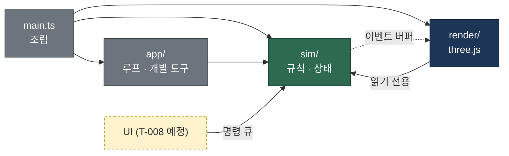
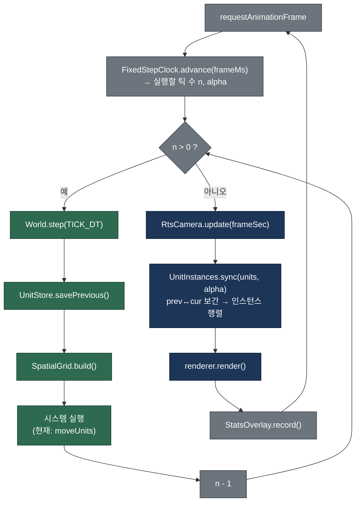

# ARCHITECTURE

테크니컬 아키텍트가 관리한다. 시스템 구조, 모듈 책임, 데이터·이벤트 흐름, 리소스 형식을 정한다. 이 문서와 실제 코드가 다르면 코드를 기준으로 이 문서를 고친다.

## 0. 요약

| # | 항목 | 결정 |
|---|------|------|
| 1 | 빌드·패키지 | Vite 8 + pnpm 10, TypeScript 7(strict), three.js 0.186 |
| 2 | 모듈 구조 | `sim`(규칙, three·DOM 금지) ← `render`(three.js) ← `app`(루프·개발 도구) ← `main.ts`(조립). 경계는 `pnpm typecheck`가 강제 |
| 3 | 게임 루프 | 고정 틱 20Hz 시뮬레이션 + 렌더 프레임마다 직전/현재 틱 보간 |
| 4 | 대량 유닛 데이터 | 구조체 배열(SoA, TypedArray) + 매 틱 재구성하는 균일 격자. Web Worker 이전 가능한 형태 |
| 5 | 대량 렌더링 | 병종당 InstancedMesh 1개. 애니메이션 1차 권고는 "본 행렬 텍스처 + GPU 인스턴스 스키닝" |
| 6 | 지형 | 높이맵 → 삼각형 메시. `Terrain.heightAt / gradientAt / slopeAt / typeAt` 을 시뮬레이션이 직접 사용 |
| 7 | 리소스 | `.glb`, 보병 300 삼각형·400 정점·20본, 텍스처 256², `public/assets/` (7절 상세) |
| 8 | 테스트·포맷 | Vitest, Prettier. ESLint는 아직 도입하지 않음 |
| 9 | 성능 목표 | 기준 사양(내장 GPU 노트북, 1080p)에서 **병사 5,000명 60fps**, 확장 목표 10,000명 |
| 11 | MVP 구현 계약 | 맵 파일 형식(북쪽이 위인 행 순서), 명령 큐, 이벤트 출력, 전술 지도 전환, 애니메이션 재생, 성능 규칙 |

---

## 1. 빌드 도구와 패키지 매니저

- **Vite 8 + pnpm 10** 을 쓴다. Vite는 TypeScript를 설정 없이 바로 번들하고 개발 서버 갱신(HMR)이 빠르다. three.js 프로젝트의 사실상 표준이라 참고 자료도 많다. pnpm은 잠금 파일(`pnpm-lock.yaml`)이 엄격하고 설치가 빠르다.
- **TypeScript 7** (Go로 다시 만든 네이티브 컴파일러)을 타입 검사에만 쓴다. 번들·테스트 변환은 Vite·Vitest가 하므로 `tsc`는 `--noEmit` 으로만 돈다. 일부 주변 도구(typescript-eslint 등)가 7을 늦게 지원할 수 있다는 점이 위험 요소다. 문제가 생기면 5.9로 내린다.
- `strict`, `noUnusedLocals`, `noUnusedParameters`, `verbatimModuleSyntax` 를 켠다.

| 스크립트 | 하는 일 |
|----------|---------|
| `pnpm dev` | 개발 서버. 성능 표시가 항상 켜진다 |
| `pnpm build` | `typecheck` 후 `dist/` 로 번들 |
| `pnpm preview` | 빌드 결과 실행. `?stats` 를 붙이면 성능 표시 |
| `pnpm test` | Vitest 1회 실행 |
| `pnpm test:slow` | 느린 검사 묶음까지 실행. `vitest run --mode slow`로 Vite 모드를 `slow`로 바꾸고, 테스트는 `import.meta.env.MODE === 'slow'`로 판단한다(환경 변수 문법을 쓰지 않아 Windows에서도 같다) |
| `pnpm typecheck` | 전체 타입 검사 + 시뮬레이션 경계 검사(2.3) |
| `pnpm format` / `format:check` | Prettier (코드·설정 파일만. `docs/`는 각 담당자 문서라 건드리지 않는다) |
| `pnpm sim:headless [--games N] [--seed S] [--plan A\|B\|C] [--json FILE]` | 브라우저 없이 실제 sim 코드로 AI 대 AI 전투를 돌린다(BALANCE §7 검증, 틱 비용 측정). Vite로 `src/app/headless.ts`를 `node_modules/.cache/headless/`에 묶은 뒤 일반 `node`로 실행한다 |

**지원 Node 버전:** `package.json`의 `engines`에 `^22.12.0 || ^24.0.0 || >=26.0.0`으로 적었다(Vitest 5의 요구 범위이며 Vite 8 범위 안에 있다). `pnpm sim:headless`는 Node의 실험적 TypeScript 실행 옵션(`--experimental-transform-types`, Node 26에서 제거됨, QA-002)을 쓰지 않으므로 이 범위의 모든 버전에서 같은 방식으로 돈다. Node 22.23.2, 24.13.0, 26.8.2에서 같은 시드가 같은 결과를 내는 것을 확인했다(2026-10-24).

개발 중 URL 파라미터(현재 `src/main.ts` 기준): `?seed=3` 시드, `?aivai` AI 대 AI 관전, `?autostart` 배치 생략, `?speed=1|2|4` 배속, `?stats` 성능 표시와 `window.__stats`·`window.__game`. 병력 규모를 바꾸는 `?scale=`은 9.3의 요구사항(T-007 구현 대기)이다. T-003 때의 `?units=N`은 임시 전투가 없어지면서 사라졌다.

## 2. 모듈 구조

### 2.1 폴더와 책임

```
src/
├── main.ts                 조립만 한다: 지형 생성 → World → GameRenderer → 루프 시작
├── sim/                    게임 규칙과 상태. three.js·DOM 금지. Node(Vitest)에서 그대로 돈다
│   ├── constants.ts        TICK_RATE(20Hz), TICK_DT
│   ├── world.ts            World: 전체 상태 보유, step(dt) 에서 시스템 실행 순서 결정
│   ├── units.ts            UnitStore: 병사 SoA 저장소
│   ├── spatialGrid.ts      SpatialGrid: 근접 탐색용 균일 격자
│   ├── terrain.ts          Terrain: 높이·경사·지형 종류 조회
│   ├── terrainGen.ts       임시 절차 생성 지형
│   ├── placeholderBattle.ts 임시 병사 배치(두 군대가 마주 보고 전진)
│   ├── systems/movement.ts 이동 + 겹침 밀어내기(임시 수치)
│   ├── rng.ts              시드 고정 난수
│   └── math.ts             clamp, wrapAngle
├── render/                 three.js 표현. sim 을 읽기만 한다
│   ├── gameRenderer.ts     WebGLRenderer, 씬, 조명, 프레임 렌더
│   ├── unitInstances.ts    UnitStore → InstancedMesh (보간)
│   └── rtsCamera.ts        RTS 카메라 입력과 배치
├── app/                    브라우저 수명 주기와 개발 도구 (three 직접 사용 금지)
│   ├── fixedStepClock.ts   고정 틱 누적기
│   └── statsOverlay.ts     FPS·CPU·시뮬레이션 시간 표시
└── types/simForbiddenThree.d.ts   경계 검사용 빈 선언(2.3)
```

**MVP 구현 단계 추가 폴더 (2026-10-23, 소유는 `docs/TASKS.md` 2단계 파일 범위):**

| 폴더·파일 | 책임 | 담당 |
|-----------|------|------|
| `src/sim/api.ts` | sim 공개 타입: `Command`, `SimEvent`, `SquadView` 등. UI·AI·렌더는 이 타입으로만 주고받는다 | B |
| `src/sim/data/` | 밸런스 수치(`balance.ts`, 디자이너 `tools/balance/` 사본), sim 설정 | B |
| `src/sim/rules.ts` | GDD 공식 순수 함수(디자이너 원본과 테스트로 일치 검사) | B |
| `src/sim/terrainRules.ts`, `src/sim/map/`, `src/sim/visibility*.ts` | 지형 효과, 맵 파싱, 경로 탐색, 시야 | A |
| `src/sim/ai/` | AI. 명령은 `World.enqueue`로만(11.2) | B |
| `src/render/terrain/` | 맵 로드(fetch), 지형·물·다리·소품 렌더 | A |
| `src/render/units/` | 병사 인스턴싱, 애니메이션 굽기·재생 | B |
| `src/ui/` | 입력, 선택, HUD, 오버레이. sim은 읽기만 하고 명령은 `Command`로 | UI |
| `src/app/gameSession.ts` | UI가 쓰는 세션(단계, 일시정지·배속, 명령 전달, 이벤트 전달) | B |

`src/ui`도 의존 방향 규칙을 따른다. ui → sim(타입·읽기), ui → render(카메라·씬)는 허용하고, sim·render가 ui를 import하는 것은 금지한다.

### 2.2 의존 방향

의존은 한 방향으로만 흐른다. `sim`은 아무것도 모른다. `render`는 `sim`의 상태를 읽어 그리기만 하고 쓰지 않는다. `app`과 `main.ts`가 둘을 엮는다. 이렇게 하면 게임 규칙을 브라우저·GPU 없이 테스트할 수 있고, 나중에 `sim`을 Web Worker나 서버로 옮겨도 `render`는 그대로 쓴다.

UI(T-008)가 생기면 UI는 `sim`의 상태를 직접 바꾸지 않고 **명령**(예: "부대 3을 (x, z)로 이동")을 `World`의 명령 큐에 넣는다. `World`는 다음 틱 시작 때 명령을 처리한다. 반대 방향으로 `sim`이 알려야 할 일(피격, 사망 등 이펙트·사운드 트리거)은 틱마다 채우는 **이벤트 버퍼**로 내보내고, 렌더·오디오가 틱 뒤에 읽는다. 두 큐 모두 첫 사용 기능(T-007, T-008)과 함께 만든다.



### 2.3 경계 강제 방법

`pnpm typecheck`는 `tsconfig.json`(전체) 다음에 `tsconfig.sim.json`(sim만)을 한 번 더 검사한다.

- `lib`에 DOM이 없다 → sim에서 `window`, `document`, `HTMLElement`를 쓰면 오류.
- `three`와 `three/*` import를 빈 선언 파일(`src/types/simForbiddenThree.d.ts`)로 돌린다 → three의 어떤 이름을 써도 `has no exported member` 오류.
- sim이 render·app 파일을 import하면 그 파일의 DOM·three 사용이 오류로 드러난다.

처음에는 Vitest 테스트(`import.meta.glob`으로 소스 문자열 검사)로 만들었으나, Vitest 5의 모듈 캐시(`node_modules/.vitest-cache`)가 테스트 파일 내용이 그대로면 새로 추가된 파일을 놓쳐 위반을 통과시켰다. 그래서 캐시 영향이 없는 컴파일 단계 검사로 바꿨다.

### 2.4 프레임워크를 쓰지 않는 이유 (ECS 등)

ECS 라이브러리(bitecs, miniplex 등)는 도입하지 않는다. 지금 대량으로 존재하는 개체는 병사 한 종류이고, 병사에게 필요한 "연속 메모리, 시스템 함수가 배열을 순회" 구조는 `UnitStore`(SoA)와 `systems/` 함수로 이미 얻는다. 개체 종류가 늘어 조합 문제가 실제로 생기면 그때 다시 판단한다.

## 3. 게임 루프

시뮬레이션은 **고정 틱 20Hz**(한 틱 50ms)로만 상태를 바꾸고, 렌더링은 모니터 주사율대로 돈다. 렌더러는 매 프레임 직전 틱과 현재 틱 상태를 `alpha`(0~1)로 보간해 그리므로 20Hz 틱에서도 움직임이 매끄럽다.

- **20Hz를 고른 이유:** RTS는 명령 단위 조작이라 50ms 입력 지연이 체감되지 않는다(스타크래프트 II도 약 22Hz). 60Hz 대비 시뮬레이션 비용이 1/3이라 그만큼 병사 수를 늘릴 수 있다. 결정적 고정 틱이라 같은 입력이면 같은 결과가 나와 테스트와 리플레이가 쉽다.
- **누적기:** `FixedStepClock.advance(frameMs)`가 실행할 틱 수를 돌려준다. 한 프레임 최대 5틱까지만 따라잡고 나머지 시간은 버린다(탭 전환 뒤 수백 틱을 몰아 실행하며 멈추는 현상 방지).
- **결정성 규칙:** sim에서는 `Math.random`, `Date`, `performance.now`를 쓰지 않는다. 난수는 `Rng`(시드 고정)만 쓴다. 브라우저 간 `Math.sin` 등의 비트 단위 일치는 보장되지 않으므로, 멀티플레이 lockstep이 필요해지면 따로 검토한다.
- **보간 데이터:** `World.step()` 시작에서 `UnitStore.savePrevious()`가 현재 값을 `prev*` 배열에 복사한다. 렌더러는 `prev + (cur - prev) × alpha`로 위치를, 최단 각도로 방향을 보간한다.



## 4. 대량 유닛 데이터 구조

### 4.1 구조체 배열(SoA)

병사는 객체가 아니라 `UnitStore`의 인덱스다. 속성마다 `Float32Array`/`Uint8Array` 하나를 두고 병사 i의 값은 각 배열의 i번째에 있다.

| 비교 | 객체 배열 `Unit[]` | 구조체 배열(SoA, 채택) |
|------|--------------------|------------------------|
| 메모리 | 객체마다 헤더·포인터, 흩어진 배치 | 속성별 연속 메모리, 병사 1명 약 50B |
| GC | 생성·삭제 때 가비지 발생 | 생성 시 한 번 할당, 이후 0 |
| 순회 속도 | 캐시 적중률 낮음 | 한 속성만 훑을 때 캐시 친화적 |
| Worker 이전 | 직렬화 필요 | 버퍼를 그대로 전송·공유 |
| 단점 | — | 필드 추가 시 배열을 하나 더 선언, 코드가 덜 객체지향적 |

현재 필드: `x, y, z, heading`, `prevX, prevY, prevZ, prevHeading`, `vx, vz`, `targetX, targetZ`, `team`. 병종·체력·애니메이션 상태 등은 GDD(T-004)가 나오면 같은 방식으로 추가한다. 좌표계는 지형 모서리가 원점이고 `x ∈ [0, width]`, `z ∈ [0, depth]`, `y`는 높이다. 방위는 **+x = 서쪽, +z = 북쪽**이고 원점은 남동쪽 모서리다(D-012. three.js 오른손 좌표계에서 북쪽을 화면 위로 둘 때 동쪽이 오른쪽에 오게 하려는 정의). `heading` 0은 +Z, 정면 벡터는 `(sin, cos)`이다.

**병사 제거는 전투 구현(T-007) 때 정한다.** 후보는 마지막 병사를 빈자리로 옮기는 swap-remove다. 배열이 빈틈 없이 유지되지만 인덱스가 바뀌므로, 외부에서 특정 병사를 오래 가리켜야 하면 `id → index` 표가 필요하다.

### 4.2 공간 분할: 균일 격자

`SpatialGrid`는 2m 칸 격자다. 매 틱 계수 정렬로 통째로 다시 만든다(O(N), 할당 없음). 병사가 계속 움직이므로 증분 갱신보다 단순하고 빠르다. `query(x, z, radius, out)`은 반경 안 병사 인덱스를 미리 할당한 `Int32Array`에 채운다. 근접 이웃(밀어내기), 근접 공격 대상 탐색에 쓴다. 사거리가 긴 탐색(궁수 30m 등)은 칸을 많이 훑게 되므로, 필요해지면 큰 칸 격자를 하나 더 둔다.

### 4.3 Web Worker 이전 계획

지금은 메인 스레드에서 돈다. 측정 결과 시뮬레이션 한 틱이 **기준 사양에서 8ms**(60fps 프레임의 절반)를 넘으면 옮긴다. 옮길 때 바뀌는 곳은 `app` 계층뿐이다.

- `World`를 Worker에서 실행하고, 틱마다 렌더에 필요한 배열(`x, y, z, heading`, 팀, 애니메이션 상태)을 transferable 버퍼 두 벌로 번갈아 보낸다. 메인 스레드는 직전/현재 스냅숏을 보간한다(지금의 prev/cur 구조와 같다).
- `SharedArrayBuffer`를 쓰면 복사도 없앨 수 있지만 COOP/COEP 응답 헤더가 필요해 배포 환경 제약이 생긴다. 측정 후 고른다.
- 이를 위해 지켜야 할 규칙: sim은 DOM을 쓰지 않는다(2.3이 강제), render는 sim 상태를 쓰지 않는다, UI 입력은 명령 큐로만 들어간다.

## 5. 대량 렌더링

### 5.1 인스턴싱

병종마다 `InstancedMesh` 하나로 그 병종 전체를 한 번의 그리기 호출로 그린다. 인스턴스 행렬은 `Object3D`를 거치지 않고 Y축 회전 + 이동 행렬을 `instanceMatrix` 배열에 직접 쓴다. 팀 색은 `instanceColor`로 넣는다(실제 리소스가 오면 7.4의 알파 마스크로 일부에만 적용).

- **절두체 컬링 끔:** 병사가 계속 움직여 경계 구가 매 프레임 바뀐다. three.js 기본 컬링은 이 경우 틀린 결과를 낸다. 지금은 꺼 두고, GPU가 병목이 되면 CPU에서 화면 밖 병사를 빼고 화면 안 병사만 앞쪽에 모아 쓰는(compaction) 방식을 넣는다.
- **그림자:** 지금은 끈다. 수천 병사에 그림자 맵을 쓰면 정점 처리량이 두 배가 된다. 권고안은 병사는 발밑 원형 그림자(인스턴스 사각형 1장), 지형·소품만 그림자 맵이다. 아트 방향 확정 후 결정한다.

### 5.2 애니메이션 방식 비교와 1차 권고

| 방식 | 원리 | 수천 명 비용 | 품질 | 리소스 제작 | 판단 |
|------|------|--------------|------|-------------|------|
| 스켈레탈 (`SkinnedMesh` + `AnimationMixer`) | 병사마다 CPU가 본 계산 | 병사마다 그리기 호출 1회와 믹서 갱신. 수천 명이면 CPU가 먼저 한계 | 최고, 블렌딩 자유 | 표준 glTF | **영웅·지휘관(수십 명)에만** |
| 정점 애니메이션 텍스처(VAT) | 모든 프레임의 정점 위치를 텍스처에 구움 | 정점당 텍스처 읽기 1~2회, 매우 쌈 | 좋음, 클립 간 블렌딩은 비용 추가 | 메시마다 굽기, 메시가 바뀌면 다시 굽기 | 후보(최대 성능이 필요할 때) |
| **본 행렬 텍스처 + GPU 인스턴스 스키닝** | 클립의 모든 프레임 본 행렬을 텍스처에 굽고, 정점 셰이더가 인스턴스별 클립·시간으로 스키닝 | 정점당 본 4개 × 텍스처 읽기 3~4회. 병사 5,000 × 400정점이면 데스크톱에서 감당 가능한 수준 | 스켈레탈과 같은 포즈, 블렌딩 가능 | 표준 스키닝 glTF 그대로. 같은 골격을 쓰는 병종 변형·LOD가 텍스처 공유 | **1차 권고** |
| 절차적 흔들기 | 셰이더에서 sin으로 상하·좌우 흔들기 | 거의 0 | 낮음, 팔다리 동작 없음 | 없음 | 아주 먼 거리 LOD 또는 임시용 |

**권고:** 일반 병사는 "본 행렬 텍스처 + GPU 인스턴스 스키닝", 영웅은 일반 `SkinnedMesh`. 아트 파이프라인은 일반 스키닝 glTF(7.5)라 특수 굽기 도구가 필요 없다. 굽기는 로드 시점에 three.js `AnimationMixer`로 각 클립을 30fps로 샘플링해 `DataTexture`(RGBA Float 또는 Half Float)에 넣는다. three.js 코어에는 인스턴스 스키닝 메시가 없으므로 `MeshStandardMaterial`/`MeshLambertMaterial`의 `onBeforeCompile`로 스키닝 부분을 바꿔 구현한다. 인스턴스별로 `클립 번호`, `클립 시작 시각` 두 값을 `InstancedBufferAttribute`로 넘긴다. 구현은 T-009(애니메이션)와 T-007(유닛)에서 한다. 성능 측정에서 부족하면 같은 원본 glTF로 VAT를 구워 바꾼다(리소스 재작업 없음).

텍스처 크기 예: 보병 20본 × 행렬당 4텍셀 = 80텍셀 폭, 클립 합 6초 × 30fps = 180줄 → 80×180 RGBA Float = 약 230KB. 병종당 1장.

## 6. 지형

시뮬레이션의 `Terrain`이 지형 데이터의 단일 원천이다. 렌더러는 같은 데이터로 메시를 만든다.

- **데이터:** `(cellsX + 1) × (cellsZ + 1)` 격자점 높이 `Float32Array` + `cellsX × cellsZ` 칸 지형 종류 `Uint8Array`(ID는 7.6). 현재 임시 지형은 256×256칸, 칸 2m → 512m × 512m, 최고 높이 40m.
- **삼각형 분할 일치:** 한 칸을 (1,0)-(0,1) 대각선으로 두 삼각형으로 나눈다. `heightAt`은 이 삼각형 평면 위의 정확한 높이를 돌려주고 `render/terrain/terrainSurface.ts`도 같은 분할로 인덱스를 만든다. 그래서 병사 발이 화면의 지면과 정확히 맞는다. 둘 중 하나만 바꾸면 안 된다.
- **조회 API (sim에서 직접 사용):**

| 메서드 | 반환 | 용도 예 |
|--------|------|---------|
| `heightAt(x, z)` | 지표면 높이(m) | 병사 y 좌표, 고지대 판정 |
| `gradientAt(x, z, out)` | `out[0]=dh/dx`, `out[1]=dh/dz` | 이동 방향의 오르막·내리막 판정(진행 벡터와 내적) |
| `slopeAt(x, z)` | 경사각(라디안) | 통과 불가 경사, 이동 속도 감소 |
| `typeAt(x, z)` | 지형 종류 ID | 숲·물·바위 효과 |
| `contains(x, z)` | 맵 안인지 | 경계 처리 |

  범위 밖 좌표는 가장자리 값으로 고정한다. 모든 조회는 할당 없이 동작한다(내부 임시 객체 재사용, 단일 스레드 전제).
- **예정 API:** 시야(가시선) 판정 `lineOfSight(a, b)`는 GDD의 시야 규칙이 나오면 높이맵 위 광선 진행으로 추가한다.
- **메시:** 격자점마다 정점 1개, 정점 색으로 지형 종류를 칠한 임시 표현이다(현재 66,049 정점, 131,072 삼각형). 아트의 지형 텍스처가 오면 지형 종류 맵을 텍스처로 올려 셰이더에서 섞는 스플래팅으로 바꾼다. 맵이 1024칸 이상이 되면 청크 분할과 거리별 LOD를 검토한다.
- **맵 파일:** 형식과 좌표 대응은 11.1이 정한다(T-012에서 PNG16 대신 원시 바이너리로 변경).
- **통과 불가 경사:** 30°(GDD §6.1, D-009). 임시 생성기의 `ROCK_SLOPE_RAD` 32°도 30°로 맞춘다(T-006).

---

## 7. 리소스 형식과 예산

아트 디렉터는 이 절의 수치와 규칙을 그대로 따른다. 수치는 "한 화면 병사 5,000명, 60fps"(9절) 목표에서 역산했다. 규칙을 바꿔야 하면 먼저 테크니컬 아키텍트와 협의한다.

### 7.1 파일 형식

| 종류 | 형식 | 비고 |
|------|------|------|
| 3D 모델 (병사, 영웅, 소품) | **glTF 2.0 바이너리 `.glb`** | 텍스처를 포함(embed)한 단일 파일. `.gltf + .bin` 분리 형식, FBX, OBJ는 받지 않는다. |
| 텍스처 원본 | PNG (8bit RGBA 또는 RGB) | 2의 거듭제곱 크기 필수(256, 512, 1024). 압축 포맷(KTX2)은 성능 측정 후 빌드 단계에서 변환한다. 아티스트가 직접 만들 필요 없다. |
| 지형 높이맵·종류 맵 | 원시 바이너리 `height.u16`, `types.u8` + `map.json` | 형식은 11.1. 맵은 `tools/map/`(T-006)이 코드로 만든다. 사람이 그린 16bit PNG를 쓰고 싶으면 `tools/map/`에서 이 형식으로 변환한다. |
| 지형 표면 텍스처 | PNG, 타일링 가능 | 지형 종류마다 1장, 512×512(최대 1024×1024). |

모델 압축(Draco, meshopt)은 쓰지 않는다. 병사 모델은 수 KB라 압축 이득이 없고 디코더 비용만 생긴다. 큰 소품이 생기면 빌드 단계에서 `gltfpack`으로 처리한다.

### 7.2 스케일, 축, 원점

- **단위:** 1 = 1미터. 일반 보병 키(발바닥~투구 끝, 무기 제외) 1.7~1.9m, 기병(말 포함) 높이 2.3~2.6m, 길이 2.4m 안팎. 이 키는 게임 판정(간격 1.4m 대형, 충돌 반경)의 기준이다. 머리·몸 비율(등신)은 아트 스타일 가이드가 정한다.
- **축:** glTF 표준대로 +Y 위, **정면은 +Z**. 게임 코드는 유닛의 진행 방향 각도를 Y축 회전으로 그대로 넣으므로 정면이 다르면 모든 병사가 옆이나 뒤로 걷는다.
  - Blender에서는 캐릭터가 **-Y 방향(Front 뷰에서 카메라를 바라보는 방향)** 을 보게 두고, 내보내기 옵션 `+Y Up`(기본값)을 켠다. 그러면 glTF에서 +Z 정면이 된다.
- **원점(피벗):** 두 발 사이 바닥 중앙 `(0, 0, 0)`. 게임은 원점을 지형 표면 높이에 놓는다. 원점이 허리에 있으면 병사가 땅에 묻힌다.
- **변환 적용:** 내보내기 전에 오브젝트의 위치·회전·스케일을 모두 적용(Apply All Transforms)해 루트 변환이 단위 행렬이 되게 한다.

### 7.3 폴리곤과 정점 예산

예산은 **삼각형 수**와 **정점 수**(UV·노멀 경계에서 갈라진 정점 포함, glTF 파일에 실제로 들어간 수) 둘 다 지킨다.

| 대상 | 삼각형 (상한) | 정점 (상한) | 본 (상한) | 메시/머티리얼 |
|------|---------------|-------------|-----------|---------------|
| 보병 1명 (무기·방패 포함) | **300** | **400** | 20 | 메시 1개, 머티리얼 1개 |
| 기병 1기 (말+기수+무기) | **700** | **900** | 40 | 메시 1개, 머티리얼 1개 |
| 영웅·지휘관 (전장에 수십 명 이하) | 3,000 | 3,500 | 40 | 메시 1개, 머티리얼 1~2개 |
| 소품 (나무, 바위, 깃발 등, 인스턴싱) | 500 | 600 | 없음 | 메시 1개, 머티리얼 1개 |
| 큰 구조물 (성벽, 건물, 수 개 배치) | 5,000 | 6,000 | 없음 | 머티리얼 2개 이하 |

- 무기, 방패, 투구는 별도 오브젝트로 내보내지 않고 병사 메시 하나로 합친다. 한 병사가 메시 2개면 그리기 호출이 2배가 된다. glTF 안에서도 **메시 1개 = 프리미티브 1개**여야 한다(머티리얼이 2개면 프리미티브가 2개로 갈라진다).
- 기병의 삼각형·정점·본 상한은 **말 + 기수 + 무기를 모두 합친 값**이다. 말과 기수는 한 메시·한 골격으로 만든다.
- 같은 골격을 쓰는 병종 변형(창병/검병/궁수)은 몸은 같게 두고 장비만 다르게 해 **같은 골격·같은 애니메이션**을 공유한다.
- LOD(원거리 저폴리 버전)는 지금 만들지 않는다. 9절 성능 측정에서 필요가 확인되면 보병 LOD1(삼각형 80 이하)을 요청한다.

### 7.4 텍스처와 머티리얼

- **병사·기병:** 텍스처 1장, 256×256(최대 512×512). 저폴리 스타일은 단색 팔레트 칸에 UV를 몰아 넣는 **팔레트 텍스처** 방식을 권장한다(같은 병종 변형끼리 한 장 공유 가능).
- **영웅:** 1024×1024 이하 1장.
- **소품:** 여러 소품이 512×512 또는 1024×1024 아틀라스 1장을 공유한다.
- **머티리얼:** glTF 기본 PBR(Metallic-Roughness). 병사는 Base Color 텍스처만 쓴다. Metallic·Roughness는 텍스처 없이 상수 값으로 둔다. 노멀맵, 발광(emissive), 투명은 병사에 쓰지 않는다.
- **알파 모드:** 병사와 기병은 `OPAQUE`. 나뭇잎 같은 소품만 `MASK`(alphaCutoff 0.5)를 허용한다. `BLEND`(반투명)는 정렬 비용 때문에 쓰지 않는다.
- **팀 색상:** 병사 Base Color 텍스처의 **알파 채널을 팀 색상 마스크**로 쓴다. 알파 1(255) = 팀 색으로 물드는 부분(망토, 방패 문양, 깃털 등), 알파 0 = 원래 색 유지. 팀 색 부분은 RGB를 밝은 회색(약 200,200,200)으로 칠한다. 게임이 이 부분에 팀 색을 곱한다. 알파 모드는 `OPAQUE`로 내보내므로 알파가 투명도로 쓰이지 않는다.
- **버텍스 컬러:** 소품(나무, 바위 등)은 텍스처 없이 버텍스 컬러(glTF `COLOR_0`)만으로 칠해도 된다. 이때 머티리얼 Base Color는 흰색, 텍스처 없음. 병사·기병은 팀 색 마스크(위)가 텍스처 알파에 있으므로 팔레트 텍스처를 쓴다. 한 모델에서 버텍스 컬러와 텍스처를 섞지 않는다.
- **색공간:** Base Color 텍스처는 sRGB. 버텍스 컬러는 glTF 규격상 파일 안에서 선형(Linear) 값이다. Blender에서는 화면에 보이는 색(sRGB)으로 칠하면 내보내기가 선형으로 바꿔 주므로 따로 변환하지 않는다. 그 밖의 데이터 텍스처(높이맵, 종류 맵)는 선형이다.

### 7.5 애니메이션

1차 방식은 **스키닝 glTF를 받아 게임이 로드 시점에 "본 행렬 텍스처"로 굽고, GPU 인스턴싱으로 재생**하는 것이다(근거는 5절). 아티스트는 일반적인 리깅·스키닝 glTF를 만들면 되고 특수 내보내기 도구는 필요 없다.

**클립 파일 (게임 디렉터 승인, 2026-10-23, `docs/INTERFACES.md` §4):**

- 메시 파일과 클립 파일을 나눈다. `public/assets/units/<unit_id>/<unit_id>.glb`(메시·골격·스킨, 아트 디렉터 소유)와 `public/assets/units/<unit_id>/animations.glb`(클립, 애니메이션 담당 소유). 서로 덮어쓰지 않는다.
- `animations.glb`는 원본과 **같은 본 이름·계층·바인드(정지 자세) 변환**의 노드만 갖고 메시는 없다. 로더(T-007)는 클립 트랙을 본 이름으로 원본 골격에 연결한 뒤 30fps로 본 행렬 텍스처에 굽는다. 이름이 하나라도 다르면 그 트랙은 무시되고 콘솔에 경고를 남긴다.
- 현재 골격(아트 디렉터 납품물 기준): `infantry`·`spearman`·`archer`는 같은 17본 인간형(`root hips spine chest head upper_arm_l forearm_l hand_l upper_arm_r forearm_r hand_r thigh_l shin_l foot_l thigh_r shin_r foot_r`), `cavalry`는 여기에 `horse_body horse_head horse_leg_0~3`을 더한 23본. 본 이름을 바꾸면 메시와 클립을 함께 다시 내보내야 한다.
- 클립마다 채널은 회전(`rotation`)만 쓴다. 예외로 `hips`의 이동(`translation`)은 허용한다(상하 흔들림). `root`의 이동·회전과 모든 스케일 채널은 금지(루트 모션 없음). 보간은 `LINEAR`.
- 재생 메타데이터는 각 glTF 애니메이션의 `extras`에 넣는다. `walk`·`run`: `{"speed": <1배속에서 발이 미끄러지지 않는 이동 속도 m/s>}`. `attack`: `{"hitTime": <클립 시작부터 타격 순간까지 초>}`. 렌더러는 `실제 속도 ÷ speed`로 재생 속도를 정하고, 공격은 시뮬레이션의 타격 시각에 `hitTime`이 맞도록 시작 시각을 당긴다(11.5). 도구가 `extras`를 쓸 수 없으면 `docs/INTERFACES.md` 요청 표로 알린다.

- **골격:** 보병 20본, 기병 40본 이하. 루트 본은 원점에 둔다. 한 정점에 영향을 주는 본은 **최대 4개**(glTF 표준 한도), 가능하면 2개 이하.
- **제자리 애니메이션:** 루트 모션 금지. 걷기·달리기도 제자리에서 움직인다. 이동은 게임 시뮬레이션이 처리한다.
- **프레임 속도:** 30fps로 만든다.
- **클립 이름(소문자, glTF 애니메이션 이름 그대로 사용):** `idle`, `walk`, `run`, `attack`, `hit`, `die`. 병종에 특수 동작이 필요하면 GDD 확정 후 추가한다(예: `attack_ranged`, `charge`).
- **반복 클립**(`idle`, `walk`, `run`)은 첫 프레임과 마지막 프레임 자세가 같아 끊김 없이 이어져야 한다. `die`는 마지막 프레임에서 쓰러진 자세로 멈춘다.
- **길이 권장:** `walk` 1.0초, `run` 0.6~0.8초, `attack` 0.6~1.0초, `hit` 0.3초, `die` 1.0~1.5초. 길수록 애니메이션 텍스처가 커진다(보병 1종 모든 클립 합 6초 이하).
- **셰이프 키(모프 타깃), 스케일 애니메이션은 쓰지 않는다.** 회전·이동 키만 쓴다.

### 7.6 지형 종류 ID

지형 종류 맵의 값, 시뮬레이션의 `TerrainType`, 표면 텍스처 이름의 약속이다. 각 종류의 게임 효과는 GDD §6.1이 정한다(D-009에서 4번의 의미 변경, 5·6번 추가). 코드(`src/sim/terrain.ts`의 `TerrainType`)는 T-006이 이 표에 맞춘다.

| ID | 이름 | 통과 | 표면 텍스처 파일 (`public/assets/terrain/`) | 비고 |
|----|------|------|---------------------------------------------|------|
| 0 | `grass` 평지 | 가능 | `grass_albedo.png` | |
| 1 | `forest` 숲 | 가능 | `forest_albedo.png` | 나무 소품은 렌더러가 종류 맵을 보고 배치(11.1 `propSeed`) |
| 2 | `rock` 절벽·바위 | **불가** | `rock_albedo.png` | |
| 3 | `sand` 흙길 | 가능 | `sand_albedo.png` | |
| 4 | `water` 깊은 물(강) | **불가** | `water_albedo.png` (강바닥) | 수면은 렌더러가 `waterLevel` 높이에 따로 그린다 |
| 5 | `ford` 여울 | 가능 | `ford_albedo.png` (신규, T-013) | 수면 없이 틴트만(INTERFACES 요청 표의 아트 제안) |
| 6 | `bridge` 다리 | 가능 | 없음. 다리 아래는 `water_albedo.png` | 시뮬레이션 높이는 둑 높이로 평평. 렌더러는 다리 칸 정점을 강바닥 높이로 내려 그리고 그 위에 `props/bridge.glb`를 놓는다 |

- 종류와 관계없이 **경사 30° 초과는 통과 불가**다(GDD §6.1). 판정은 `Terrain.slopeAt` 기준이다.
- 다리 모델 규격(INTERFACES 요청 표, 디렉터 승인): 로컬 +Z가 길이 방향 40m, X 통행 폭 10m, 통행면이 로컬 Y=0, 하부 구조는 Y<0, 난간은 통행 폭 바깥. 위치·방향은 `map.json`의 `bridges`(11.1)로 준다.

### 7.7 assets 폴더 규칙

런타임에 불러오는 리소스는 Vite의 정적 폴더인 **`public/assets/`** 아래에 둔다. 빌드하면 경로 그대로 배포된다. (`docs/TASKS.md`의 `assets/`는 이 `public/assets/`를 뜻한다.) 블렌더 파일·PSD 같은 원본은 게임 빌드에 넣지 않는다. 원본 보관 위치는 아트 디렉터가 정하되 `public/` 밖에 둔다.

```
public/assets/
├── units/<unit_id>/<unit_id>.glb        # 메시·골격·스킨 (아트 디렉터). 예: units/spearman/spearman.glb
├── units/<unit_id>/animations.glb        # 클립 6종, 메시 없음 (애니메이션 담당, 7.5)
├── props/<prop_id>.glb                   # 나무, 바위, 다리(bridge.glb), 깃발 등
├── terrain/<type>_albedo.png             # 7.6의 지형 종류별 표면 텍스처
├── ui/                                   # UI·UX 디자이너 소유
└── audio/                                # 사운드 디자이너 소유

public/maps/<map_id>/                     # 맵 데이터 (T-006, tools/map/ 이 생성. 형식은 11.1)
├── map.json
├── height.u16
├── types.u8
└── preview.png                           # 사람이 보는 미리보기(선택, 게임은 읽지 않음)
```

맵은 아트 리소스가 아니라 코드가 만드는 게임 데이터라서 `public/assets/` 밖의 `public/maps/`에 둔다(`docs/TASKS.md` 2단계 파일 범위와 같다).

- 파일·폴더 이름은 **소문자 영문, 숫자, 밑줄(snake_case)** 만 쓴다. 공백, 한글, 대문자 금지(배포 서버가 대소문자를 구분한다).
- `<unit_id>`는 GDD의 병종 ID와 같게 짓는다.
- 파일 크기 상한: 보병·기병 `.glb` 300KB, 영웅 2MB, 소품 500KB.
- 같은 이름으로 덮어쓰면 코드 수정 없이 교체된다. 임시 리소스는 이름 앞에 `tmp_`를 붙여 출시 전에 찾을 수 있게 한다.

### 7.8 로딩 방식

로딩은 렌더링 계층만 한다. 시뮬레이션은 리소스를 모르고 병종 ID(숫자)만 안다.

(로더는 첫 리소스가 들어올 때 구현한다. 아래는 그 동작 약속이다.) 전투가 시작되기 전에 그 전투에 필요한 모든 리소스를 한꺼번에 불러온다(전투 중 추가 로딩 없음). 모델은 three.js `GLTFLoader`로 읽고, 스키닝 모델은 이어서 애니메이션 굽기 단계를 거쳐 인스턴싱용 메시가 된다. 리소스 하나라도 실패하면 해당 병종을 임시 캡슐로 대체하고 콘솔에 경로와 원인을 남긴다(게임은 멈추지 않는다).

```
전투 준비 → 리소스 목록 결정(병종 ID → 경로) → GLTFLoader 병렬 로드 → 애니메이션 굽기 → InstancedMesh 생성 → 전투 시작
                                                  ↓ 실패
                                         임시 캡슐로 대체 + 경고 로그
```

### 7.9 아트 디렉터 납품 체크리스트

- [ ] `.glb` 단일 파일, 텍스처 포함
- [ ] 1m = 1, +Y 위, +Z 정면, 원점은 발 밑 중앙, 변환 적용됨
- [ ] 삼각형·정점·본 수가 7.3 표 안
- [ ] 메시 1개·프리미티브 1개·머티리얼 1개, 알파 모드 `OPAQUE`
- [ ] 텍스처 2의 거듭제곱, 크기 상한 안, 팀 색 마스크는 알파 채널
- [ ] 클립 이름 7.5 규칙, 제자리, 30fps, 반복 클립 이음매 없음
- [ ] 파일 이름 snake_case, 7.7 경로

---

## 8. 테스트, 린트, 포맷

- **테스트: Vitest 5.** Vite 설정을 그대로 쓰고 TypeScript를 바로 실행한다. 테스트 파일은 대상 옆에 `*.test.ts`로 둔다. sim 테스트는 Node 환경에서 돌며 three.js·브라우저가 필요 없다. 현재 테스트:
  - `sim/terrain.test.ts`: 높이 보간, 범위 밖 고정, 경사·기울기, 대각선 분할 연속성, 지형 종류 조회, 생성기 결정성
  - `sim/spatialGrid.test.ts`: 격자 탐색 결과가 전수 탐색과 같은지(무작위 2,000명 × 50질의), 경계 밖 좌표
  - `sim/world.test.ts`: 경사 지형에서 목표까지 이동·발 높이·방향, 겹친 병사 분리
  - `app/fixedStepClock.test.ts`: 틱 누적, 최대 틱 제한, 음수 시간 무시
- **무엇을 테스트하나:** 게임 규칙(sim)은 단위 테스트를 반드시 붙인다. 렌더링·UI는 실제 화면 확인(QA)으로 검증한다.
- **포맷: Prettier** (`package.json`의 `prettier` 항목: 작은따옴표, 줄 폭 100).
- **린트: 지금은 ESLint를 넣지 않는다.** TypeScript strict와 미사용 변수 검사, 2.3의 경계 검사가 가장 중요한 규칙을 이미 강제한다. ESLint flat config(`eslint.config.js`)는 이번 작업 파일 범위 밖이고, typescript-eslint의 TypeScript 7 지원도 확인이 필요하다. 팀에서 규칙 요구가 생기면 게임 디렉터 승인 후 추가한다.
- **주의:** Vitest 5는 `node_modules/.vitest-cache`에 변환 결과를 내용 기준으로 캐시한다. `import.meta.glob`처럼 다른 파일 목록에 의존하는 테스트는 파일이 추가돼도 갱신되지 않을 수 있으니 쓰지 않는다(2.3 참고).

## 9. 성능 목표

### 9.1 목표

| 항목 | 목표 |
|------|------|
| 기준 사양 | 내장 GPU 노트북(Apple M1 또는 Intel Iris Xe급), 최신 Chrome, 1920×1080, 픽셀 비율 1 |
| **필수 목표** | 실제 리소스(보병 300 삼각형, GPU 스키닝 애니메이션)로 **병사 5,000명이 한 화면에서 싸울 때 60fps** (프레임 16.7ms) |
| 확장 목표 | 같은 조건 10,000명 50fps 이상 |
| 시뮬레이션 예산 | 기준 사양에서 한 틱 8ms 이하. 넘으면 Worker 이전(4.3) |
| 그리기 호출 | 병종 수 + 지형 + 소품 종류 수 수준 (병사 수와 무관) |

**N = 5,000의 근거:**
- 아래 개발 장비 측정에서 임시 병사(264 삼각형)는 50,000명에서도 GPU 프레임이 주사율(144Hz)을 유지했다. 렌더링 쪽 한계는 5,000명보다 훨씬 위에 있다.
- 기준 사양 GPU는 측정 장비(Apple M5)보다 대략 3~5배 느리다고 본다([낮음] 공개 벤치마크 기반 추정, 실측 필요). GPU 스키닝은 정점 처리 비용을 2~4배 올린다. 둘을 곱해도 5,000명은 여유가 있다.
- 시뮬레이션은 지금 이동·밀어내기만 하는데도 측정 장비에서 20,000명 밀집 시 틱당 4~4.7ms다. 전투·목표 탐색·시야가 붙으면 비용이 몇 배로 늘고 기준 사양 CPU는 더 느리다. 이쪽이 먼저 한계가 될 가능성이 높아 5,000명을 필수로, 10,000명을 확장 목표로 둔다.
- 기획 목표("한 전투 양측 합계 수천 명")와도 맞는다.

### 9.2 측정 결과 (2026-10-23, 임시 병사 264 삼각형, 개발 서버)

측정 장비: Apple M5, Paseo 내장 브라우저(Electron 44 / Chrome 152), 2560×1600(픽셀 비율 2), 144Hz 화면. FPS는 화면 주사율(144)에 묶여 있으므로, 여유는 `cpu`(프레임당 메인 스레드 작업 시간)와 `sim`(틱 1회 시간)으로 본다. 밀집 = 두 군대가 맞부딪힌 뒤.

| 병사 수 | 삼각형 | FPS | cpu ms/프레임 | sim ms/틱 (전진 → 밀집) |
|---------|--------|-----|---------------|-------------------------|
| 4,000 | 1.06M | 144 | 0.5~0.8 | 0.5~0.8 → 1.0 (밀집 직전, 완전 밀집은 미측정) |
| 10,000 | 2.64M | 144 | 1.0~1.3 | 0.8~1.8 → 2.1~2.9 |
| 20,000 | 5.28M | 144 | 1.0~1.9 | 1.8~3.1 → 3.9~4.7 |
| 50,000 | 13.2M | 140~144 | 1.7~4.3 | 3.8~5.3 → 7.3~9.1 |

- 50,000명 밀집에서는 틱이 실행되는 프레임이 6.9ms(144Hz 한 프레임)를 넘어 FPS가 조금 떨어지기 시작한다. 틱이 한 프레임에 몰리는 구조라서 생기는 현상이며, 4.3의 Worker 이전이 해결책이다.
- 위 표는 T-003 뼈대(임시 캡슐 병사, 이동·밀어내기만) 기록이다. 그때 쓰던 `?units=N` 절차는 더 이상 동작하지 않는다. 현재 측정 절차는 9.3이다.

### 9.3 측정 절차 (2026-10-24 재정의, T-011)

실제 시나리오("갈대 여울", 9,560명)를 AI 대 AI로 돌려 잰다. 임시 전투가 아니라 실제 전투·AI·시야 비용이 들어간 값이어야 목표(D-008)와 비교할 수 있다.

**병력 규모 바꾸기 — B에게 넘길 요구사항 (`?scale=k`):**

- `src/main.ts`가 `?scale=k`(0.25~2, 기본 1)를 읽어, 시나리오의 **부대 수와 배치는 그대로 두고 부대마다 병사 수를 `round(size × k)`로** 만든다. 총 병력 ≈ 9,560 × k. `k = 0.5`이면 약 4,780명(필수 목표 5,000명 근처), `k = 1`이면 9,560명(확장 목표 10,000명 근처), `k = 2`이면 19,120명(한계 확인).
- `?units=N`이 아니라 배율인 이유: 실제 시나리오의 부대 구성·AI·시야 비용을 유지한 채 병사 수만 바꿀 수 있다. 부대 수가 같으므로 부대 단위 비용(시야, AI, 경로)은 고정되고 병사 단위 비용만 변해 원인 분리가 쉽다.
- 밸런스용이 아니라 성능 측정용이다. 결과 화면에 `scale ≠ 1`을 표시해 혼동을 막는다.
- 헤드리스 러너에도 같은 옵션(`--scale k`)을 둔다.
- 렌더러 인스턴스 용량은 world 생성 때 병사 수로 정해지므로(`gameRenderer.ts`), scale이 바뀌면 페이지를 다시 연다(URL 파라미터이므로 자연히 그렇다).

**브라우저 측정 순서 (QA):**

```
pnpm build && pnpm preview → http://localhost:4173/?aivai&autostart&stats&speed=4&scale=k
  → 전투 시간 210초(첫 접촉 약 3:07~3:28) 지나면 콘솔에서 __game.session.setSpeed(1)
  → 10초 안정화 → 30초 동안 0.5초마다 window.__stats 기록(60개)
  → k = 0.5, 1, 2 반복, 그다음 같은 방법으로 speed 2, 4 측정
```

1. 화면 1920×1080, 브라우저 확대 100%, 다른 탭 없음. 카메라는 시작 위치에서 조작하지 않는다(전술 지도로 바뀌면 병사를 그리지 않아 값이 달라진다). 병사가 화면에 보이는지 스크린샷 한 장을 남긴다.
2. 기록 값: `fps`, `frameMs`, `cpuMs`, `simMsPerTick`의 중앙값과 최악값(60개 중), 크롬이면 `performance.memory.usedJSHeapSize`의 시작·끝.
3. 합격 기준(D-008): 기준 사양에서 `k = 0.5` 1배속 FPS 중앙값 60, 최악값 50 이상. `k = 1`은 확장 목표로 기록만 한다.
4. 15분 메모리 측정: `k = 1`, 1배속으로 한 판을 끝까지 돌리며 1분마다 힙 크기를 적는다. 계속 늘면 누수다.

**헤드리스 측정 (브라우저 없이 시뮬레이션만):** `pnpm sim:headless --games 3 --seed 1`이 틱 평균·최대와 시스템별 ms/틱을 출력한다. 렌더링과 무관한 sim 비용을 기준 사양에서 직접 잴 수 있다. 다른 프로그램을 끄고 잰다(아래 9.4의 값은 다른 에이전트가 동시에 돌던 상태라 높게 나왔을 수 있다).

### 9.4 시뮬레이션 실측과 Worker 이전 위험 (2026-10-24, T-012 2차 리뷰)

개발 장비(Apple M5) 헤드리스, 9,560명 AI 대 AI 15분 한 판 기준.

| 항목 | 값 |
|------|-----|
| 틱 평균 | B 측정 1.6~3.0ms(Node), 1.6~2.1ms(브라우저). 아키텍트 측정 3.2~3.9ms(다른 작업이 동시에 돌던 상태) |
| 가장 큰 시스템 | 병사 이동 `soldiers` 평균 2.6~2.7ms. 그다음 격자 재구성 0.6~0.75ms |
| 틱 최대 | 137~390ms (부하 상태 측정이라 과장됐을 수 있으나 GC와 최적화 해제가 원인으로 확인됨, 아래) |
| 가비지 | **틱당 약 1.3MB**(한 판 22.7GB), 소규모 GC 3,926회(4.6틱에 1회) |

**가비지의 원인 (V8 할당 표본 측정):** `updateSoldiers` 55%, `Terrain.heightAt` 18%, `Math.hypot` 12%, `directionalSlopeDeg` 5%. 모두 객체를 만들지 않는 숫자 함수인데 할당이 생긴 이유는, V8이 **인라인되지 않은 함수의 실수 반환값과 최적화되지 않은 코드의 실수를 힙 객체로 감싸기** 때문이다. `Math.hypot`은 V8이 인라인하지 않는 내장 함수다. 실험으로 `Math.hypot`만 `Math.sqrt(a*a + b*b)`로 바꾸자 한 판 가비지가 22.7GB에서 15.4GB로 32% 줄었다([높음] 같은 시드 비교). `updateSoldiers`는 한 판 동안 최적화와 해제를 여러 번 반복했다(`--trace-deopt`).

**기준 사양 평가:** 기준 사양이 3~5배 느리면 틱 평균은 5~19ms다. **Worker 이전 기준(8ms)을 넘을 가능성이 높다**([중간]).

- 1배속: 초당 20틱 × 5~19ms = 메인 스레드의 10~38%. 틱이 걸리는 프레임(60fps에서 3프레임 중 1개)이 16.7ms를 넘어 끊김이 보인다.
- 4배속: 초당 80틱 × 5~19ms = 0.4~1.5초/초. **기준 사양에서 4배속은 유지할 수 없다.** 2배속도 경계다.
- GC 멈춤은 메인 스레드를 막으므로 sim을 Worker로 옮기면 렌더 끊김은 줄어든다. 하지만 sim 자체가 느려지는 문제는 그대로다.

**권고 순서:**

```
1) 가비지 줄이기(11.6-11, 비용 작음) → 2) 기준 사양 실측(9.3, T-011) → 3) 틱 평균 > 8ms 또는 4배속 필요 시 Worker 이전(4.3) → 4) 그 전까지 sim ms/틱이 4ms를 넘는 장비에서는 4배속을 끈다
```

## 10. 남은 문제와 다음 결정

| 항목 | 상태 | 담당·시점 |
|------|------|-----------|
| 임시 이동은 목표를 향하는 힘이 밀어내기보다 강해, 두 군대가 서로를 뚫고 섞인다 | GDD 확정. 충돌·대형·교전 규칙으로 교체 | T-007 |
| 명령 큐·이벤트 출력 | 계약 확정(11.2, 11.3), 구현 대기 | T-007 |
| 병사 제거 방식(4.1) | 전투 구현 시 결정 | T-007 |
| GPU 인스턴스 스키닝(5.2), 클립 로더 | 클립 형식 승인(7.5), 구현 대기 | T-007 + T-009a |
| 맵 파일 로더 | 형식 확정(11.1), 구현 대기 | T-006 |
| 지형 표현이 정점 색(칸 경계가 계단처럼 보임) | 지형 텍스처 스플래팅으로 교체 | T-006 |
| 전술 지도 전환, 안개·far 거리 | 방식 확정(11.4), 구현 대기 | T-008 + T-007 |
| 절두체 컬링 꺼짐(5.1) | GPU 병목이 측정되면 compaction 도입 | T-011 측정 후 |
| 그림자 방식(5.1) | 아트 방향 확정 후 | 아트 디렉터와 협의 |
| 기준 사양 성능 실측 | 미검증 | T-011 |
| sim 가비지 틱당 1.3MB, 틱 최대 137ms 이상 (9.4) | 2차 리뷰에서 발견. 11.6-11로 줄이기 | T-007(B) `updateSoldiers`, T-006(A) `heightAt`·`directionalSlopeDeg` |
| 병력 규모 측정 파라미터 `?scale=k` (9.3) | 요구사항 확정, 구현 대기 | T-007(B) |
| Worker 이전 여부 (4.3, 9.4) | 기준 사양 실측 후 결정. 그 전까지 느린 장비에서 4배속 제한 | 게임 디렉터, T-011 측정 후 |
| 사용하지 않는 파일: `src/render/unitInstances.ts`(개발용 `ui/dev/harness_mock.ts`만 사용). `src/render/terrainMesh.ts`는 A가 삭제함(2026-10-24, 지형 메시는 `render/terrain/terrainSurface.ts`) | 삭제 또는 개발 폴더로 이동 | B, UI |

---

## 11. MVP 구현 계약 (T-012, 2026-10-23)

T-006(A), T-007(B), T-008(UI), T-009a(애니메이션)가 병렬로 구현할 때 서로 맞춰야 하는 형식과 규칙이다. 세부 함수 시그니처는 각 담당자가 `docs/INTERFACES.md`에 적고, 이 절은 그 시그니처가 지켜야 할 구조 원칙을 정한다.

### 11.1 맵 파일 형식 (T-006 구현)

맵 하나는 `public/maps/<map_id>/` 폴더 하나다. `tools/map/`(Node)이 GDD §10의 배치를 코드로 만들어 이 형식으로 쓴다.

**`map.json`**: 필드 정의는 T-006 담당자가 `docs/INTERFACES.md` §1.4의 `MapMeta`로 확정했고(2026-10-23 리뷰 반영) 이 문서는 그것을 따른다. 아키텍처가 요구하는 것은 다음 다섯 가지다.

| 요구 | 이유 |
|------|------|
| 최상위에 `format: 1` 정수를 둔다. 로더는 모르는 버전이면 오류 | 형식이 바뀐 맵 파일을 조용히 잘못 읽는 일을 막는다 |
| `cellSize`, `cellsX`, `cellsZ`, `heightMin`, `heightMax`를 둔다 | 바이너리 해석에 필요한 값이 전부 `map.json` 안에 있어야 한다 |
| 길이는 m, 각도는 라디안이고 0 = +Z(병사 `heading`과 같다) | 좌표 규칙을 하나로 유지한다 |
| 렌더 전용 값(`waterLevel`, `riverBedHeight`, `propSeed`)은 sim 규칙에 쓰지 않는다 | 시야·이동 판정은 높이맵과 종류 맵만 본다 |
| 병력 편성은 넣지 않는다 | 맵과 시나리오를 분리한다 |

병력 편성(어느 부대가 어디서 시작하는지)은 맵이 아니라 시나리오 데이터로, T-007이 `src/sim/` 안의 TypeScript 데이터로 둔다.

**`height.u16`**: 부호 없는 16bit 정수, 리틀 엔디언, `(cellsX + 1) × (cellsZ + 1)`개. 높이 = `heightMin + (heightMax − heightMin) × 값 ÷ 65535` (64m 범위면 약 1mm 정밀도).

**`types.u8`**: 8bit 정수 `cellsX × cellsZ`개, 값은 7.6의 지형 종류 ID.

**행 순서 = 첫 행이 북쪽.** 두 파일 모두 행 우선으로 저장한다. **첫 행은 북쪽 가장자리(z 최대)**, 마지막 행은 남쪽(z = 0)이다. 각 행 안에서는 x = 0(**동쪽** 끝)에서 x가 커지는 쪽(서쪽)으로 간다(D-012: +x = 서, +z = 북). 그래서 파일을 그대로 그림으로 그리면 북쪽은 위지만 **동서가 뒤집힌 거울상**이 된다. 사람이 보는 `preview.png`는 좌우를 뒤집어 저장해야 GDD §10.2 개략도(북쪽 위, 동쪽 오른쪽)와 같아진다. `Terrain` 내부 배열은 `iz = 0`이 남쪽이므로 로더가 행을 뒤집는다(열은 뒤집지 않는다). 데이터 순서는 D-012 전과 같다.

```
파일 행 r, 열 c  →  격자점 (ix = c, iz = cellsZ − r)        →  월드 (x = c × cellSize, z = (cellsZ − r) × cellSize)
types 행 r, 열 c →  칸 (ix = c, iz = cellsZ − 1 − r)         →  x ∈ [c, c+1) × cellSize, z ∈ [iz, iz+1) × cellSize
```

- 로더는 둘로 나눈다. 바이트를 받아 `GameMap`(`Terrain` + 메타)을 만드는 **순수 함수 `parseMap`은 `src/sim/map/`**(Node 테스트 가능), `fetch`는 렌더 계층 `src/render/terrain/loadMap.ts`(T-006)가 한다.
- 필수 테스트: ① 파일 첫 행 첫 값이 **북동쪽** 모서리 `(x = 0, z = depth)`의 높이가 되는지(D-012로 x = 0은 동쪽 끝. `src/sim/map/gameMap.test.ts`에 구현됨) ② 길이가 맞지 않으면 파일명과 기대 길이를 담은 오류 ③ `heightMin/Max` 변환.
- **PNG16 대신 원시 바이너리를 쓰는 이유:** 브라우저 Canvas는 PNG를 8bit로 잘라 읽으므로 16bit PNG는 별도 디코더 의존성이 필요하다. 생성기가 Node 코드라서 원시 바이너리를 쓰는 편이 간단하고 정확하다. 크기는 513²×2 + 512² ≈ 790KB이며 배포 서버의 gzip이 줄인다.

### 11.2 명령 큐 (T-007 구현, T-008·AI가 사용)

플레이어 UI와 AI는 시뮬레이션 상태를 직접 바꾸지 않고 명령만 넣는다.

- **위치:** 명령 타입은 `src/sim/api.ts`의 `Command`(T-007 작성). 큐는 **sim 안의 `World`**에 두고(`World.enqueue(command)`), `World.step()`의 **맨 처음**, 시스템보다 먼저 받은 순서대로 처리한다. UI가 쓰는 `GameSession.issue()`(`src/app/gameSession.ts`)는 즉시 결과(`CommandResult`)를 돌려준 뒤 `World.enqueue`로 넘기는 얇은 껍데기다.
- **AI는 `World.enqueue`를 직접 쓴다.** AI는 `src/sim/ai/`에 있고 sim은 app을 import할 수 없으므로(2.3) `GameSession.issue`를 부를 수 없다. 공정성(GDD §8.1)을 위해 `issue`의 검증 로직은 sim의 순수 함수(예: `validateCommand(world, cmd)`)로 두고 `issue`와 AI가 같은 함수를 쓴다.
- **즉시 검증은 안내용, 최종 판정은 적용 시점.** `issue`가 `ok`를 돌려줘도 다음 틱 전에 부대가 패주할 수 있다(특히 일시정지 중 명령). 적용할 때 sim이 다시 확인한다.
- **명령은 직렬화 가능한 평범한 객체**다(함수·클래스 인스턴스·three.js 객체 금지). `kind` 필드로 구분하는 판별 유니온이다(`move`, `attack`, `charge`, `advance`, `hold`, `formation`, `deploy`).
- **명령 타입은 하나만.** UI도 `src/sim/api.ts`의 `Command`를 그대로 만든다(ui → sim 타입 import는 허용). UI 전용 명령 타입을 따로 두고 어댑터로 바꾸면 이름(`loose`/`skirmish` 등)과 필드가 갈라진다.
- **드래그 선분을 부대별 위치로 나누는 계산은 sim 순수 함수 하나로.** 열 수(8~80)와 간격은 규칙 데이터이므로 sim이 계산한다. UI의 드래그 중 미리보기와 명령 적용이 같은 함수를 불러야 미리보기와 실제 위치가 어긋나지 않는다. 그래야 리플레이 기록, Worker 전송, 테스트 재현이 된다.
- **부대는 부대 ID로 가리킨다.** 부대 ID = `squads()` 배열 인덱스이고 괴멸한 부대도 자리를 지키므로 전투 중 바뀌지 않는다(T-007 확정). 병사 인덱스는 제거 때 바뀌므로 명령·UI·이벤트 어디서도 병사 인덱스를 오래 들고 있지 않는다.
- **판정은 sim이 한다.** 패주 부대 무시, 교전 중 이동 시 이탈 판정(GDD §7.2 흐름도)은 sim이 처리한다. UI는 "선택이 없으면 명령을 넣지 않고 안내만 띄우는" 것까지만 한다. 선택 상태 자체는 UI 상태이고 sim에 없다.
- **AI도 같은 큐를 쓴다.** AI(`src/sim/ai/`)는 시스템으로 돌면서 명령을 큐에 넣고, 다음 틱에 처리된다. 플레이어와 같은 지연, 같은 판정을 받는다. AI는 전장의 안개 규칙(GDD §6.4)을 따르므로 적 정보는 시야 결과로만 읽는다.
- **일시정지·배속은 명령이 아니다.** `app`의 루프가 처리한다. 일시정지는 틱을 진행하지 않고(명령은 받아 둔다), 배속은 `FixedStepClock`에 넘기는 경과 시간에 배수를 곱한다. 4배속이면 초당 80틱이 돌므로 시뮬레이션 비용도 4배가 된다(11.6).

### 11.3 이벤트 출력과 렌더가 읽는 상태 (T-007 구현)

sim이 밖으로 알리는 정보는 빈도에 따라 두 경로로 나눈다.

| 경로 | 무엇 | 형태 | 소비자 |
|------|------|------|--------|
| **병사 상태 배열 (고빈도)** | 병사 하나하나의 피격, 공격, 사망처럼 초당 수백~수천 번 일어나는 일 | `UnitStore`의 SoA 필드에 "마지막으로 일어난 틱"을 기록. 예: `hp`, `deathTick`(살아 있으면 −1), `lastHitTick`, `lastAttackTick`, `squad` | 렌더(애니메이션, 피격 반짝임), 사운드(부대 단위로 집계) |
| **이벤트 목록 (저빈도)** | 부대·전투 단위의 사건: 상태 전환(동요·패주·재집결·괴멸), 돌격 충돌, 일제 사격, 깃발 상태, 전투 종료, 이벤트 로그(GDD §6.5) | `api.ts`의 `SimEvent`(T-007). sim은 틱 동안 버퍼에 쌓기만 하고, 앱(`GameSession`)이 틱을 다 돌린 뒤 꺼내 `onEvent` 구독자에게 전달한다. sim 안에서 구독자 콜백을 부르지 않는다(Worker 이전 대비) | UI(로그·HUD), 사운드, VFX |

- 병사마다 이벤트 객체를 만들지 않는다. 9,560명이 싸우면 초당 수천 개의 객체가 생겨 GC 멈춤이 생긴다. 이벤트 목록은 초당 수백 개 이하가 목표다.
- 이벤트 로그는 문장이 아니라 **원인 코드와 값**을 담는다(예: `{type: 'log', cause: 'rangeTooShort', squadId, heightDiff: 20, range: 96}`). 문장 만들기와 번역은 UI가 한다. "같은 원인은 부대당 10초에 한 번"(GDD §6.5)은 규칙이므로 sim이 거른다.
- UI가 읽는 부대 상태(병력, 사기, 상태, 현재 명령, 정면 방향 등)는 부대 수가 50개 안팎이라 평범한 객체 배열이어도 된다. UI는 읽기만 한다.
- 시야: 적 부대 표시 여부는 sim의 시야 결과(팀별 부대 가시 여부, 마지막 목격 위치·틱)로만 정한다. UI·렌더가 따로 거리 계산을 해서 보여 주면 안개가 새어 나간다.

명령과 이벤트를 합친 한 프레임의 흐름은 다음과 같다.

```
UI 입력·AI 결정 → World.enqueue(명령) → (다음 step 시작) 명령 처리 → 시스템 실행 → 병사 상태 배열·World.events 갱신
                                                                                  ↓ 프레임 끝
                                             렌더(상태 배열 읽기) · UI/사운드/VFX(World.drainEvents())
```

### 11.4 전술 지도 전환 (T-008 카메라·오버레이, T-007 유닛 렌더)

최대로 축소하면 병사 모델 대신 부대 아이콘을 보여 준다(GDD §9.1).

- **판단 기준은 하나만 둔다.** `RtsCamera.tacticalView: boolean`(T-008 확정, `docs/INTERFACES.md` §3.2)이 유일한 기준이다. 켜지는 거리와 꺼지는 거리를 다르게 두어(예: 700m 이상에서 켜지고 600m 아래에서 꺼짐) 경계에서 깜빡이지 않게 한다. 수치는 UI가 정한다. 다른 모듈은 거리 숫자를 따로 비교하지 않는다.
- **병사는 숨긴다(작게 만들지 않는다).** `tacticalView`가 true이면 유닛 렌더(B)가 병사 `InstancedMesh`의 `visible`을 끄고 **인스턴스 행렬·애니메이션 값 갱신도 건너뛴다**(CPU 절약). 그동안 UI가 부대 사각형과 아이콘을 그린다.
- 다시 보일 때는 행렬을 먼저 갱신하고 `visible`을 켠다(한 프레임 동안 옛 위치가 보이는 문제 방지). 사망·피격·공격 애니메이션은 틱 기록(11.3)으로 계산하므로 숨겨진 동안 시간이 흘러도 어긋나지 않는다. 걷기 위상만 숨긴 동안 멈춰도 된다.
- **안개와 원근 범위:** 현재 씬 안개(400~1,200m)와 카메라 `far`(2,000m)는 1,024m 맵 전체를 보는 거리에서 맵을 가린다. 안개 거리와 `far`를 카메라 거리에 비례하게 바꾸거나 전술 지도에서 안개를 끈다. `gameRenderer.ts`(B)와 `rtsCamera.ts`(UI)가 함께 맞춘다.
- 최대 거리: 시야각 50°에서 맵 1,024m가 다 들어오려면 위에서 내려다볼 때 약 1,100m가 필요하다. UI가 1,250m로 정했다(§3.2). 이때 카메라 `far` 2,000m는 맵 반대편 모서리까지(약 1,250 + 1,450m) 닿지 않을 수 있으니 화면에서 확인한다.

### 11.5 애니메이션 재생 (T-007 유닛 렌더, T-009a 클립)

- 렌더(B, `src/render/units/`)가 프레임마다 병사별 **클립 번호와 클립 시간**을 정해 `InstancedBufferAttribute` 두 개(float 2개 × 병사 수)로 올린다. 셰이더는 그 값으로 본 행렬 텍스처를 읽는다(5.2).
- 클립 선택은 sim 상태에서 **렌더가 유도**한다. sim에는 애니메이션 상태를 두지 않는다(표현과 규칙 분리).

```
사망(deathTick ≥ 0)              → die, 시간 = 사망 후 경과(마지막 프레임에서 정지)
피격 후 hit 클립 길이 이내        → hit
교전 중(lastAttackTick 최근)      → attack, 다음 타격 예상 시각에 hitTime이 오도록 시작
속도 > (걷기+달리기)/2            → run, 재생 속도 = 실제 속도 ÷ extras.speed
속도 > 0.1 m/s                    → walk, 재생 속도 = 실제 속도 ÷ extras.speed
그 외                             → idle
```

- 다음 타격 예상 시각 = `lastAttackTick` + 병종 공격 간격. 교전 첫 타격은 미리 알 수 없으므로 클립을 `hitTime` 지점부터 재생한다(준비 동작 생략).
- `idle`·`walk`는 병사 인덱스로 만든 고정 위상 차이를 더해 수천 명이 똑같이 움직이지 않게 한다.

### 11.6 성능 규칙 (구조 리뷰 기준)

5,000명 60fps(D-008)를 지키기 위해 구현이 지켜야 할 규칙이다. 구조 리뷰는 이 목록으로 한다.

1. **주기 작업은 틱에 나눠 돌린다.** 시야(0.5초 = 10틱마다)와 AI 전술층(1초 = 20틱마다)을 한 틱에 몰아 돌리지 말고 `squadId % 주기 == tick % 주기`처럼 나눈다. 한 틱에 몰면 그 틱만 수~수십 ms가 걸려 화면이 주기적으로 끊긴다.
2. **시야 판정 비용을 묶는다.** 거리 350m 밖은 직선 검사 전에 버린다. 아군 중 하나라도 보면 그 적 부대는 바로 끝낸다. 직선 표본 간격은 칸 크기(2m) 이상. 대략 계산: 16 × 26 부대 쌍 × 양방향 × 표본점 3 × 175표본 ≈ 44만 번의 높이 조회가 0.5초마다 생긴다. 10틱에 나누면 틱당 약 4.4만 번, 1ms 안쪽이다. 몰아서 하면 그 틱만 5~10ms가 늘어난다([중간] 추정, 구현 후 측정).
3. **경로 탐색은 부대 단위로 한 번.** 명령을 받을 때 부대 경로를 구하고, 병사는 대형 슬롯을 따라간다. 병사 단위 경로 탐색은 하지 않는다. 512×512 칸 전체에 A*를 매번 돌리기보다 성긴 격자(예: 8m)나 결과 캐시를 쓴다.
4. **병사 루프 안에서 할당하지 않는다.** 병사마다 도는 루프(틱, 프레임)에서 객체·배열·클로저를 만들지 않는다. `map`/`filter`/구조 분해로 새 배열을 만들지 않는다. 미리 할당한 TypedArray를 쓴다. 부대 단위(50개 안팎) 루프는 객체를 써도 된다.
5. **O(N²) 금지.** 병사 간 탐색은 `SpatialGrid.query`로 한다. 사거리가 긴 궁수 표적 탐색은 병사가 아니라 부대 단위로 먼저 고른다.
6. **렌더 루프는 TypedArray 쓰기만.** 병사마다 `Object3D`, `Matrix4.compose`, 새 머티리얼을 쓰지 않는다. 병종당 `InstancedMesh` 하나를 유지한다(팀 색은 인스턴스 색).
7. **배속 예산.** 4배속에서는 초당 80틱이다. 기준 사양에서 한 틱 시뮬레이션이 3ms를 넘으면 4배속 60fps가 깨진다. 넘으면 배속 상한을 낮추거나 Worker 이전(4.3)을 앞당긴다.
8. **측정.** `?units=` 대신 실제 시나리오에서도 개발용 성능 표시(cpu, sim ms/틱)가 보여야 한다. 조립(B)이 `StatsOverlay`를 유지한다.
9. **규칙 수치와 공식은 한 곳에만.** 밸런스 수치는 `src/sim/data/balance.ts`, GDD 공식은 `src/sim/rules.ts`에만 둔다(둘 다 디자이너의 `tools/balance/` 사본이며 테스트가 일치를 검사한다). 지형·시야 모듈(T-006)은 이 둘을 import해서 쓰고 같은 공식이나 상수를 따로 만들지 않는다. 두 벌이 생기면 밸런스 수정이 한쪽에만 반영된다.
10. **UI 조회는 캐시하고 빈도를 줄인다.** 경사 오버레이는 칸마다 `moveFactor`를 매 프레임 부르지 말고 병종이 바뀔 때 한 번 계산해 텍스처로 올린다(512×512 = 26만 칸). 경로 미리보기는 드래그 중 커서가 경로 격자 한 칸(4m) 넘게 움직였을 때만, 최대 초당 10회. 궁수 사거리 투영은 선택이 바뀌거나 부대가 움직였을 때만 다시 계산한다.
11. **병사 루프에서 실수가 힙 객체로 감싸지지 않게 한다(가비지 방지).** V8은 인라인되지 않은 함수가 돌려주거나 받는 실수, 최적화되지 않은 코드의 실수를 힙 객체로 감싼다. 병사 루프는 틱당 9,560번 돌므로 이것이 그대로 가비지가 된다(9.4). 지킬 것:
    - `Math.hypot` 대신 `Math.sqrt(dx*dx + dz*dz)`. `Math.hypot`은 인라인되지 않는다.
    - **숫자를 돌려주는 함수는 인라인될 만큼 작게** 만들고, 병사 루프 안의 인라인되지 않는 호출에 실수를 넘기거나 돌려받지 않는다. 결과가 여럿이면 미리 할당한 배열에 쓰는 형태(`out` 인자, 예: `moveFactorInto`)로 한다.
    - **실수를 담을 객체 필드는 생성 때부터 실수 표현으로** 둔다. 정수(예: `0`)로 초기화한 필드에 나중에 실수를 넣으면 필드 표현이 바뀌어 최적화가 풀린다. 생성 직후 실수 값을 한 번 넣어 두는 방식(`primeDoubleFields`, T-007)을 쓴다.
    - **정수 상수와 실수를 섞은 삼항식 클램프**(`v < 0 ? 0 : v > 1 ? 1 : v`) 대신 `Math.min`/`Math.max`를 쓴다. 삼항식은 결과가 정수·실수 두 표현이 되어 감싸기가 생긴다.
    - 큰 병사 루프 함수는 단계별 작은 함수로 나눠 최적화와 해제를 반복하지 않게 한다.

    **측정 방법:** ① `tools/map/allocBench.ts`(T-020): 실제 AI 대 AI 전투를 예열 뒤 지정 틱 수만큼 돌리며 V8 표본 힙 프로파일러로 함수별 할당 바이트와 틱당 할당량, 최종 상태 지문(결과가 바뀌지 않았는지 확인용)을 출력한다. Node 버전과 관계없이 돌리려면 `pnpm sim:headless`와 같은 방식으로 묶어 실행한다: `vite build --ssr tools/map/allocBench.ts --outDir node_modules/.cache/allocbench --emptyOutDir --logLevel warn && node node_modules/.cache/allocbench/allocBench.js [틱 수] [시드] [예열 틱]` (Node 26.8.2에서 확인). 파일 머리의 `--experimental-transform-types` 명령은 Node 26에서 동작하지 않는다(QA-002). ② `pnpm sim:headless --profile`: 시스템별 ms/틱(평균·최대). 측정 훅이 조금 할당하므로 가비지 측정과 같이 보지 않는다. **합격 기준:** `allocBench` 전투 구간 틱당 가비지 100KB 이하, 개발 장비 무부하에서 틱 최대 20ms 이하. 참고 실측(2026-10-24, A·B 수정 뒤): 틱 200~600(교전 전) 구간 틱당 284KB, 최상위 `refreshFactors` 25%·`turnSquad` 19%·`moveFactorInto` 17%·`updateSoldiers` 16%. 수정 전 한 판 평균은 1.3MB였다.
