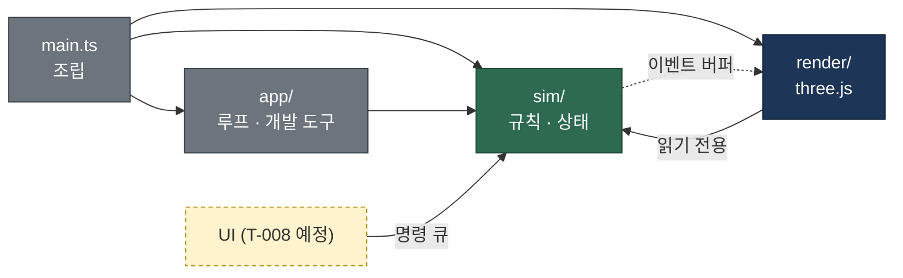
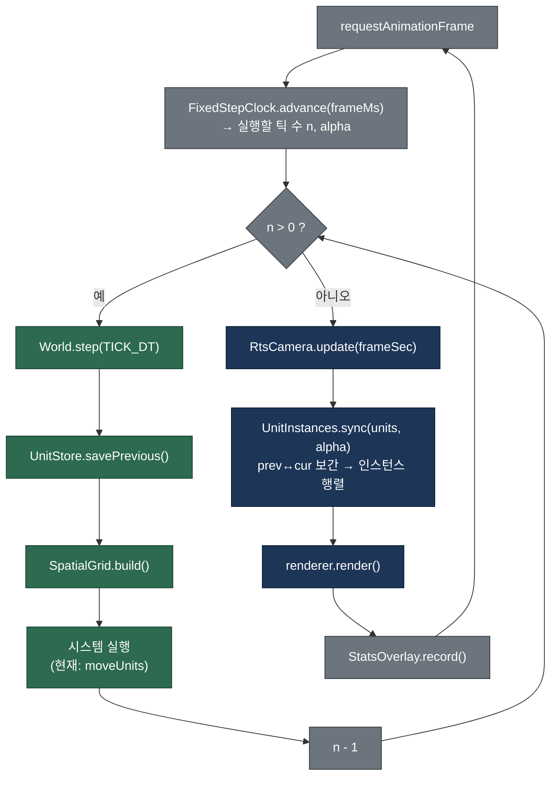

# ARCHITECTURE

테크니컬 아키텍트가 관리한다. 시스템 구조, 모듈 책임, 데이터·이벤트 흐름, 리소스 형식을 정한다. 이 문서와 실제 코드가 다르면 코드를 기준으로 이 문서를 고친다.

## 0. 요약

| # | 항목 | 결정 |
|---|------|------|
| 1 | 빌드·패키지 | Vite 8 + pnpm 10, TypeScript 7(strict), three.js 0.186 |
| 2 | 모듈 구조 | `sim`(규칙, three·DOM 금지) ← `render`(three.js) ← `app`(루프·개발 도구) ← `main.ts`(조립). 경계는 `pnpm typecheck`가 강제 |
| 3 | 게임 루프 | 고정 틱 20Hz 시뮬레이션 + 렌더 프레임마다 직전/현재 틱 보간 |
| 4 | 대량 유닛 데이터 | 구조체 배열(SoA, TypedArray) + 매 틱 재구성하는 균일 격자. Web Worker 이전 가능한 형태 |
| 5 | 대량 렌더링 | 병종당 InstancedMesh 1개. 애니메이션 1차 권고는 "본 행렬 텍스처 + GPU 인스턴스 스키닝" |
| 6 | 지형 | 높이맵 → 삼각형 메시. `Terrain.heightAt / gradientAt / slopeAt / typeAt` 을 시뮬레이션이 직접 사용 |
| 7 | 리소스 | `.glb`, 보병 300 삼각형·400 정점·20본, 텍스처 256², `public/assets/` (7절 상세) |
| 8 | 테스트·포맷 | Vitest, Prettier. ESLint는 아직 도입하지 않음 |
| 9 | 성능 목표 | 기준 사양(내장 GPU 노트북, 1080p)에서 **병사 5,000명 60fps**, 확장 목표 10,000명 |

---

## 1. 빌드 도구와 패키지 매니저

- **Vite 8 + pnpm 10** 을 쓴다. Vite는 TypeScript를 설정 없이 바로 번들하고 개발 서버 갱신(HMR)이 빠르다. three.js 프로젝트의 사실상 표준이라 참고 자료도 많다. pnpm은 잠금 파일(`pnpm-lock.yaml`)이 엄격하고 설치가 빠르다.
- **TypeScript 7** (Go로 다시 만든 네이티브 컴파일러)을 타입 검사에만 쓴다. 번들·테스트 변환은 Vite·Vitest가 하므로 `tsc`는 `--noEmit` 으로만 돈다. 일부 주변 도구(typescript-eslint 등)가 7을 늦게 지원할 수 있다는 점이 위험 요소다. 문제가 생기면 5.9로 내린다.
- `strict`, `noUnusedLocals`, `noUnusedParameters`, `verbatimModuleSyntax` 를 켠다.

| 스크립트 | 하는 일 |
|----------|---------|
| `pnpm dev` | 개발 서버. 성능 표시가 항상 켜진다 |
| `pnpm build` | `typecheck` 후 `dist/` 로 번들 |
| `pnpm preview` | 빌드 결과 실행. `?stats` 를 붙이면 성능 표시 |
| `pnpm test` | Vitest 1회 실행 |
| `pnpm typecheck` | 전체 타입 검사 + 시뮬레이션 경계 검사(2.3) |
| `pnpm format` / `format:check` | Prettier (코드·설정 파일만. `docs/`는 각 담당자 문서라 건드리지 않는다) |

개발 중 URL 파라미터: `?units=10000` (병사 수, 최대 50,000), `?seed=3` (지형·배치 시드).

## 2. 모듈 구조

### 2.1 폴더와 책임

```
src/
├── main.ts                 조립만 한다: 지형 생성 → World → GameRenderer → 루프 시작
├── sim/                    게임 규칙과 상태. three.js·DOM 금지. Node(Vitest)에서 그대로 돈다
│   ├── constants.ts        TICK_RATE(20Hz), TICK_DT
│   ├── world.ts            World: 전체 상태 보유, step(dt) 에서 시스템 실행 순서 결정
│   ├── units.ts            UnitStore: 병사 SoA 저장소
│   ├── spatialGrid.ts      SpatialGrid: 근접 탐색용 균일 격자
│   ├── terrain.ts          Terrain: 높이·경사·지형 종류 조회
│   ├── terrainGen.ts       임시 절차 생성 지형
│   ├── placeholderBattle.ts 임시 병사 배치(두 군대가 마주 보고 전진)
│   ├── systems/movement.ts 이동 + 겹침 밀어내기(임시 수치)
│   ├── rng.ts              시드 고정 난수
│   └── math.ts             clamp, wrapAngle
├── render/                 three.js 표현. sim 을 읽기만 한다
│   ├── gameRenderer.ts     WebGLRenderer, 씬, 조명, 프레임 렌더
│   ├── terrainMesh.ts      Terrain → 메시
│   ├── unitInstances.ts    UnitStore → InstancedMesh (보간)
│   └── rtsCamera.ts        RTS 카메라 입력과 배치
├── app/                    브라우저 수명 주기와 개발 도구 (three 직접 사용 금지)
│   ├── fixedStepClock.ts   고정 틱 누적기
│   └── statsOverlay.ts     FPS·CPU·시뮬레이션 시간 표시
└── types/simForbiddenThree.d.ts   경계 검사용 빈 선언(2.3)
```

### 2.2 의존 방향

의존은 한 방향으로만 흐른다. `sim`은 아무것도 모른다. `render`는 `sim`의 상태를 읽어 그리기만 하고 쓰지 않는다. `app`과 `main.ts`가 둘을 엮는다. 이렇게 하면 게임 규칙을 브라우저·GPU 없이 테스트할 수 있고, 나중에 `sim`을 Web Worker나 서버로 옮겨도 `render`는 그대로 쓴다.

UI(T-008)가 생기면 UI는 `sim`의 상태를 직접 바꾸지 않고 **명령**(예: "부대 3을 (x, z)로 이동")을 `World`의 명령 큐에 넣는다. `World`는 다음 틱 시작 때 명령을 처리한다. 반대 방향으로 `sim`이 알려야 할 일(피격, 사망 등 이펙트·사운드 트리거)은 틱마다 채우는 **이벤트 버퍼**로 내보내고, 렌더·오디오가 틱 뒤에 읽는다. 두 큐 모두 첫 사용 기능(T-007, T-008)과 함께 만든다.



### 2.3 경계 강제 방법

`pnpm typecheck`는 `tsconfig.json`(전체) 다음에 `tsconfig.sim.json`(sim만)을 한 번 더 검사한다.

- `lib`에 DOM이 없다 → sim에서 `window`, `document`, `HTMLElement`를 쓰면 오류.
- `three`와 `three/*` import를 빈 선언 파일(`src/types/simForbiddenThree.d.ts`)로 돌린다 → three의 어떤 이름을 써도 `has no exported member` 오류.
- sim이 render·app 파일을 import하면 그 파일의 DOM·three 사용이 오류로 드러난다.

처음에는 Vitest 테스트(`import.meta.glob`으로 소스 문자열 검사)로 만들었으나, Vitest 5의 모듈 캐시(`node_modules/.vitest-cache`)가 테스트 파일 내용이 그대로면 새로 추가된 파일을 놓쳐 위반을 통과시켰다. 그래서 캐시 영향이 없는 컴파일 단계 검사로 바꿨다.

### 2.4 프레임워크를 쓰지 않는 이유 (ECS 등)

ECS 라이브러리(bitecs, miniplex 등)는 도입하지 않는다. 지금 대량으로 존재하는 개체는 병사 한 종류이고, 병사에게 필요한 "연속 메모리, 시스템 함수가 배열을 순회" 구조는 `UnitStore`(SoA)와 `systems/` 함수로 이미 얻는다. 개체 종류가 늘어 조합 문제가 실제로 생기면 그때 다시 판단한다.

## 3. 게임 루프

시뮬레이션은 **고정 틱 20Hz**(한 틱 50ms)로만 상태를 바꾸고, 렌더링은 모니터 주사율대로 돈다. 렌더러는 매 프레임 직전 틱과 현재 틱 상태를 `alpha`(0~1)로 보간해 그리므로 20Hz 틱에서도 움직임이 매끄럽다.

- **20Hz를 고른 이유:** RTS는 명령 단위 조작이라 50ms 입력 지연이 체감되지 않는다(스타크래프트 II도 약 22Hz). 60Hz 대비 시뮬레이션 비용이 1/3이라 그만큼 병사 수를 늘릴 수 있다. 결정적 고정 틱이라 같은 입력이면 같은 결과가 나와 테스트와 리플레이가 쉽다.
- **누적기:** `FixedStepClock.advance(frameMs)`가 실행할 틱 수를 돌려준다. 한 프레임 최대 5틱까지만 따라잡고 나머지 시간은 버린다(탭 전환 뒤 수백 틱을 몰아 실행하며 멈추는 현상 방지).
- **결정성 규칙:** sim에서는 `Math.random`, `Date`, `performance.now`를 쓰지 않는다. 난수는 `Rng`(시드 고정)만 쓴다. 브라우저 간 `Math.sin` 등의 비트 단위 일치는 보장되지 않으므로, 멀티플레이 lockstep이 필요해지면 따로 검토한다.
- **보간 데이터:** `World.step()` 시작에서 `UnitStore.savePrevious()`가 현재 값을 `prev*` 배열에 복사한다. 렌더러는 `prev + (cur - prev) × alpha`로 위치를, 최단 각도로 방향을 보간한다.



## 4. 대량 유닛 데이터 구조

### 4.1 구조체 배열(SoA)

병사는 객체가 아니라 `UnitStore`의 인덱스다. 속성마다 `Float32Array`/`Uint8Array` 하나를 두고 병사 i의 값은 각 배열의 i번째에 있다.

| 비교 | 객체 배열 `Unit[]` | 구조체 배열(SoA, 채택) |
|------|--------------------|------------------------|
| 메모리 | 객체마다 헤더·포인터, 흩어진 배치 | 속성별 연속 메모리, 병사 1명 약 50B |
| GC | 생성·삭제 때 가비지 발생 | 생성 시 한 번 할당, 이후 0 |
| 순회 속도 | 캐시 적중률 낮음 | 한 속성만 훑을 때 캐시 친화적 |
| Worker 이전 | 직렬화 필요 | 버퍼를 그대로 전송·공유 |
| 단점 | — | 필드 추가 시 배열을 하나 더 선언, 코드가 덜 객체지향적 |

현재 필드: `x, y, z, heading`, `prevX, prevY, prevZ, prevHeading`, `vx, vz`, `targetX, targetZ`, `team`. 병종·체력·애니메이션 상태 등은 GDD(T-004)가 나오면 같은 방식으로 추가한다. 좌표계는 지형 모서리가 원점이고 `x ∈ [0, width]`, `z ∈ [0, depth]`, `y`는 높이다. `heading` 0은 +Z, 정면 벡터는 `(sin, cos)`이다.

**병사 제거는 전투 구현(T-007) 때 정한다.** 후보는 마지막 병사를 빈자리로 옮기는 swap-remove다. 배열이 빈틈 없이 유지되지만 인덱스가 바뀌므로, 외부에서 특정 병사를 오래 가리켜야 하면 `id → index` 표가 필요하다.

### 4.2 공간 분할: 균일 격자

`SpatialGrid`는 2m 칸 격자다. 매 틱 계수 정렬로 통째로 다시 만든다(O(N), 할당 없음). 병사가 계속 움직이므로 증분 갱신보다 단순하고 빠르다. `query(x, z, radius, out)`은 반경 안 병사 인덱스를 미리 할당한 `Int32Array`에 채운다. 근접 이웃(밀어내기), 근접 공격 대상 탐색에 쓴다. 사거리가 긴 탐색(궁수 30m 등)은 칸을 많이 훑게 되므로, 필요해지면 큰 칸 격자를 하나 더 둔다.

### 4.3 Web Worker 이전 계획

지금은 메인 스레드에서 돈다. 측정 결과 시뮬레이션 한 틱이 **기준 사양에서 8ms**(60fps 프레임의 절반)를 넘으면 옮긴다. 옮길 때 바뀌는 곳은 `app` 계층뿐이다.

- `World`를 Worker에서 실행하고, 틱마다 렌더에 필요한 배열(`x, y, z, heading`, 팀, 애니메이션 상태)을 transferable 버퍼 두 벌로 번갈아 보낸다. 메인 스레드는 직전/현재 스냅숏을 보간한다(지금의 prev/cur 구조와 같다).
- `SharedArrayBuffer`를 쓰면 복사도 없앨 수 있지만 COOP/COEP 응답 헤더가 필요해 배포 환경 제약이 생긴다. 측정 후 고른다.
- 이를 위해 지켜야 할 규칙: sim은 DOM을 쓰지 않는다(2.3이 강제), render는 sim 상태를 쓰지 않는다, UI 입력은 명령 큐로만 들어간다.

## 5. 대량 렌더링

### 5.1 인스턴싱

병종마다 `InstancedMesh` 하나로 그 병종 전체를 한 번의 그리기 호출로 그린다. 인스턴스 행렬은 `Object3D`를 거치지 않고 Y축 회전 + 이동 행렬을 `instanceMatrix` 배열에 직접 쓴다. 팀 색은 `instanceColor`로 넣는다(실제 리소스가 오면 7.4의 알파 마스크로 일부에만 적용).

- **절두체 컬링 끔:** 병사가 계속 움직여 경계 구가 매 프레임 바뀐다. three.js 기본 컬링은 이 경우 틀린 결과를 낸다. 지금은 꺼 두고, GPU가 병목이 되면 CPU에서 화면 밖 병사를 빼고 화면 안 병사만 앞쪽에 모아 쓰는(compaction) 방식을 넣는다.
- **그림자:** 지금은 끈다. 수천 병사에 그림자 맵을 쓰면 정점 처리량이 두 배가 된다. 권고안은 병사는 발밑 원형 그림자(인스턴스 사각형 1장), 지형·소품만 그림자 맵이다. 아트 방향 확정 후 결정한다.

### 5.2 애니메이션 방식 비교와 1차 권고

| 방식 | 원리 | 수천 명 비용 | 품질 | 리소스 제작 | 판단 |
|------|------|--------------|------|-------------|------|
| 스켈레탈 (`SkinnedMesh` + `AnimationMixer`) | 병사마다 CPU가 본 계산 | 병사마다 그리기 호출 1회와 믹서 갱신. 수천 명이면 CPU가 먼저 한계 | 최고, 블렌딩 자유 | 표준 glTF | **영웅·지휘관(수십 명)에만** |
| 정점 애니메이션 텍스처(VAT) | 모든 프레임의 정점 위치를 텍스처에 구움 | 정점당 텍스처 읽기 1~2회, 매우 쌈 | 좋음, 클립 간 블렌딩은 비용 추가 | 메시마다 굽기, 메시가 바뀌면 다시 굽기 | 후보(최대 성능이 필요할 때) |
| **본 행렬 텍스처 + GPU 인스턴스 스키닝** | 클립의 모든 프레임 본 행렬을 텍스처에 굽고, 정점 셰이더가 인스턴스별 클립·시간으로 스키닝 | 정점당 본 4개 × 텍스처 읽기 3~4회. 병사 5,000 × 400정점이면 데스크톱에서 감당 가능한 수준 | 스켈레탈과 같은 포즈, 블렌딩 가능 | 표준 스키닝 glTF 그대로. 같은 골격을 쓰는 병종 변형·LOD가 텍스처 공유 | **1차 권고** |
| 절차적 흔들기 | 셰이더에서 sin으로 상하·좌우 흔들기 | 거의 0 | 낮음, 팔다리 동작 없음 | 없음 | 아주 먼 거리 LOD 또는 임시용 |

**권고:** 일반 병사는 "본 행렬 텍스처 + GPU 인스턴스 스키닝", 영웅은 일반 `SkinnedMesh`. 아트 파이프라인은 일반 스키닝 glTF(7.5)라 특수 굽기 도구가 필요 없다. 굽기는 로드 시점에 three.js `AnimationMixer`로 각 클립을 30fps로 샘플링해 `DataTexture`(RGBA Float 또는 Half Float)에 넣는다. three.js 코어에는 인스턴스 스키닝 메시가 없으므로 `MeshStandardMaterial`/`MeshLambertMaterial`의 `onBeforeCompile`로 스키닝 부분을 바꿔 구현한다. 인스턴스별로 `클립 번호`, `클립 시작 시각` 두 값을 `InstancedBufferAttribute`로 넘긴다. 구현은 T-009(애니메이션)와 T-007(유닛)에서 한다. 성능 측정에서 부족하면 같은 원본 glTF로 VAT를 구워 바꾼다(리소스 재작업 없음).

텍스처 크기 예: 보병 20본 × 행렬당 4텍셀 = 80텍셀 폭, 클립 합 6초 × 30fps = 180줄 → 80×180 RGBA Float = 약 230KB. 병종당 1장.

## 6. 지형

시뮬레이션의 `Terrain`이 지형 데이터의 단일 원천이다. 렌더러는 같은 데이터로 메시를 만든다.

- **데이터:** `(cellsX + 1) × (cellsZ + 1)` 격자점 높이 `Float32Array` + `cellsX × cellsZ` 칸 지형 종류 `Uint8Array`(ID는 7.6). 현재 임시 지형은 256×256칸, 칸 2m → 512m × 512m, 최고 높이 40m.
- **삼각형 분할 일치:** 한 칸을 (1,0)-(0,1) 대각선으로 두 삼각형으로 나눈다. `heightAt`은 이 삼각형 평면 위의 정확한 높이를 돌려주고 `render/terrainMesh.ts`도 같은 분할로 인덱스를 만든다. 그래서 병사 발이 화면의 지면과 정확히 맞는다. 둘 중 하나만 바꾸면 안 된다.
- **조회 API (sim에서 직접 사용):**

| 메서드 | 반환 | 용도 예 |
|--------|------|---------|
| `heightAt(x, z)` | 지표면 높이(m) | 병사 y 좌표, 고지대 판정 |
| `gradientAt(x, z, out)` | `out[0]=dh/dx`, `out[1]=dh/dz` | 이동 방향의 오르막·내리막 판정(진행 벡터와 내적) |
| `slopeAt(x, z)` | 경사각(라디안) | 통과 불가 경사, 이동 속도 감소 |
| `typeAt(x, z)` | 지형 종류 ID | 숲·물·바위 효과 |
| `contains(x, z)` | 맵 안인지 | 경계 처리 |

  범위 밖 좌표는 가장자리 값으로 고정한다. 모든 조회는 할당 없이 동작한다(내부 임시 객체 재사용, 단일 스레드 전제).
- **예정 API:** 시야(가시선) 판정 `lineOfSight(a, b)`는 GDD의 시야 규칙이 나오면 높이맵 위 광선 진행으로 추가한다.
- **메시:** 격자점마다 정점 1개, 정점 색으로 지형 종류를 칠한 임시 표현이다(현재 66,049 정점, 131,072 삼각형). 아트의 지형 텍스처가 오면 지형 종류 맵을 텍스처로 올려 셰이더에서 섞는 스플래팅으로 바꾼다. 맵이 1024칸 이상이 되면 청크 분할과 거리별 LOD를 검토한다.
- **맵 파일 로딩(예정):** 7.7의 `height.png`(16bit)는 브라우저 Canvas로 읽으면 8bit로 잘리므로, PNG 디코더(`fast-png` 등 작은 라이브러리)로 직접 해독해 `Terrain`을 만든다. 첫 제작 맵이 들어올 때 구현한다.

---

## 7. 리소스 형식과 예산

아트 디렉터는 이 절의 수치와 규칙을 그대로 따른다. 수치는 "한 화면 병사 5,000명, 60fps"(9절) 목표에서 역산했다. 규칙을 바꿔야 하면 먼저 테크니컬 아키텍트와 협의한다.

### 7.1 파일 형식

| 종류 | 형식 | 비고 |
|------|------|------|
| 3D 모델 (병사, 영웅, 소품) | **glTF 2.0 바이너리 `.glb`** | 텍스처를 포함(embed)한 단일 파일. `.gltf + .bin` 분리 형식, FBX, OBJ는 받지 않는다. |
| 텍스처 원본 | PNG (8bit RGBA 또는 RGB) | 2의 거듭제곱 크기 필수(256, 512, 1024). 압축 포맷(KTX2)은 성능 측정 후 빌드 단계에서 변환한다. 아티스트가 직접 만들 필요 없다. |
| 지형 높이맵 (제작한 맵) | 16bit 그레이스케일 PNG | 크기는 `2^n + 1` (예: 257×257, 513×513). 검정=최저, 흰색=최고. |
| 지형 종류 맵 | 8bit 그레이스케일 PNG | 높이맵보다 한 칸 작다(예: 256×256). 픽셀 값 = 지형 종류 ID(7.6). |
| 지형 표면 텍스처 | PNG, 타일링 가능 | 지형 종류마다 1장, 512×512(최대 1024×1024). |

모델 압축(Draco, meshopt)은 쓰지 않는다. 병사 모델은 수 KB라 압축 이득이 없고 디코더 비용만 생긴다. 큰 소품이 생기면 빌드 단계에서 `gltfpack`으로 처리한다.

### 7.2 스케일, 축, 원점

- **단위:** 1 = 1미터. 일반 보병 키(발바닥~투구 끝, 무기 제외) 1.7~1.9m, 기병(말 포함) 높이 2.3~2.6m, 길이 2.4m 안팎. 이 키는 게임 판정(간격 1.4m 대형, 충돌 반경)의 기준이다. 머리·몸 비율(등신)은 아트 스타일 가이드가 정한다.
- **축:** glTF 표준대로 +Y 위, **정면은 +Z**. 게임 코드는 유닛의 진행 방향 각도를 Y축 회전으로 그대로 넣으므로 정면이 다르면 모든 병사가 옆이나 뒤로 걷는다.
  - Blender에서는 캐릭터가 **-Y 방향(Front 뷰에서 카메라를 바라보는 방향)** 을 보게 두고, 내보내기 옵션 `+Y Up`(기본값)을 켠다. 그러면 glTF에서 +Z 정면이 된다.
- **원점(피벗):** 두 발 사이 바닥 중앙 `(0, 0, 0)`. 게임은 원점을 지형 표면 높이에 놓는다. 원점이 허리에 있으면 병사가 땅에 묻힌다.
- **변환 적용:** 내보내기 전에 오브젝트의 위치·회전·스케일을 모두 적용(Apply All Transforms)해 루트 변환이 단위 행렬이 되게 한다.

### 7.3 폴리곤과 정점 예산

예산은 **삼각형 수**와 **정점 수**(UV·노멀 경계에서 갈라진 정점 포함, glTF 파일에 실제로 들어간 수) 둘 다 지킨다.

| 대상 | 삼각형 (상한) | 정점 (상한) | 본 (상한) | 메시/머티리얼 |
|------|---------------|-------------|-----------|---------------|
| 보병 1명 (무기·방패 포함) | **300** | **400** | 20 | 메시 1개, 머티리얼 1개 |
| 기병 1기 (말+기수+무기) | **700** | **900** | 40 | 메시 1개, 머티리얼 1개 |
| 영웅·지휘관 (전장에 수십 명 이하) | 3,000 | 3,500 | 40 | 메시 1개, 머티리얼 1~2개 |
| 소품 (나무, 바위, 깃발 등, 인스턴싱) | 500 | 600 | 없음 | 메시 1개, 머티리얼 1개 |
| 큰 구조물 (성벽, 건물, 수 개 배치) | 5,000 | 6,000 | 없음 | 머티리얼 2개 이하 |

- 무기, 방패, 투구는 별도 오브젝트로 내보내지 않고 병사 메시 하나로 합친다. 한 병사가 메시 2개면 그리기 호출이 2배가 된다. glTF 안에서도 **메시 1개 = 프리미티브 1개**여야 한다(머티리얼이 2개면 프리미티브가 2개로 갈라진다).
- 기병의 삼각형·정점·본 상한은 **말 + 기수 + 무기를 모두 합친 값**이다. 말과 기수는 한 메시·한 골격으로 만든다.
- 같은 골격을 쓰는 병종 변형(창병/검병/궁수)은 몸은 같게 두고 장비만 다르게 해 **같은 골격·같은 애니메이션**을 공유한다.
- LOD(원거리 저폴리 버전)는 지금 만들지 않는다. 9절 성능 측정에서 필요가 확인되면 보병 LOD1(삼각형 80 이하)을 요청한다.

### 7.4 텍스처와 머티리얼

- **병사·기병:** 텍스처 1장, 256×256(최대 512×512). 저폴리 스타일은 단색 팔레트 칸에 UV를 몰아 넣는 **팔레트 텍스처** 방식을 권장한다(같은 병종 변형끼리 한 장 공유 가능).
- **영웅:** 1024×1024 이하 1장.
- **소품:** 여러 소품이 512×512 또는 1024×1024 아틀라스 1장을 공유한다.
- **머티리얼:** glTF 기본 PBR(Metallic-Roughness). 병사는 Base Color 텍스처만 쓴다. Metallic·Roughness는 텍스처 없이 상수 값으로 둔다. 노멀맵, 발광(emissive), 투명은 병사에 쓰지 않는다.
- **알파 모드:** 병사와 기병은 `OPAQUE`. 나뭇잎 같은 소품만 `MASK`(alphaCutoff 0.5)를 허용한다. `BLEND`(반투명)는 정렬 비용 때문에 쓰지 않는다.
- **팀 색상:** 병사 Base Color 텍스처의 **알파 채널을 팀 색상 마스크**로 쓴다. 알파 1(255) = 팀 색으로 물드는 부분(망토, 방패 문양, 깃털 등), 알파 0 = 원래 색 유지. 팀 색 부분은 RGB를 밝은 회색(약 200,200,200)으로 칠한다. 게임이 이 부분에 팀 색을 곱한다. 알파 모드는 `OPAQUE`로 내보내므로 알파가 투명도로 쓰이지 않는다.
- **버텍스 컬러:** 소품(나무, 바위 등)은 텍스처 없이 버텍스 컬러(glTF `COLOR_0`)만으로 칠해도 된다. 이때 머티리얼 Base Color는 흰색, 텍스처 없음. 병사·기병은 팀 색 마스크(위)가 텍스처 알파에 있으므로 팔레트 텍스처를 쓴다. 한 모델에서 버텍스 컬러와 텍스처를 섞지 않는다.
- **색공간:** Base Color 텍스처는 sRGB. 버텍스 컬러는 glTF 규격상 파일 안에서 선형(Linear) 값이다. Blender에서는 화면에 보이는 색(sRGB)으로 칠하면 내보내기가 선형으로 바꿔 주므로 따로 변환하지 않는다. 그 밖의 데이터 텍스처(높이맵, 종류 맵)는 선형이다.

### 7.5 애니메이션

1차 방식은 **스키닝 glTF를 받아 게임이 로드 시점에 "본 행렬 텍스처"로 굽고, GPU 인스턴싱으로 재생**하는 것이다(근거는 5절). 아티스트는 일반적인 리깅·스키닝 glTF를 만들면 되고 특수 내보내기 도구는 필요 없다.

- **골격:** 보병 20본, 기병 40본 이하. 루트 본은 원점에 둔다. 한 정점에 영향을 주는 본은 **최대 4개**(glTF 표준 한도), 가능하면 2개 이하.
- **제자리 애니메이션:** 루트 모션 금지. 걷기·달리기도 제자리에서 움직인다. 이동은 게임 시뮬레이션이 처리한다.
- **프레임 속도:** 30fps로 만든다.
- **클립 이름(소문자, glTF 애니메이션 이름 그대로 사용):** `idle`, `walk`, `run`, `attack`, `hit`, `die`. 병종에 특수 동작이 필요하면 GDD 확정 후 추가한다(예: `attack_ranged`, `charge`).
- **반복 클립**(`idle`, `walk`, `run`)은 첫 프레임과 마지막 프레임 자세가 같아 끊김 없이 이어져야 한다. `die`는 마지막 프레임에서 쓰러진 자세로 멈춘다.
- **길이 권장:** `walk` 1.0초, `run` 0.6~0.8초, `attack` 0.6~1.0초, `hit` 0.3초, `die` 1.0~1.5초. 길수록 애니메이션 텍스처가 커진다(보병 1종 모든 클립 합 6초 이하).
- **셰이프 키(모프 타깃), 스케일 애니메이션은 쓰지 않는다.** 회전·이동 키만 쓴다.

### 7.6 지형 종류 ID (임시)

지형 종류 맵의 픽셀 값과 표면 텍스처 이름의 약속이다. 종류의 실제 효과(이동 속도, 시야 등)는 GDD가 정한다. GDD에서 종류가 바뀌면 이 표를 함께 고친다.

| ID | 이름 | 표면 텍스처 파일 |
|----|------|------------------|
| 0 | `grass` 평지 | `grass_albedo.png` |
| 1 | `forest` 숲 | `forest_albedo.png` |
| 2 | `rock` 바위·절벽 | `rock_albedo.png` |
| 3 | `sand` 모래·흙길 | `sand_albedo.png` |
| 4 | `water` 얕은 물 | `water_albedo.png` |

### 7.7 assets 폴더 규칙

런타임에 불러오는 리소스는 Vite의 정적 폴더인 **`public/assets/`** 아래에 둔다. 빌드하면 경로 그대로 배포된다. (`docs/TASKS.md`의 `assets/`는 이 `public/assets/`를 뜻한다.) 블렌더 파일·PSD 같은 원본은 게임 빌드에 넣지 않는다. 원본 보관 위치는 아트 디렉터가 정하되 `public/` 밖에 둔다.

```
public/assets/
├── units/<unit_id>/<unit_id>.glb        # 병사·기병·영웅. 예: units/spearman/spearman.glb
├── props/<prop_id>.glb                   # 나무, 바위, 깃발 등
├── terrain/<type>_albedo.png             # 7.6의 지형 종류별 표면 텍스처
├── maps/<map_id>/height.png              # 16bit 높이맵
├── maps/<map_id>/types.png               # 8bit 지형 종류 맵
├── maps/<map_id>/map.json                # { "cellSize": 2, "heightScale": 40 } 등 메타데이터
├── ui/                                   # UI·UX 디자이너 소유
└── audio/                                # 사운드 디자이너 소유
```

- 파일·폴더 이름은 **소문자 영문, 숫자, 밑줄(snake_case)** 만 쓴다. 공백, 한글, 대문자 금지(배포 서버가 대소문자를 구분한다).
- `<unit_id>`는 GDD의 병종 ID와 같게 짓는다.
- 파일 크기 상한: 보병·기병 `.glb` 300KB, 영웅 2MB, 소품 500KB.
- 같은 이름으로 덮어쓰면 코드 수정 없이 교체된다. 임시 리소스는 이름 앞에 `tmp_`를 붙여 출시 전에 찾을 수 있게 한다.

### 7.8 로딩 방식

로딩은 렌더링 계층만 한다. 시뮬레이션은 리소스를 모르고 병종 ID(숫자)만 안다.

(로더는 첫 리소스가 들어올 때 구현한다. 아래는 그 동작 약속이다.) 전투가 시작되기 전에 그 전투에 필요한 모든 리소스를 한꺼번에 불러온다(전투 중 추가 로딩 없음). 모델은 three.js `GLTFLoader`로 읽고, 스키닝 모델은 이어서 애니메이션 굽기 단계를 거쳐 인스턴싱용 메시가 된다. 리소스 하나라도 실패하면 해당 병종을 임시 캡슐로 대체하고 콘솔에 경로와 원인을 남긴다(게임은 멈추지 않는다).

```
전투 준비 → 리소스 목록 결정(병종 ID → 경로) → GLTFLoader 병렬 로드 → 애니메이션 굽기 → InstancedMesh 생성 → 전투 시작
                                                  ↓ 실패
                                         임시 캡슐로 대체 + 경고 로그
```

### 7.9 아트 디렉터 납품 체크리스트

- [ ] `.glb` 단일 파일, 텍스처 포함
- [ ] 1m = 1, +Y 위, +Z 정면, 원점은 발 밑 중앙, 변환 적용됨
- [ ] 삼각형·정점·본 수가 7.3 표 안
- [ ] 메시 1개·프리미티브 1개·머티리얼 1개, 알파 모드 `OPAQUE`
- [ ] 텍스처 2의 거듭제곱, 크기 상한 안, 팀 색 마스크는 알파 채널
- [ ] 클립 이름 7.5 규칙, 제자리, 30fps, 반복 클립 이음매 없음
- [ ] 파일 이름 snake_case, 7.7 경로

---

## 8. 테스트, 린트, 포맷

- **테스트: Vitest 5.** Vite 설정을 그대로 쓰고 TypeScript를 바로 실행한다. 테스트 파일은 대상 옆에 `*.test.ts`로 둔다. sim 테스트는 Node 환경에서 돌며 three.js·브라우저가 필요 없다. 현재 테스트:
  - `sim/terrain.test.ts`: 높이 보간, 범위 밖 고정, 경사·기울기, 대각선 분할 연속성, 지형 종류 조회, 생성기 결정성
  - `sim/spatialGrid.test.ts`: 격자 탐색 결과가 전수 탐색과 같은지(무작위 2,000명 × 50질의), 경계 밖 좌표
  - `sim/world.test.ts`: 경사 지형에서 목표까지 이동·발 높이·방향, 겹친 병사 분리
  - `app/fixedStepClock.test.ts`: 틱 누적, 최대 틱 제한, 음수 시간 무시
- **무엇을 테스트하나:** 게임 규칙(sim)은 단위 테스트를 반드시 붙인다. 렌더링·UI는 실제 화면 확인(QA)으로 검증한다.
- **포맷: Prettier** (`package.json`의 `prettier` 항목: 작은따옴표, 줄 폭 100).
- **린트: 지금은 ESLint를 넣지 않는다.** TypeScript strict와 미사용 변수 검사, 2.3의 경계 검사가 가장 중요한 규칙을 이미 강제한다. ESLint flat config(`eslint.config.js`)는 이번 작업 파일 범위 밖이고, typescript-eslint의 TypeScript 7 지원도 확인이 필요하다. 팀에서 규칙 요구가 생기면 게임 디렉터 승인 후 추가한다.
- **주의:** Vitest 5는 `node_modules/.vitest-cache`에 변환 결과를 내용 기준으로 캐시한다. `import.meta.glob`처럼 다른 파일 목록에 의존하는 테스트는 파일이 추가돼도 갱신되지 않을 수 있으니 쓰지 않는다(2.3 참고).

## 9. 성능 목표

### 9.1 목표

| 항목 | 목표 |
|------|------|
| 기준 사양 | 내장 GPU 노트북(Apple M1 또는 Intel Iris Xe급), 최신 Chrome, 1920×1080, 픽셀 비율 1 |
| **필수 목표** | 실제 리소스(보병 300 삼각형, GPU 스키닝 애니메이션)로 **병사 5,000명이 한 화면에서 싸울 때 60fps** (프레임 16.7ms) |
| 확장 목표 | 같은 조건 10,000명 50fps 이상 |
| 시뮬레이션 예산 | 기준 사양에서 한 틱 8ms 이하. 넘으면 Worker 이전(4.3) |
| 그리기 호출 | 병종 수 + 지형 + 소품 종류 수 수준 (병사 수와 무관) |

**N = 5,000의 근거:**
- 아래 개발 장비 측정에서 임시 병사(264 삼각형)는 50,000명에서도 GPU 프레임이 주사율(144Hz)을 유지했다. 렌더링 쪽 한계는 5,000명보다 훨씬 위에 있다.
- 기준 사양 GPU는 측정 장비(Apple M5)보다 대략 3~5배 느리다고 본다([낮음] 공개 벤치마크 기반 추정, 실측 필요). GPU 스키닝은 정점 처리 비용을 2~4배 올린다. 둘을 곱해도 5,000명은 여유가 있다.
- 시뮬레이션은 지금 이동·밀어내기만 하는데도 측정 장비에서 20,000명 밀집 시 틱당 4~4.7ms다. 전투·목표 탐색·시야가 붙으면 비용이 몇 배로 늘고 기준 사양 CPU는 더 느리다. 이쪽이 먼저 한계가 될 가능성이 높아 5,000명을 필수로, 10,000명을 확장 목표로 둔다.
- 기획 목표("한 전투 양측 합계 수천 명")와도 맞는다.

### 9.2 측정 결과 (2026-10-23, 임시 병사 264 삼각형, 개발 서버)

측정 장비: Apple M5, Paseo 내장 브라우저(Electron 44 / Chrome 152), 2560×1600(픽셀 비율 2), 144Hz 화면. FPS는 화면 주사율(144)에 묶여 있으므로, 여유는 `cpu`(프레임당 메인 스레드 작업 시간)와 `sim`(틱 1회 시간)으로 본다. 밀집 = 두 군대가 맞부딪힌 뒤.

| 병사 수 | 삼각형 | FPS | cpu ms/프레임 | sim ms/틱 (전진 → 밀집) |
|---------|--------|-----|---------------|-------------------------|
| 4,000 | 1.06M | 144 | 0.5~0.8 | 0.5~0.8 → 1.0 (밀집 직전, 완전 밀집은 미측정) |
| 10,000 | 2.64M | 144 | 1.0~1.3 | 0.8~1.8 → 2.1~2.9 |
| 20,000 | 5.28M | 144 | 1.0~1.9 | 1.8~3.1 → 3.9~4.7 |
| 50,000 | 13.2M | 140~144 | 1.7~4.3 | 3.8~5.3 → 7.3~9.1 |

- 50,000명 밀집에서는 틱이 실행되는 프레임이 6.9ms(144Hz 한 프레임)를 넘어 FPS가 조금 떨어지기 시작한다. 틱이 한 프레임에 몰리는 구조라서 생기는 현상이며, 4.3의 Worker 이전이 해결책이다.
- **기준 사양 실측은 아직 없다(미검증).** QA·성능 엔지니어가 T-011에서 기준 사양 장비로 `?units=5000`, `?units=10000`을 측정해야 한다. 측정 방법: `pnpm build && pnpm preview` 후 `http://localhost:4173/?units=5000&stats`, 두 군대가 맞부딪힌 뒤(약 25초) 10초 동안 표시값을 기록. 자동 측정은 `window.__stats`(`fps`, `frameMs`, `cpuMs`, `simMsPerTick`)를 읽는다.

## 10. 남은 문제와 다음 결정

| 항목 | 상태 | 담당·시점 |
|------|------|-----------|
| 임시 이동은 목표를 향하는 힘이 밀어내기보다 강해, 두 군대가 서로를 뚫고 섞인다 | 임시 코드라 의도된 한계. 충돌·대형·교전 규칙은 GDD 후 T-007 | 게임플레이 프로그래머 |
| 명령 큐·이벤트 버퍼(2.2) 미구현 | 첫 사용 기능과 함께 구현 | T-007, T-008 |
| 병사 제거 방식(4.1) | 전투 구현 시 결정 | T-007 |
| GPU 인스턴스 스키닝(5.2) 미구현 | 첫 스키닝 리소스가 오면 구현 | T-009 + 테크니컬 아키텍트 리뷰 |
| glTF 로더, 맵 파일 로더(7.8, 6) 미구현 | 첫 리소스·맵이 오면 구현 | T-005 이후 |
| 지형 표현이 정점 색(칸 경계가 계단처럼 보임) | 지형 텍스처 스플래팅으로 교체 | T-006 |
| 절두체 컬링 꺼짐(5.1) | GPU 병목이 측정되면 compaction 도입 | T-011 측정 후 |
| 그림자 방식(5.1) | 아트 방향 확정 후 | 아트 디렉터와 협의 |
| 기준 사양 성능 실측 | 미검증 | T-011 |
