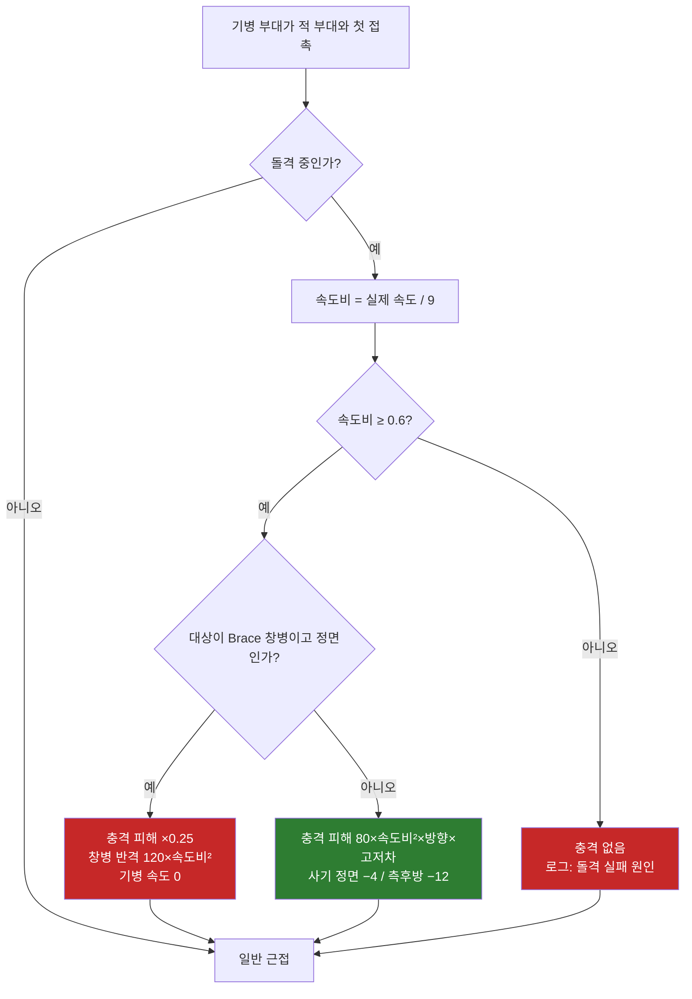
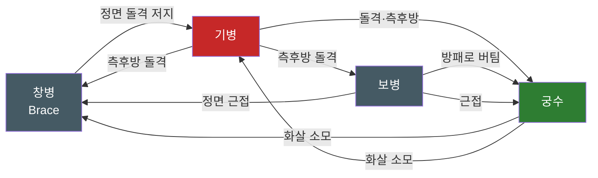
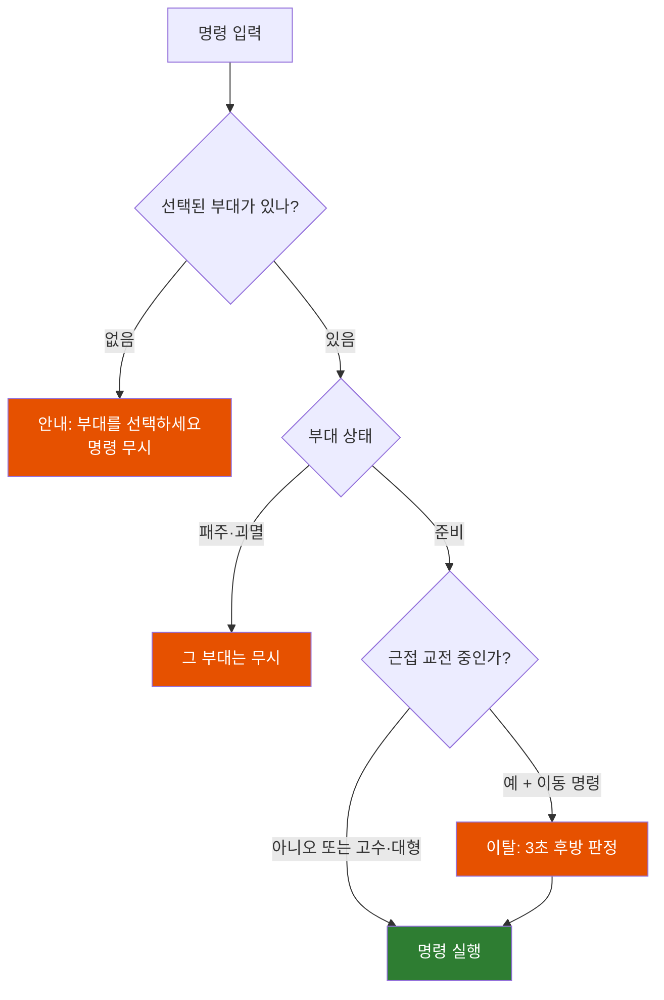

# GDD — 게임 디자인 문서

- 담당: 게임 디자이너 (T-004)
- 버전: v0.4 (2026-10-24), 상태: **1차안 승인(D-009), 구현 중 확인 사항 반영(D-011, D-012, T-015 해석 판정)**
- 근거 결정: D-001(TypeScript + three.js), D-002(분석만, 직접 제작), D-003(3D 지형이 전략 요소), D-004(규칙·지휘·UX만 참고, MVP 범위), D-005
- 관련 문서: `docs/BALANCE.md`(모든 수치와 시뮬레이션 결과), `docs/ARCHITECTURE.md`(단위·틱·리소스), `docs/REFERENCE_ANALYSIS.md`(레퍼런스 관찰), `tools/balance/`(밸런스 시뮬레이터)

이 문서는 **규칙**을 정한다. 수치는 대부분 `docs/BALANCE.md`의 표를 가리키고, 규칙을 이해하는 데 필요한 핵심 수치만 여기에 적는다. 두 문서가 다르면 `tools/balance/config.ts` → `docs/BALANCE.md` → 이 문서 순서로 믿는다.

**공통 단위:** 거리 m(1 월드 유닛 = 1m), 속도 m/s, 시간 초, 각도 도(°). 비율은 %로 쓰고 코드에서는 0~1 소수로 쓴다. 시뮬레이션은 20Hz 고정 틱이다(`src/sim/constants.ts` `TICK_RATE = 20`). 방향 0 = +Z, 정면 벡터 = (sin, cos)이다.

---

## 1. 콘셉트

### 1.1 한 줄 콘셉트

> **수천 명의 군대를 지휘해 언덕과 숲과 강을 읽고, 배치와 기동으로 적의 대열을 무너뜨리는 3D 실시간 전술 게임.**

플레이어는 칼을 휘두르는 영웅이 아니라 전장을 내려다보는 지휘관이다. 한 판에서 하는 일은 세 가지다. 어디에 설지 고르고(배치), 언제 어디를 칠지 정하고(기동), 적이 무너질 때까지 버틴다(사기 싸움).

### 1.2 디자인 기둥

1. **지형이 곧 무기다.** 화면에 보이는 높이, 경사, 숲, 강은 모두 숫자로 작동하는 규칙이다. 같은 병력이라도 능선을 먼저 잡고 측면을 지형에 기댄 쪽이 이긴다. 시뮬레이션에서 측면이 막힌 능선의 방어군을 이기려면 공격군에게 약 1.6배의 병력이 필요했다(BALANCE §6.6).
2. **전멸이 아니라 패주로 이긴다.** 부대는 마지막 한 명까지 싸우지 않는다. 측면과 후방을 맞거나, 돌격을 받거나, 옆 부대가 무너지면 사기가 꺾여 달아난다. 그래서 병력 총합보다 **어디를 언제 치느냐**가 승부를 가른다.
3. **결과의 이유가 보인다.** 왜 느려졌는지, 왜 화살이 닿지 않는지, 왜 부대가 무너졌는지를 화면 오버레이와 로그가 설명한다. 플레이어가 실패를 지형과 결정 탓으로 이해할 수 있어야 다시 도전한다.

### 1.3 세계관과 톤

- 가상의 대륙 **"에른 고원"** 의 국경 분쟁. 실존 국가, 인물, 역사 전투는 쓰지 않는다(D-002, D-004). 마법, 괴물, 초인 영웅도 없다.
- 장비 수준은 철기 시대 말에서 중세 초 사이의 **가상 기술 수준**이다. 화약은 없다.
- 두 진영(색은 `docs/ART_STYLE_GUIDE.md`):
  - **청람 변경군**(진영 A, 청람색 `#247DA8`): 고원 서쪽 산지의 방어적 군대. 방패와 창이 중심이다.
  - **황토 동맹군**(진영 B, 황토색 `#E4A33B`): 동쪽 평원 도시들의 연합군. 수가 많고 기병이 강하다.
- 톤은 담백하고 사실적이다. 텍스트는 짧은 브리핑과 이벤트 로그로 한정한다. 승리를 화려하게 축하하기보다 전장의 무게(손실 통계, 무너진 부대)를 보여 준다.

---

## 2. 한 판 흐름

한 판은 브리핑 → 배치 → 전투 → 결과의 네 단계다. MVP에는 메인 메뉴에서 시나리오 1개("갈대 여울", §10)와 진영을 고르는 화면만 있다.

1. **브리핑**: 맵 미리보기(전술 지도), 양군 병력 구성, 승리 조건, 권장 진영을 보여 준다. 플레이어는 진영을 고르고 "배치로" 버튼을 누른다.
2. **배치**: 시간 제한 없이 자기 진영 배치 구역 안에서 부대 위치, 정면 방향, 대형, 폭(열 수)을 정한다. 적 배치는 보이지 않고 적 배치 구역만 보인다. 기본 배치가 미리 깔려 있어 바로 시작할 수도 있다. "전투 시작"을 누르면 전투로 넘어간다. 통과 불가 칸(물, 절벽)이나 구역 밖에는 놓을 수 없고, 놓을 수 없는 위치는 빨간 윤곽으로 표시한다.
3. **전투**: 실시간으로 진행한다. 배속은 1×, 2×, 4×이고 **언제든 일시정지할 수 있다.** 일시정지 중에도 명령을 내릴 수 있다. 전투 시간(게임 시간)이 승리 조건의 시간 기준이다.
4. **결과**: 승패, 승패 사유, 통계(전투 시간, 양군 손실·생존·패주, 부대별 처치), **패주 원인 상위 3개**(예: "창병 2대대: 측면 공격 34초"), 지형 활용 지표(고지에서 싸운 병사·초 비율, 측면·후방 공격 횟수)를 보여 준다. "다시 하기"와 "브리핑으로"를 고를 수 있다.

전투 중 일시정지와 배속은 전투 상태 안의 하위 상태다. 아래 차트는 화면 상태 전이를 정리한 것이다.

```mermaid
stateDiagram-v2
    [*] --> 브리핑
    브리핑 --> 배치: 진영 선택 + "배치로"
    배치 --> 브리핑: 뒤로
    배치 --> 전투: "전투 시작"
    state 전투 {
        [*] --> 진행
        진행 --> 일시정지: Space / 메뉴
        일시정지 --> 진행: Space / 재개
        진행 --> 진행: 배속 1×·2×·4× 변경
    }
    전투 --> 결과: 승리 조건 충족 / 패배 조건 충족 / 제한 시간 종료
    전투 --> 브리핑: 일시정지 메뉴에서 "포기"(패배로 기록)
    결과 --> 배치: 다시 하기
    결과 --> 브리핑: 브리핑으로

    classDef prep fill:#455a64,color:#fff
    classDef play fill:#1565c0,color:#fff
    classDef end fill:#6a1b9a,color:#fff
    class 브리핑,배치 prep
    class 전투 play
    class 결과 end
```

---

## 3. 승리·패배 조건

### 3.1 공통 용어

- **실질 병력**: 상태가 `준비`(패주·괴멸이 아닌) 부대에 남은 병사 수의 합. 패주 중인 병사는 살아 있어도 세지 않는다.
- **붕괴**: 한 진영의 실질 병력이 **시작 병력의 25% 미만**이 된 상태. 붕괴한 진영이 진다. 판정은 1초마다 한다. 두 진영이 같은 판정 시점에 동시에 붕괴하면 무승부다.
- **지휘관 전사는 즉시 패배가 아니다.** 사기 충격을 준다(§4.6).

### 3.2 MVP 시나리오 조건 (공방전: 깃발 점령 / 시간 방어)

MVP 맵 "갈대 여울"은 비대칭 공방전이다. 방어(청람)는 능선을 지키고 공격(황토)은 강을 건너 능선을 빼앗는다.

| 진영 | 승리 조건 (먼저 충족한 쪽이 승리) |
|---|---|
| 공격(황토) | ① 깃발 구역을 **연속 60초** 점령 ② 방어군 붕괴 |
| 방어(청람) | ① 전투 시간 **15:00** 까지 깃발을 빼앗기지 않음 ② 공격군 붕괴 |

**깃발 구역**: 중심 (420, 432), 반경 40m 원. 부대 중심점이 원 안에 있으면 "구역 안"이다. 깃발 상태는 1초마다 아래 규칙으로 정한다.

- 구역 안에 `준비` 상태 방어 부대가 1개 이상 있으면 **방어 중**이다. 점령 진행도는 즉시 0으로 돌아간다.
- 방어 부대가 없고 `준비` 상태 공격 부대가 1개 이상 있으면 **점령 중**이다. 진행도가 초당 1씩 올라 60에 도달하면 공격이 승리한다.
- 둘 다 없으면 **비어 있음**이다. 진행도는 초당 2씩 떨어진다(0 미만으로 내려가지 않는다).
- 15:00이 됐을 때 점령 진행도가 0보다 크면 연장전으로 넘어간다. 진행도가 0이 되거나 60에 도달할 때까지 계속하며, 연장전은 최대 60초다. 60초가 지나면 방어가 승리한다.

아래 차트는 깃발 상태 전이를 정리한 것이다.

```mermaid
stateDiagram-v2
    [*] --> 방어중
    방어중 --> 비어있음: 구역 안 방어 부대 0
    비어있음 --> 점령중: 공격 부대 진입
    점령중 --> 방어중: 방어 부대 진입 (진행도 0으로)
    점령중 --> 비어있음: 공격 부대 모두 이탈 (진행도 -2/초)
    비어있음 --> 방어중: 방어 부대 진입
    점령중 --> 공격승리: 진행도 60
    방어중 --> 방어승리: 15:00

    classDef def fill:#1565c0,color:#fff
    classDef atk fill:#e65100,color:#fff
    classDef win fill:#2e7d32,color:#fff
    class 방어중 def
    class 점령중 atk
    class 공격승리,방어승리 win
```

### 3.3 확장 후보 (MVP 이후)

| 유형 | 내용 | 지형 활용 의도 |
|---|---|---|
| 섬멸전 | 깃발 없이 붕괴만으로 승부. 대칭 맵 | 조우전, 고지 선점 경쟁 |
| 다중 깃발 동시 점령 | 깃발 2~3개를 동시에 N초 | 병력 분산 강요, 기동 |
| 지휘관 처치 | 적 지휘관 처치 + 적 30% 패주 | 기병 침투, 숲 매복 |
| 호위·탈출 | 보급 마차를 지도 끝 출구까지 | 길·다리 병목 통과 |
| 지연전 | 패배가 정해진 병력으로 N분 버티기 | 연속 방어선, 후퇴 기동 |

---

## 4. 부대·병사 모델

### 4.1 구조

- **병사**: 시뮬레이션의 최소 단위. 개별 위치, HP, 공격 쿨다운을 갖는다. 병사 1명 = 화면 모델 1개다.
- **부대**: 같은 병종 병사 수백 명의 묶음. 명령, 대형, 사기, 상태는 부대 단위로 가진다. 플레이어는 부대에만 명령한다.
- **지휘관 부대**: 각 진영에 1개. 지휘관과 친위 기병으로 이뤄진다(§4.6).

### 4.2 병사 능력치

병사 능력치는 레퍼런스처럼 적게 유지한다. 실제 수치는 BALANCE §2에 있다.

| 필드 | 단위 | 의미 |
|---|---|---|
| `hp` | 점 | 0 이하가 되면 죽는다. 회복은 없다 |
| `armor` | % | 근접·원거리 피해 감소율 |
| `shield` | % | 정면에서 오는 원거리 공격을 통째로 막을 확률. 근접에서는 피해를 `shield × 30%`만큼 줄인다 |
| `meleeDamage` | 점 | 근접 1회 피해 |
| `meleeInterval` | 초 | 근접 공격 간격 |
| `reach` | m | 근접 리치. 이 거리 안의 적 병사만 칠 수 있다 |
| `walkSpeed`, `runSpeed` | m/s | 걷기, 달리기(돌격·추격·패주) 속도 |
| `ranged` | — | 원거리 병종만. 피해, 간격, 사거리, 최소 사거리, 명중률(근거리/최대 사거리) |
| `charge` | — | 기병만. 돌격 속도, 충격 피해, 대상 수, 도움닫기 거리, 최소 속도비, 재사용 대기 |
| `brace` | — | 창병만. 정착 시간, 충격 감소율, 반격 피해 |

### 4.3 부대 능력치와 대형

| 필드 | 의미 |
|---|---|
| `size` | 시작 병사 수 (보병·창병 300, 궁수 200, 기병 120, 지휘관 40) |
| `files` | 열 수(가로 병사 수). 기본값은 병종별. 병사가 `files`보다 적으면 열 수 = 병사 수 |
| `ranks` | 행 수 = 올림(병사 수 ÷ 열 수). 병사가 죽으면 뒤 행이 앞으로 채운다 |
| `fileSpacing`, `rankSpacing` | 좌우·앞뒤 간격(m). 폭 = 열 수 × 좌우 간격, 깊이 = 행 수 × 앞뒤 간격 |
| `morale` | 사기 0~100 |
| `state` | §4.5 상태 |

대형은 MVP에 3종이다.

| 대형 | 열 수 | 간격 | 효과 | 쓰임 |
|---|---|---|---|---|
| 횡대 (기본) | 병종 기본값(보병·창병·궁수 40, 기병 30) | ×1 | 기본 | 전열 |
| 종대 | 10 | ×1 | 폭이 좁아 다리·숲길을 그대로 지난다 | 도하, 행군 |
| 산개 | 기본값 | ×2 | 받는 화살 명중률 ×50%. 같은 접촉 폭에 싸우는 병사가 절반 | 궁수 상대, 궁수 자신 |

- 플레이어는 우클릭 드래그로 폭을 직접 정할 수 있다(열 수 8~80).
- **자동 폭 조정**: 이동 경로가 부대 폭보다 좁으면(다리, 절벽 사이) 부대는 통로 폭에 맞춰 열 수를 줄였다가 통로를 지나면 원래 열 수로 돌아간다. 플레이어가 따로 종대를 지정할 필요는 없다. 다만 자동 조정 중에는 대형이 길게 늘어져 측면이 약하다.

### 4.4 사기

사기는 부대마다 0~100이고 시작값은 100이다. 아래 수치는 BALANCE §4의 값이다.

**감소**

| 원인 | 양 |
|---|---|
| 병사 손실 | 시작 병력의 1%를 잃을 때마다 −1.2 |
| 근접 교전 중 | 초당 −0.25 |
| 측면을 공격받는 중 | 초당 −1.5 (후방과 겹치면 후방만 적용) |
| 후방을 공격받는 중 | 초당 −3 |
| 기병 돌격 충격 | 정면 −4, 측면·후방 −12 (충돌 순간 1회) |
| 보병 돌격 충격 | 정면 −5, 측면·후방 −12 (고수 중인 부대의 정면에는 없음) |
| 80m 안의 아군 부대가 패주 | −8 (1회) |
| 아군 지휘관 전사 | 150m 안 −25, 그 밖 −10 (1회) |

지휘관 부대 60m 안에 있으면 위 감소량이 모두 ×0.75가 된다.

**회복**: 교전 중이 아니고 최근 10초간 손실이 없으면 초당 +1.5. 상한은 `100 − 손실률(%) × 0.5`다. 예를 들어 병력의 40%를 잃은 부대는 80까지만 회복한다.

**구간**

| 사기 | 상태 | 효과 |
|---|---|---|
| 40 이상 | 안정 | 없음 |
| 20 초과 40 미만 | 동요 | 주는 근접 피해 ×0.85, 돌격 불가, 부대 카드에 경고 표시 |
| 20 이하 | 패주 | §4.5 |

### 4.5 부대 상태와 패주·재집결

부대 상태는 `준비`, `패주`, `괴멸` 세 가지다. `준비` 안에서 명령과 상황에 따라 하위 상태(대기, 이동, 교전, 돌격, 고수, Brace)를 가진다.

- **패주**: 사기가 20 이하가 되면 즉시 패주한다. 패주 부대는 명령을 받지 않고, 가장 가까운 적의 반대 방향으로 `달리기 속도 × 0.9`로 달아난다. 공격하지 않으며, 쫓아온 적에게는 등을 보이므로 후방 판정(피해 ×1.6)을 받는다.
- **재집결**: 패주 중 가장 가까운 적과 60m 이상 떨어지면 사기가 초당 +3씩 오른다. 사기가 40에 도달하고, 남은 병력이 시작의 25% 이상이고, 재집결한 적이 없으면 `준비`로 돌아온다. 돌아온 부대의 명령은 `고수`다. 재집결은 부대당 1회다.
- **괴멸**: 다음 중 하나면 괴멸한다. 병사 0명, 재집결할 수 없는 패주 부대가 적과 250m 이상 멀어짐, 패주 부대가 맵 가장자리에 닿음. 괴멸한 부대는 전장에서 사라지고 잃은 병력으로 센다.
- **추격**: 공격 명령을 받은 부대는 표적이 패주하면 쫓는다. 보병은 12초, 기병은 25초 뒤 추격을 멈추고 표적을 놓은 채 대기로 돌아간다(§7.2 자동 반응 30m는 그대로 작동). 새 표적은 플레이어가 정하고, AI 부대는 AI가 다음 평가 때 고른다(T-015 판정). `고수` 중인 부대는 쫓지 않는다.

아래 차트는 부대 상태 전이를 정리한 것이다.

```mermaid
stateDiagram-v2
    [*] --> 준비
    state 준비 {
        [*] --> 대기
        대기 --> 이동: 이동·전진 명령
        이동 --> 대기: 도착
        대기 --> 고수: 고수 명령
        고수 --> Brace: 창병, 정지 3초
        Brace --> 이동: 이동 명령 (Brace 해제)
        이동 --> 교전: 적과 접촉
        대기 --> 교전: 적과 접촉
        고수 --> 교전: 적과 접촉 (위치 유지)
        이동 --> 돌격: 돌격 명령 / 기병 공격
        돌격 --> 교전: 충돌 (충격 판정)
        교전 --> 이동: 이동 명령 (이탈, 3초간 후방 판정)
    }
    준비 --> 패주: 사기 20 이하
    패주 --> 준비: 적과 60m 이상 + 사기 40 + 병력 25% 이상 + 첫 재집결
    패주 --> 괴멸: 재집결 불가 + 적과 250m / 맵 가장자리
    준비 --> 괴멸: 병사 0명
    괴멸 --> [*]

    classDef ok fill:#2e7d32,color:#fff
    classDef bad fill:#c62828,color:#fff
    classDef gone fill:#424242,color:#fff
    class 준비 ok
    class 패주 bad
    class 괴멸 gone
```

### 4.6 지휘관

- 지휘관 부대는 친위 기병 40기(기병 능력치)로 이뤄진 기병 부대다. 지휘관은 이 부대 자체로 표현한다(별도의 강한 영웅 유닛이 아니다, D-004).
- 지휘관 부대는 사기가 고정이라 패주하지 않는다. 병사가 0명이 되면 **지휘관 전사**다.
- **지휘 오라**: 지휘관 부대 중심에서 60m 안의 아군 부대는 사기 감소량이 ×0.75다.
- **지휘관 전사**: 그 진영의 150m 안 부대 사기 −25, 나머지 −10. 그 진영 모든 부대의 사기 회복 상한이 남은 전투 동안 10 낮아진다. 전투는 계속된다.
- 지휘관은 돌격과 공격이 가능하지만 40기라 전투력은 기병 1개 부대의 1/3 수준이다. 위험한 곳에 넣으면 잃는다. 이 위험과 오라 효과 사이의 판단이 지휘관 운용이다.

---

## 5. 전투 규칙

### 5.1 근접

근접은 병사 단위로 판정한다.

1. **공격 가능**: 병사는 `reach` 안에 적 병사가 있으면 그 병사를 친다. 같은 거리면 자기 정면에 가까운 적을 고른다. 병사 간격 때문에 앞에서부터 `1 + floor((reach − 1.5) ÷ rankSpacing)`개 행만 싸운다. 보병·궁수·기병은 1행, 창병(리치 3.5m)은 2행이 싸운다.
2. **공격 주기**: `meleeInterval`마다 1회. 첫 공격 시점은 0~interval 사이에서 무작위로 정해 병사들이 동시에 치지 않게 한다.
3. **명중**: 60%.
4. **피해**: §5.3 공식.

### 5.2 방향 판정 (정면·측면·후방)

방향은 **공격하는 부대의 중심** 위치를 **방어하는 부대의 대형 사각형** 기준으로 판정한다. 병사 개인의 위치나 병사가 보는 방향은 따지지 않는다. 병사 위치로 판정하면 정면으로 맞붙은 두 횡대의 양 끝 병사가 45° 경계를 넘나들어, 정면 교전인데도 측면 사기 감소가 계속 걸렸다(T-007 실측: 보병 대 고수 보병 교전 시간 116초 → 62초). 부대 단위 시뮬레이터와 같은 기준이다(T-015 판정).

```
f = 방어 부대 중심→공격자 벡터 · 방어 부대 정면 벡터
l = 방어 부대 중심→공격자 벡터 · 방어 부대 오른쪽 벡터
각도 = atan2(|l| / (부대 폭/2 + 1), f / (부대 깊이/2 + 1))   // 도
각도 ≤ 45° → 정면,  각도 ≥ 135° → 후방,  그 사이 → 측면
```

부대의 폭과 깊이로 정규화하므로, 넓은 횡대는 앞쪽 넓은 범위가 정면이고 옆 끝이 측면이다. 패주 중인 부대의 정면은 달아나는 방향이므로 추격자는 항상 후방을 친다.

| 방향 | 근접·충격 피해 배율 | 방패 | 사기 |
|---|---|---|---|
| 정면 | ×1.0 | 적용 | — |
| 측면 | ×1.3 | 적용 안 함 | 초당 −1.5 |
| 후방 | ×1.6 | 적용 안 함 | 초당 −3 |

### 5.3 피해 공식

모든 피해는 아래 식으로 계산한다. `감소율 합계`의 상한은 80%다.

```
근접 피해 = meleeDamage × 방향 배율 × 고저차 배율 × 대기병 배율 × 상태 배율 × (1 − 감소율 합계)

  고저차 배율 = 1 + 0.015 × clamp(내려다보는 각도, −15°, +15°)
               내려다보는 각도 = atan2(공격자 높이 − 방어자 높이, 수평 거리)  (부대 중심 기준)
               → 위에서 치면 최대 ×1.225, 아래에서 치면 최소 ×0.775
  대기병 배율 = 방어자가 기병이면 공격자의 antiMounted (창병 1.5, 나머지 1.0)
  상태 배율   = 동요 ×0.85, 여울에 서서 공격 ×0.85, 보병 돌격 보너스 ×1.25 (곱해서 누적)
  감소율 합계 = armor + (정면이면: shield × 30% + 고수 보너스)
  고수 보너스 = 보병이 고수 명령으로 1초 이상 정지했을 때 +10% (방패벽)
```

원거리 피해는 방패를 확률로 처리한다.

```
원거리 1발: 정면에서 맞으면 shield 확률(곡사는 shield × 50%)로 막힘 → 피해 0
            막히지 않으면 피해 = ranged.damage × (1 − armor)
```

방패를 감소율이 아니라 막기 확률로 둔 이유: 감소율로 두면 화살 피해가 수백 명에게 고르게 퍼져 "다친 병사만 많고 죽는 병사는 없는" 상태가 된다. 그러면 병력 숫자가 줄지 않아 플레이어가 화살의 효과를 읽을 수 없다(BALANCE §8 조정 기록).

### 5.4 돌격

**기병 돌격**은 기병이 공격 명령을 받으면 조건이 될 때 자동으로 한다. 돌격 명령(Z)을 쓰면 거리가 짧아도 바로 가속한다.

1. **가속**: 표적과의 간격이 120m 안이고, 재사용 대기(20초)가 끝났고, 사기가 동요 상태가 아니면 돌격을 시작한다. 속도는 걷기 속도에서 돌격 속도 9m/s까지 일정하게 가속하며, 30m를 달리면 최고 속도에 도달한다(가속도 1.15m/s²).
2. **실제 속도** = 가속 속도 × 지형 이동 계수(§6). 내리막에서는 최대 ×1.12까지 빨라지고, 숲(×0.4)·여울(×0.4)·오르막에서는 느려진다.
3. **충돌**: 부대가 처음 접촉한 틱에 충격을 판정한다. `속도비 = 실제 속도 ÷ 9`.
   - 속도비가 0.6 미만이면 충격이 없다(숲, 여울, 가파른 오르막, 짧은 도움닫기). 로그에 "돌격 실패: 속도 부족(숲)"처럼 원인을 남긴다.
   - 충격 피해 = `80 × 속도비² × 방향 배율 × 고저차 배율 × (1 − 감소율 합계)`.
   - 접촉 폭 안의 앞 2행 기수가 각각 정면 반원 2.5m 안의 적 병사를 최대 2명까지 친다. 1명당 명중 80%.
   - 대상 부대 사기: 정면 −4, 측면·후방 −12.
4. **Brace 반격**: 대상이 Brace 상태인 창병이고 정면에서 받았다면 충격 피해가 75% 줄어든다. 동시에 앞 2행 창병이 각각 첫 행 기수에게 `120 × 속도비² × (1 − 기병 감소율)` 피해를 준다(명중 80%). 기병의 속도는 0이 된다. 빠르게 들이받을수록 기병이 더 많이 죽는다.
5. 돌격 후에는 일반 근접 교전이 된다. 기병은 정면 소모전에 약하므로 **치고 빠지기**(이동 명령으로 이탈 → 재돌격)가 기본 운용이다.

**보병·창병 돌격(Z)**: 표적과 간격이 40m 안이면 달리기로 전환한다. 달리기 속도의 70% 이상으로 15m 이상 달려서 접촉하면 8초 동안 근접 피해 ×1.25를 얻고 대상 사기를 깎는다(정면 −5, 측면·후방 −12). 고수 중인 부대의 정면에 돌격하면 효과가 없다(방패벽과 창벽이 받아 낸다). 재사용 대기는 30초다. 숲·여울에서는 달리기 속도의 70%를 넘지 못하므로 효과가 없다.

아래 차트는 기병 충돌 판정 순서다.



### 5.5 원거리

1. **사격 조건**: 궁수 부대가 `준비` 상태이고, 근접 교전 중이 아니고, 1초 이상 정지해 있어야 쏜다. 이동 중에는 쏘지 않는다.
2. **표적**: 명령받은 표적이 사거리 안이면 그 부대, 아니면 사거리 안에서 가장 가까운 **보이는** 적 부대. 아군과 근접 중인 적은 자동으로 쏘지 않는다. 플레이어가 명령하면 쏘지만, 명중한 화살의 25%가 그 적과 붙어 있는 아군 부대에 맞는다.
3. **사거리**: 고도차에 따라 바뀐다(§6.3). 최소 사거리는 15m다.
4. **발사**: 병사마다 4초에 1발.
5. **명중률**: 거리에 따라 선형으로 바뀐다. 0m에서 25%, 최대 사거리에서 7%. 거리는 그 순간의 실제 최대 사거리에 대한 비율로 계산하므로 높은 곳에서 쏘면 같은 거리에서도 더 정확하다. 이어서 아래 배율을 곱한다.

| 조건 | 명중률 배율 |
|---|---|
| 표적이 기병 | ×1.3 |
| 곡사(직사 LOS가 막힘) | ×0.6 |
| 표적이 숲 칸 안 | ×0.5 |
| 표적이 산개 대형 | ×0.5 |

6. **직사와 곡사**: 사수(눈높이 1.7m)에서 표적(지면 +1m)까지의 직선이 지형이나 숲(높이 12m 장애물, §6.4의 40m 예외 적용)에 막히지 않으면 직사다. 막히면 45° 탄도로 넘길 수 있는지 본다. 탄도 높이는 직선 위로 `거리 × t × (1 − t)`만큼 더해진다(t는 0~1 진행 비율, 정점 높이 = 거리/4). 탄도도 막히면 쏠 수 없다. 판정은 2m 간격 샘플링으로 한다(`tools/balance/rules.ts` `lineClear`).
7. 화살은 무제한이다(MVP). 탄약은 백로그다(§11).

### 5.6 이탈

근접 중인 부대에 이동 명령을 내리면 이탈한다. 이탈하는 부대는 3초 동안 접촉한 적에게 후방 판정을 받는다. 기병은 빨라서 손실이 적고 보병은 크다. 이 비용 때문에 보병의 섣부른 후퇴는 손해다.

### 5.7 병종 역할과 상성

상성은 배율표가 아니라 위 규칙(방향, Brace, 방패, 리치, 돌격, 지형)에서 나온다. 근거는 BALANCE §6의 S1~S5 결과다.

| 병종 | ID | 역할 | 강한 상대 (작동 규칙) | 약한 상대 (작동 규칙) |
|---|---|---|---|---|
| 보병 | `infantry` | 전열 유지, 화살 받아 내기 | 창병 정면 근접(창병 피해 9로 낮음), 궁수(방패 55% 막기: 접근 중 손실 2%) | 측면·후방 돌격, 오르막 정면 공격, 고수 중인 같은 보병 정면 |
| 창병 | `spearman` | 대기병 방어, 2행 전열 | 기병 정면(Brace 반격, 대기병 ×1.5: 돌격 기병 손실 58%) | 보병 정면 근접, 궁수(방패 30%만 막음: 접근 중 손실 30%), 측면·후방(갑옷 20%) |
| 궁수 | `archer` | 원거리 소모, 고지 화력 | 창병·기병·노출된 측면, 고지에서 아래쪽 적(사거리 +21%/+20m) | 기병 돌격(1회 충격으로 15% 손실), 근접 전반, 방패 든 보병 정면, 숲 안 표적 |
| 기병 | `cavalry` | 기동, 측후방 타격, 추격, 궁수 사냥 | 궁수, 측면·후방이 드러난 모든 부대(후방 돌격 시 보병 23초 만에 패주), 패주병 | Brace 창병 정면, 정면 소모전, 숲·여울·오르막(돌격 불가) |

아래 차트는 주요 상성 관계를 그린 것이다.



---

## 6. 지형 규칙

지형은 두 가지 데이터로 정해진다. **높이맵**(경사, 고지, 절벽)과 **지형 종류 맵**(칸마다 종류 ID)이다. 형식과 해상도는 `docs/ARCHITECTURE.md` §7을 따른다.

### 6.1 지형 종류 ID (ARCHITECTURE §7.6 변경 요청)

현재 ARCHITECTURE §7.6의 임시 표는 ID 4를 "얕은 물"로 두고 다리·여울이 없다. MVP 규칙에 맞춰 아래처럼 바꿔 줄 것을 테크니컬 아키텍트에게 요청한다. 0~3은 그대로 두고, 4의 의미를 바꾸고, 5와 6을 추가한다.

| ID | 이름 | 통과 | 이동 계수 (보병류 / 기병) | 전투 | 시야 |
|---|---|---|---|---|---|
| 0 | `grass` 평지 | 가능 | 1.0 / 1.0 | 기본 | 기본 |
| 1 | `forest` 숲 | 가능 | 0.6 / 0.4 | 돌격 불가(속도 부족), 안에 있는 표적의 화살 명중 ×0.5 | 숲 안 부대는 40m 안의 적에게만 보임. 직사 LOS를 12m 높이 장애물로 막되, 시선 양 끝점에서 40m 안의 숲 칸은 장애물에서 뺀다(§6.4) |
| 2 | `rock` 절벽·바위 | **불가** | — | — | 지형 높이로 LOS를 막음 |
| 3 | `sand` 흙길 | 가능 | 1.1 / 1.1 | 기본 | 기본 |
| 4 | `water` 깊은 물(강) | **불가** | — | — | 막지 않음 |
| 5 | `ford` 여울 (신규) | 가능 | 0.5 / 0.4 | 돌격 불가, 여울에 서서 주는 근접 피해 ×0.85, Brace 불가 | 기본 |
| 6 | `bridge` 다리 (신규) | 가능 | 1.0 / 1.0 | 기본. 폭이 좁아 자동 폭 조정(§4.3)이 일어난다 | 기본 |

추가 규칙은 다음과 같다.

- 종류와 관계없이 **경사 30° 초과 칸은 통과 불가**다(절벽). `src/sim/terrainGen.ts`의 `ROCK_SLOPE_RAD`(32°)는 30°로 맞추는 것을 제안한다.
- 다리는 높이맵에서 둑과 같은 높이의 평평한 길로 만들고(시뮬레이션은 높이맵만 본다), 렌더러가 그 위에 다리 모델을, 옆에 물을 그린다. 강바닥은 높이맵에 낮게 두되 종류 맵이 `water`라 들어갈 수 없다.
- 이동 계수는 경사 계수(§6.2)와 곱한다.

### 6.2 경사와 이동

진행 방향의 경사각 θ(오르막 +, 내리막 −)는 부대 위치의 높이 기울기와 이동 방향의 내적으로 구한다: `θ = atan(∇h · 이동 방향 단위벡터)`.

```
오르막(θ ≥ 0):  계수 = max(0.35, 1 − 0.025 × θ)
내리막(θ < 0):  d = −θ
                d ≤ 12°  → 계수 = 1 + 0.01 × d          (최대 1.12)
                d > 12°  → 계수 = max(0.4, 1.12 − 0.04 × (d − 12))
|θ| > 30°      → 통과 불가
```

| 경사 | 5° | 10° | 15° | 20° | 25° | 30° |
|---|---|---|---|---|---|---|
| 오르막 | 88% | 75% | 63% | 50% | 38% | 35% |
| 내리막 | 105% | 110% | 100% | 80% | 60% | 40% |

**완만한 내리막은 돌격을 돕는다.** 기병 충격 피해는 속도비의 제곱이므로 12° 내리막에서 최고 속도로 들이받으면 충격이 ×1.25가 된다. 반대로 15°를 넘는 급경사 내리막은 대열을 유지하기 어려워 오히려 느려진다.

**고지의 근접 이점**은 §5.3의 고저차 배율이다. 위에서 싸우는 쪽은 최대 ×1.225, 아래에서 싸우는 쪽은 최소 ×0.775다. 같은 보병끼리 붙었을 때 교환비(공격 손실 ÷ 방어 손실)가 평지 1.33에서 10° 경사 1.77, 15° 경사 2.31로 오른다(BALANCE §6.4).

### 6.3 고도차와 사거리

고도차 Δh = 사수 지면 높이 − 표적 지면 높이(m), 기본 사거리 R₀ = 160m다.

```
R(Δh) = R₀/2 × (1 + sqrt(1 + k × 4Δh / R₀)),   k = 2
        제곱근 안이 0 이하면 R = R₀ × 0.6
        결과는 [R₀ × 0.6, R₀ × 1.4] = [96m, 224m] 범위로 자른다
```

45° 발사 탄도의 물리식(k = 1)에서 고도 효과를 2배로 과장했다. 플레이어가 느낄 수 있게 하기 위해서다. 높은 곳에서 쏘면 멀리 가고, 아래에서 위로 쏘면 짧아진다.

| Δh | −30m | −20m | −10m | 0 | +10m | +20m | +30m | +40m |
|---|---|---|---|---|---|---|---|---|
| 사거리 | 96m | 96m | 137m | 160m | 178m | 193m | 206m | 219m |

### 6.4 시야(전장의 안개)

MVP는 부대 단위 시야를 쓴다.

- 적 부대는 아군 부대 중 하나라도 그 부대를 볼 수 있으면 보인다. 판정은 0.5초마다 한다.
- 볼 수 있음 = 거리 350m 이하 **그리고** 아군 부대 중심(지면 +1.7m)에서 적 부대의 중심·좌측 앞 모서리·우측 앞 모서리 중 하나(지면 +1.7m, 기병 +2.4m)까지 직선이 지형과 숲(12m)에 막히지 않음.
- **숲 LOS 예외(D-011)**: 시선 위의 숲 칸 중 **양 끝점(보는 쪽, 보이는 쪽) 어느 하나에서 40m 안에 있는 칸은 장애물로 치지 않는다.** 그래서 숲 가장자리 40m 안의 부대는 숲 밖을 보고 쏠 수 있고, 그보다 깊이 있는 부대는 밖을 못 본다. 숲 은폐 거리(40m)와 같은 값이라 규칙이 대칭이다. 이 예외는 시야와 직사 판정(§5.5) 모두에 적용한다. 곡사 탄도 판정에도 같은 장애물 높이를 쓴다.
- **숲 은폐**: 숲 칸 안에 있는 부대는 위 조건과 관계없이 40m 안의 적에게만 보인다. 사격하거나 근접 교전을 하면 10초 동안 드러난다.
- 보이지 않게 된 적은 마지막 위치에 반투명 표시를 10초 남긴다.
- AI도 같은 시야 규칙을 따른다. AI가 안개를 무시하면 숲 매복과 능선 뒤 예비대가 의미를 잃기 때문이다.

### 6.5 지형별 규칙 요약과 화면 표현

수용 기준 "지형 5종 모두 이동·시야·전투 중 하나 이상에 수치로 영향"을 아래 표로 확인한다. 화면 표현의 상세 디자인은 UI·UX 담당이고, 여기서는 반드시 보여야 할 정보를 정한다.

| 지형 | 이동 | 시야 | 전투 | 화면에 보여 줄 것 (UI 요구사항) |
|---|---|---|---|---|
| 평지·흙길 | 1.0, 흙길 1.1 | 기본 | 기본 | 흙길은 텍스처로 구분. 마우스 오버 시 "흙길: 이동 110%" |
| 경사·고지 | §6.2 곡선 | 능선이 LOS를 막음(뒤쪽 사각지대) | 고저차 근접 배율 최대 ±22.5%, 사거리 §6.3, 내리막 돌격 충격 최대 ×1.25 | ① **경사 오버레이**(토글): 선택한 병종 기준 이동 계수를 색으로(95% 이상 초록, 70~94% 노랑, 35~69% 주황, 통과 불가 빨간 빗금) ② **이동 경로 미리보기**: 우클릭 드래그 중 경로를 계수 색으로 칠하고 예상 도착 시간(초) 표시 ③ 궁수 선택 시 **실제 사거리 영역**을 지형에 투영(방향마다 고도차로 계산한 다각형) ④ 근접 교전 중 고지 쪽 부대 카드에 "고지 +N%" 표시 |
| 숲 | 0.6 / 기병 0.4 | 숲 안 부대는 40m 밖에서 안 보임, 직사 LOS 차단(양 끝점 40m 안의 숲 칸 제외) | 돌격 불가, 숲 안 표적 화살 명중 ×0.5 | 숲 안 아군 부대에 "은폐" 아이콘. 숲 경계를 지면에 선명하게. 기병 돌격 경로가 숲을 지나면 경로 미리보기에 "돌격 불가" 경고. 숲 너머는 사거리 영역에서 빗금(곡사만 가능) |
| 강·다리·여울 | 강 통과 불가, 다리 1.0(폭 제한), 여울 0.5 / 0.4 | 강은 LOS를 막지 않음 | 여울: 돌격 불가, 근접 피해 ×0.85, Brace 불가 | 강 위에 커서를 두면 통과 불가 표시(✕). 다리·여울은 전술 지도에서 병목 아이콘으로 강조. 여울 마우스 오버 시 "여울: 이동 50%, 돌격 불가, 공격 ×0.85". 자동 폭 조정 중인 부대 카드에 "종대 통과 중" |
| 절벽 | 통과 불가(종류 `rock` 또는 경사 30° 초과) | 높이로 LOS 차단 | 측면을 기댈 수 있는 벽(우회 불가) | 경사 오버레이에서 빨간 빗금. 이동 경로가 자동으로 돌아가고, 도달 불가 지점을 찍으면 커서에 ✕와 "도달 불가" |

**실패 원인 설명 규칙**: 지형이 결과를 바꾼 순간은 이벤트 로그에 원인과 함께 남긴다. 예시:

- "황토 기병 1대: 돌격 실패 — 숲에서 속도 부족"
- "청람 궁수 2대: 사거리 밖 — 표적이 20m 높음(사거리 96m)"
- "황토 창병 3대: 측면 공격받음 — 사기 하락"
- "청람 보병 1대: 고지에서 싸우는 중 — 피해 +18%"

같은 원인의 로그는 부대당 10초에 한 번만 남긴다.

---

## 7. 명령 체계

### 7.1 선택

- 좌클릭: 부대 1개 선택. Shift+좌클릭: 추가·해제. 좌클릭 드래그: 상자 선택.
- Ctrl+1~9: 선택한 부대를 그룹으로 저장. 1~9: 그룹 선택. 두 번 누르면 카메라가 그 그룹으로 이동.
- `` ` ``(백틱): **전군 선택**.
- 부대 카드 클릭도 선택과 같다.

**선택이 없을 때 명령은 아무 부대에도 적용하지 않는다.** 대신 "부대를 선택하세요" 안내를 짧게 띄운다. 레퍼런스는 선택이 없으면 전선 전체에 명령하지만, 이 게임은 배치 위치 하나가 승패를 가른다. 실수로 전군이 강으로 걸어 들어가면 되돌릴 수 없다. 전군 명령이 필요하면 백틱 한 번으로 전군을 선택하면 된다.

### 7.2 명령

키는 제안값이다. 최종 키 배치는 UI·UX 담당이 정한다(현재 WASD·Q·E는 카메라가 쓴다).

| 명령 | 입력(제안) | 동작 |
|---|---|---|
| 이동 | 우클릭 지면 | 대형을 유지한 채 걸어서 이동. 도착하면 이동 방향을 정면으로 선다. 이동 중 적과 닿으면 싸운다 |
| 이동(정면·폭 지정) | 우클릭 드래그 | 드래그 선분이 도착 위치의 정면 폭과 방향이 된다. 여러 부대를 고르면 선분을 나눠 나란히 선다 |
| 공격 | 우클릭 적 부대 | 근접 병종은 걸어서 접근해 교전. 기병은 조건이 되면 자동 돌격. 궁수는 사거리까지 다가가 멈춰서 쏜다 |
| 돌격 | Z (+ 우클릭 적 또는 현재 표적) | 기병: 즉시 가속. 보병·창병: 40m 안에서 달리기, 보너스(§5.4) |
| 전진 | C | 현재 정면 방향으로 계속 걷는다. 보이는 적 부대가 정면 60m 안에 들어오면 그 적을 공격 |
| 고수 | X | 그 자리에 서서 위치를 지킨다. 접촉한 적과만 싸우고 추격하지 않는다. 보병은 1초 뒤 방패벽(+10%), 창병은 3초 뒤 Brace |
| 대형 | F 횡대 / G 종대 / H 산개 | §4.3 |
| 일시정지 | Space | 전투 정지. 명령 가능 |
| 배속 | +/− 또는 버튼 | 1× / 2× / 4× |

**명령이 없는 부대의 자동 반응**

- 대기 중인 근접 부대는 정면 30m 안에 들어온 적과 싸운다. 접촉하면 맞서 싸우되 30m 넘게 쫓지 않는다.
- 궁수는 명령이 없으면 사거리 안의 가장 가까운 보이는 적을 쏜다(§5.5).
- 부대가 표적을 잃으면(괴멸, 추격 시간 초과) 대기로 돌아간다. 플레이어 부대는 AI처럼 스스로 새 표적을 찾아 멀리 가지 않는다.

아래 차트는 명령 입력이 부대에 적용되는 흐름이다.



### 7.3 전선·부관 위임: MVP에 넣지 않는다

**결정: MVP에는 전선(Front)과 AI 부관 위임을 넣지 않는다.** 이유는 세 가지다.

1. MVP 병력은 한 진영 15~25개 부대다(§10.3). 그룹 지정, 상자 선택, 일시정지로 직접 지휘할 수 있는 규모다. 레퍼런스는 한 진영 20,000명 규모라 위임이 필요했다.
2. 부관 AI는 적 AI(§8)와 같은 전술 판단을 아군에게 쓰는 것이다. 적 AI가 먼저 검증되지 않으면 부관이 플레이어의 계획을 망친다. 그러면 플레이어는 위임을 쓰지 않게 된다.
3. 지휘 중심 게임에서 처음 배우는 것은 "부대 하나를 어디에 둘 것인가"다. 위임은 그 다음 단계의 편의 기능이다.

MVP 이후 병력이 20,000명 규모로 늘거나 맵이 커지면 백로그 항목(§11)으로 다시 검토한다. 전제 조건은 AI 대 AI 시뮬레이션에서 적 AI가 목표 승률(§8.4)을 내는 것이다.

---

## 8. AI 상대 (MVP)

### 8.1 원칙

- **공정함**: AI는 플레이어와 같은 규칙, 같은 시야(§6.4), 같은 병력·수치를 쓴다. 난이도 보정(능력치 보너스)은 MVP에 없다.
- **반응 지연**: AI는 1초마다 상황을 평가하고, 새 명령은 평가 후 0.5~1.5초 뒤에 내린다(무작위). 사람보다 빠른 반응을 막는다.
- **설명 가능**: AI의 행동은 몇 개의 계획과 규칙으로 정해져 플레이어가 읽고 대응할 수 있어야 한다.

### 8.2 구조

AI는 두 층으로 나뉜다. **전략층**은 전투 시작 때 계획 하나를 고르고, 계획의 단계(전개 → 공세 → 예비대 투입)를 시간과 조건으로 넘긴다. **전술층**은 부대마다 1초마다 표적을 다시 고른다.

전술층의 표적 점수 = 상성 점수 + 거리 점수 + 기회 점수 − 위험 점수다.

| 항목 | 규칙 |
|---|---|
| 상성 | §5.7 표의 "강한 상대"면 +30, "약한 상대"면 −30 |
| 거리 | −(거리 m ÷ 10) |
| 기회 | 표적이 다른 아군과 교전 중이고 이 부대가 측면·후방으로 닿을 수 있으면 +40. 표적이 동요 상태면 +15, 패주 중이면 기병만 +20 |
| 위험 | 이동 경로가 Brace 창병 정면이면 기병 −60. 표적이 위쪽 10° 이상 경사에 있으면 −15. 경로가 적 궁수 사거리를 60m 넘게 지나면 −10 |

추가 규칙은 다음과 같다.

- 기병은 근접에 6초 이상 묶이면 이탈해 50m 물러났다가 재돌격한다(치고 빠지기).
- 창병은 적 기병이 150m 안에 보이면 고수로 바꿔 Brace한다.
- 부대 사기가 30 미만이면 가장 가까운 아군 지휘관 쪽으로 물러난다(패주 전 자발적 후퇴). 이 후퇴는 이탈 규칙(§5.6)을 따른다.
- 궁수는 근접 적이 40m 안에 오면 뒤로 60m 물러난다. 물러날 수 없으면 싸운다.

### 8.3 MVP 시나리오 계획

**AI가 공격(황토)일 때**, 전투 시작 시 아래 3개 중 하나를 무작위로 고른다(시드 고정, 리플레이 가능).

| 계획 | 주공 | 조공·견제 | 기병 |
|---|---|---|---|
| A 중앙 돌파 | 여울로 보병·창병 주력, 궁수는 북쪽 둔덕에서 엄호 | 동쪽 다리에 보병 1·창병 1 견제 | 서쪽 다리 → 서쪽 들판으로 우회해 방어군 후방 궁수 |
| B 동쪽 망치 | 동쪽 다리로 종대 연속 투입 | 여울에 궁수 + 창병 1 견제 | 서쪽 우회 |
| C 서쪽 우회 | 서쪽 다리 → 검은숲을 지나 능선 서쪽 끝 | 여울 견제 | 넓게 서쪽으로 돌아 능선 뒤 |

각 계획은 예비대 투입 규칙을 가진다. 첫 접촉 후 120초가 지나면 예비대와 견제 부대를 **항상** 투입한다. 투입 방면은 주공이 깃발 반경 150m 안에 들었으면 그 방면, 아니면 깃발에 가장 가까이 간 주공 부대의 방면이다. 예비대를 끝까지 세워 두면 쓰지 않는 병력이 되기 때문이다(T-015 판정). 투입 시점과 대기 위치는 BALANCE §10의 AI 수정 항목(AI-3)에서 다시 조정한다.

**AI가 방어(청람)일 때**: 보병·창병을 능선 앞 경사(깃발 북쪽 30~50m)에 횡대로, 궁수를 능선 마루에, 동쪽 다리 출구에 보병 1·창병 1, 기병 2개 부대는 능선 서쪽 끝 뒤에 예비대로 둔다. 강을 건넌 적 부대가 다리·여울 출구에서 30초 이상 머물면 가장 가까운 예비대가 측면을 친다. 서쪽 숲에서 적이 나오면 기병 예비대가 대응한다.

### 8.4 AI 품질 목표 (구현 후 검증)

T-006·T-007 구현 후 실제 시뮬레이션 코드로 AI 대 AI를 각 계획마다 40판 이상 돌려 확인한다.

- AI 공격 대 AI 방어의 방어 승률 45~55% (맵·병력 균형 확인)
- AI끼리 대칭 조우전 승률 45~55% (편향 확인)
- 한 판 전투 시간 중앙값 8~13분

---

## 9. 카메라·HUD 요구사항

상세 화면 디자인은 UI·UX 디자이너(T-008) 담당이다. 이 절은 게임 규칙상 반드시 있어야 하는 것만 정한다.

### 9.1 카메라

- 현재 `src/render/rtsCamera.ts`의 회전·기울기·확대 RTS 카메라를 기준으로 한다. **회전은 필수다.** 능선 뒤와 숲 가장자리를 보려면 돌려 봐야 한다.
- 최대로 축소하면 맵 전체(1,024m)가 보여야 한다. 그 거리에서는 병사 모델 대신 부대 아이콘으로 바뀌는 **전술 지도** 표시가 된다(레퍼런스의 연속 줌 → 전술 지도 구조). 현재 최대 거리 450m는 늘려야 한다.
- 부대 카드나 그룹 번호를 두 번 누르면 그 부대로 카메라가 이동한다.
- 이벤트 로그 항목을 누르면 그 위치로 카메라가 이동한다.

### 9.2 HUD

| 위치(제안) | 내용 |
|---|---|
| 상단 | 양군 병력 막대(실질 병력 / 패주 중 / 손실을 색으로 구분), 전투 시간과 제한 시간, 목표 띠(깃발 상태: 방어 중 / 비어 있음 / 점령 중 + 진행도) |
| 하단 | 부대 카드 바: 병종 아이콘, 그룹 번호, 병력 수, **사기 막대**와 상태(안정·동요·패주·괴멸), 현재 명령, 돌격 준비(재사용 대기 게이지), Brace·방패벽·은폐 아이콘 |
| 하단 | 명령 버튼: 이동·공격·돌격·전진·고수, 대형 3종, 일시정지, 배속 |
| 좌측 | 이벤트 로그(원인 포함, §6.5) |
| 우측 하단 | 미니맵(시야 안 적만 표시) |
| 전장 위 | 부대 마커: 진영 색 + **진영별 모양**(색각 이상 대비, 아트 스타일 가이드 요구), 병종 아이콘, 줌에 따라 병력 수 |
| 전장 위 | 선택 부대: 정면 방향 화살표, 공격 표적 선, 궁수 사거리 영역 |
| 토글 | 경사 오버레이, 시야(안개) 표시, 사거리 영역 상시 표시 |
| 마우스 오버 | 지형 종류, 높이(m), 경사(°), 선택 병종의 이동 계수 |

### 9.3 결과 화면

§2의 결과 단계 내용을 보여 준다. 패주 원인과 지형 활용 지표를 반드시 넣는다. 플레이어가 "왜 졌는지"를 지형과 결정으로 이해하게 하는 것이 목적이다.

---

## 10. MVP 맵: "갈대 여울" (`reed_ford`)

### 10.1 개요

- 크기 1,024m × 1,024m. 높이맵 513×513, 칸 크기 2m(ARCHITECTURE §7.1, `map.json`의 `cellSize: 2`). 맵 가장자리 40m는 통과 불가 경계이며 패주 부대만 닿을 수 있다(닿으면 괴멸).
- 좌표는 월드 좌표 (x, z)이고 **+x = 서쪽, +z = 북쪽**이다(D-012). 즉 x가 클수록 서쪽, 작을수록 동쪽이다. three.js에서 +x를 동쪽으로 두면 북쪽이 위인 화면에서 지도가 좌우 반전되므로, 코드와 맵 데이터의 좌표는 그대로 두고 방위 이름만 이렇게 정했다. 높이맵 PNG의 행 방향과 z의 대응은 테크니컬 아키텍트가 정한다.
- 기본 평지 높이 10m. 강 수면 7m, 강바닥 4m.
- 방어(청람)는 남쪽, 공격(황토)은 북쪽에서 시작한다.

### 10.2 지형 배치

표의 위치·크기는 설계 의도를 나타내는 **근사값**이다. 숲과 벼랑의 경계는 사각형이 아니라 ±15~25m의 자연스러운 외곽선으로 만든다(D-012). 규칙 판정과 실제 경계는 **맵 데이터(지형 종류 맵·높이맵) 기준**이다.

| 요소 | 위치·크기 | 지형 | 의도 |
|---|---|---|---|
| 갈대강 | 중심선 (0,610)→(300,590)→(520,600)→(760,585)→(1024,600), 폭 30m | `water` | 맵을 가르는 장벽. 건널 곳은 3곳뿐 |
| 동쪽 다리 | 중심 (240, 592), 남북 방향, 폭 10m, 길이 40m | `bridge` | 가장 좁은 병목. 건너자마자 능선 경사를 오르며 화살을 맞는 사지 |
| 중앙 여울 | 중심 (520, 600), 강을 따라 폭 40m | `ford` | 넓지만 느리다. 돌격 불가, 여울 위 근접 ×0.85 |
| 서쪽 다리 | 중심 (800, 588), 폭 10m, 길이 40m | `bridge` | 깃발에서 멀다. 검은숲과 서쪽 들판으로 이어지는 우회로 |
| 매봉 능선 | 마루선 (180,420)→(660,430), 마루 높이 35m(평지 +25m). 북쪽 앞 경사 12°(z 약 430→548), 남쪽 뒤 경사 6°(z 약 430→192) | `grass` | 방어의 핵심. 앞 경사에 서면 고저차 근접 보너스, 마루의 궁수는 사거리 +21%(+20m) |
| 매봉 깃발 | 중심 (420, 432), 반경 40m | — | 공격 목표 |
| 동쪽 벼랑 | z 380~560 구간의 x 40(맵 경계)~180 전체, 경사 30° 초과 | `rock` | 능선 동쪽 끝을 막아 동쪽 다리로 건넌 적이 우회하지 못하게 한다(측면 고정). 경계와 벼랑 사이에 틈이 있으면 그 틈으로 능선을 돌아갈 수 있으므로 맵 경계까지 막는다(D-011) |
| 검은숲 | x 680~880, z 330~520, 지면 높이 10~14m의 완만한 기복(나무 모델 높이도 10~14m) | `forest` | 서쪽 측면의 반쯤 열린 통로. 느리지만 숨는다. 기병 돌격 불가 |
| 서쪽 들판 | x 880~984, z 200~560 | `grass` | 기병의 넓은 우회로. 방어군 후방으로 이어진다 |
| 북쪽 둔덕 | 중심 (520, 760), 높이 22m(평지 +12m), 경사 6° | `grass` | 공격군 궁수 진지. 여울까지 약 160m, +12~15m 고도로 여울을 엄호 |
| 흙길 | 북쪽 배치 구역 → 각 도하 지점, 남쪽 배치 구역 → 능선 뒤 | `sand` | 이동 110% |
| 배치 구역 | 방어: x 150~900, z 150~560 / 공격: x 60~960, z 800~980 | — | 배치 단계에서만 쓴다 |

이 배치는 S6·S7 시뮬레이션 결과를 바탕으로 했다. 측면이 막힌 능선은 방어 가치가 가장 크고(손익분기 병력비 약 1.6배), 다리는 공격 측에 매우 불리하다(공격 보병 600이 방어 보병 300 + 궁수 200을 다리로 넘지 못함). 그래서 동쪽은 벼랑으로 막고 서쪽은 숲과 들판으로 반쯤 열어 **공격자는 어디를 칠지, 방어자는 어디를 비울지**를 고르게 했다.

아래 그림은 배치를 위에서 본 개략도다. 북쪽이 위, 동쪽이 오른쪽이며, **오른쪽으로 갈수록 x가 작아진다**(D-012).

```
            서쪽(x 큼)                                      동쪽(x 작음)
z=1024 ┌──────────────────────────────────────────────────────────┐
       │        [공격 배치 구역 x960~60, z800~980]                 │
       │                       ▲ 북쪽 둔덕(+12m, x520)              │
       │   흙길 ║              ║ 흙길              ║ 흙길          │
z≈600  │≈≈≈≈≈≈[서쪽 다리 x800]≈≈[중앙 여울 x520]≈≈≈≈[동쪽 다리 x240]≈≈│ 갈대강
       │ 서쪽  │♣♣♣♣♣♣♣♣│     앞 경사 12°              │       ▓벼랑│
       │ 들판  │♣검은숲♣│  ═══ 매봉 능선 마루(+25m) ═══════  ▓벼랑│
       │       │♣♣♣♣♣♣♣♣│        ⚑ 깃발(x420, z432)             ▓벼랑│
       │                             뒤 경사 6°                     │
       │        [방어 배치 구역 x900~150, z150~560]                │
z=0    └──────────────────────────────────────────────────────────┘
       x=1024                                                    x=0
```

### 10.3 병력 편성 (1차 가설)

| 진영 | 보병 | 창병 | 궁수 | 기병 | 지휘관 | 합계 | 부대 수 |
|---|---|---|---|---|---|---|---|
| 방어 청람 | 5 (1,500) | 3 (900) | 4 (800) | 3 (360) | 1 (40) | **3,600** | 16 |
| 공격 황토 | 8 (2,400) | 6 (1,800) | 5 (1,000) | 6 (720) | 1 (40) | **5,960** | 26 |

- 양측 합계 9,560명으로 D-004 목표(5,000~10,000명) 안이다.
- 병력비 1.66배는 S6의 "능선 + 측면 고정" 손익분기(1.6배 전후)에 강의 병목 이점과 서쪽의 열린 측면을 함께 고려한 **출발값**이다. 실제 맵 기하로 시뮬레이션하지 않았으므로 확정값이 아니다. 검증 계획은 BALANCE §7이다.
- 권장 진영은 방어(청람)다. 처음 하는 플레이어에게 "지형을 잡고 버티는" 경험이 핵심 재미를 가장 빨리 전달한다.

### 10.4 의도한 플레이

- **방어**: 능선 앞 경사에 전열을 세우고 궁수를 마루에 둔다. 동쪽 다리는 적은 병력으로 막을 수 있다. 여울은 정면 화력으로 막는다. 문제는 서쪽이다. 검은숲으로 들어온 적을 언제 볼 수 있는지, 기병 예비대를 어디에 둘지가 핵심 판단이다.
- **공격**: 셋 중 어디가 약한지 찔러 보고(견제), 둔덕의 궁수로 여울을 엄호하고, 주력을 한 곳에 모은다. 기병은 서쪽 들판으로 돌아 마루의 궁수를 치면 방어선 전체의 사기가 흔들린다.
- 예상 흐름(검증 전 가설): 배치 1~2분, 접근 1.5~2.5분(도하 지점까지 약 200m), 도하와 능선 공방 5~9분, 붕괴 또는 깃발 결판 1~2분.

---

## 11. MVP에 넣지 않는 것 (백로그)

| 항목 | 이유 | 재검토 조건 |
|---|---|---|
| 전선·부관 위임 | §7.3 | 적 AI가 §8.4 목표를 달성한 뒤 |
| 피로도(스태미나) | 돌격·달리기의 비용을 만들지만 규칙과 UI가 늘어난다. MVP는 재사용 대기로 대신한다 | 플레이 테스트에서 "항상 돌격"이 최적이면 |
| 화살 탄약 | 궁수 운용 판단을 늘리지만 수치 검증 범위가 커진다 | 궁수가 지나치게 강하다는 테스트 결과가 나오면 |
| 대형 추가(쐐기, 원진, 속 빈 방진) | MVP 3종으로 상성 확인이 먼저다 | 병종이 늘어날 때 |
| 병종 추가(쇠뇌, 중보병, 경기병 등) | 4병종 상성 검증이 먼저다 | MVP 검수 후 |
| 날씨·시간대(비, 안개, 밤) | 시야·사거리 규칙과 렌더링 비용이 늘어난다 | 맵이 3개 이상일 때 |
| 진흙·눈 등 지형 종류 추가 | 5종으로 핵심 상호작용이 충분하다 | 맵 테마가 늘어날 때 |
| 공성(성벽, 성문) | 별도 시스템 | 장기 |
| 캠페인, 진행·성장, 업적 | 한 판의 재미 검증이 먼저다. 레퍼런스처럼 능력치 성장 없이 업적만 둘 계획 | MVP 이후 |
| 멀티플레이 | 결정론적 시뮬레이션은 준비되어 있지만(시드 RNG) 네트워크가 필요하다 | 장기 |
| 난이도 선택 | MVP는 "보통" 1개 | AI 계획이 늘어날 때 |
| 지휘관 능동 기술(재집결 명령 등) | 지휘관을 보조 수준으로 두는 원칙 확인이 먼저다 | 테스트에서 지휘관 역할이 약하다고 판단되면 |
| 시체·핏자국 누적 | 애니메이션·VFX 범위, 규칙과 무관 | T-009 |

---

## 12. 결정된 쟁점 (D-009, D-011, D-012)

v0.1의 미결 쟁점 5건은 게임 디렉터가 디자이너 권장안대로 결정했다(D-009). 구현 중 나온 지형 질문 3건은 D-011로, 월드 좌표 방위는 D-012로 결정했다.

| # | 쟁점 | 결정 | 반영 위치 |
|---|---|---|---|
| 1 | MVP 시나리오 형식 | 비대칭 공방전(깃발 60초 점령 / 15분 방어 / 상대 붕괴). 병력비 1.66배는 가설이며 구현 후 AI 대 AI로 검증 | §3.2, §10, BALANCE §7 |
| 2 | 전장의 안개 | 부대 단위 시야를 MVP에 넣는다. AI도 같은 규칙 | §6.4 |
| 3 | 선택 없음 시 명령 | 무시한다. 백틱으로 전군 선택 | §7.1 |
| 4 | 지형 종류 ID | 4 = 깊은 물, 5 = `ford`, 6 = `bridge`. 절벽 경사 기준 30°로 통일 | §6.1 |
| 5 | 세계관·진영 이름 | 가제(청람·황토) 유지, 출시 전 재결정 | §1.3 |
| 6 | 전선·부관 위임 | MVP에서 뺀다 | §7.3 |
| 7 | 숲 LOS | 양 끝점에서 40m 안의 숲 칸은 장애물에서 뺀다 (D-011) | §5.5, §6.1, §6.4, §6.5 |
| 8 | 동쪽 벼랑 범위 | z 380~560에서 x 40~180 전체 (D-011, 동서 표기는 D-012) | §10.2 |
| 9 | 검은숲 높이 | 지면 높이 10~14m의 완만한 기복 (D-011) | §10.2 |
| 10 | 월드 좌표 방위 | +x = 서쪽, +z = 북쪽. 좌표는 그대로 두고 §8.3·§10의 동서 표기를 뒤집음 (D-012) | §8.3, §10 |
