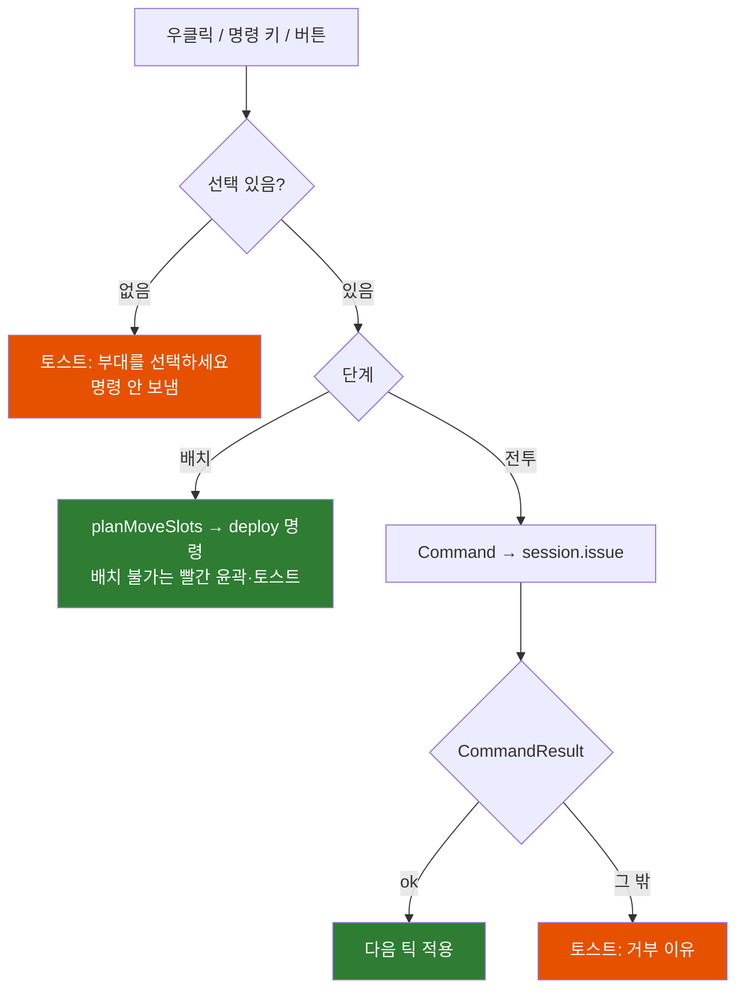

# UI/UX GUIDE

- 담당: UI·UX 디자이너 (T-008)
- 버전: v1.0 (2026-10-23), 상태: **구현됨, QA 대기**
- 근거: GDD §2·§6.5·§7·§9, D-004(지형을 눈으로 읽게), D-009(선택 없으면 명령 무시), D-011(인터페이스 단일화), D-012(+x = 서쪽), ART_STYLE_GUIDE(팔레트·진영 색·접근성), INTERFACES §3
- 코드: `src/ui/`, `src/render/rtsCamera.ts`, `src/render/overlays/`, `index.html`

이 문서는 화면에 보이는 모든 것의 규칙이다. 코드의 토큰 원본은 `src/ui/theme.ts`(캔버스·three.js)와 `src/ui/styles.css`(DOM)이고, 둘은 같은 값을 쓴다. 이 문서와 코드가 다르면 코드를 기준으로 이 문서를 고친다.

---

## 1. 원칙

1. **지형이 왜 결과를 바꿨는지 화면이 설명한다.** 느려지는 곳(경사 오버레이·경로 색), 닿지 않는 곳(사거리 투영), 싸움이 유리한 곳(카드의 "고지 +N%"), 실패한 이유(로그의 "— 원인")를 모두 화면에 둔다.
2. **색만으로 구분하지 않는다.** 진영은 색 + 모양 + 명도 극성, 사기는 색 + 문자, 통과 불가는 색 + 빗금으로 이중 부호화한다.
3. **선택·명령 표시는 진영 색을 덮지 않는다.** 선택은 미색 모서리 괄호와 윤곽, 공격은 빨간 점선과 화살촉이다.
4. **전장을 가리지 않는다.** HUD는 화면 가장자리에만 두고, 지면 표시는 반투명·얇은 선으로 그린다.
5. **실수로 전군을 움직이지 않는다.** 선택이 없으면 명령을 보내지 않고 "부대를 선택하세요"를 띄운다(D-009).

---

## 2. 디자인 토큰

### 2.1 색

진영 색은 아트 팔레트 그대로다. 진영을 표시하는 곳(마커, 병력 막대, 전술 지도 부대 사각형, 로그 글리프)에만 쓴다.

| 토큰 | 값 | 쓰임 |
|---|---|---|
| `TEAM_FILL[0]` 청람 | `#247DA8` | 청람 마커 바탕, 병력 막대 |
| `TEAM_FILL[1]` 황토 | `#E4A33B` | 황토 마커 바탕, 병력 막대 |
| `TEAM_INK/RIM[0]` | `#E6DCC4` (공통 밝은 면) | 청람 마커 테두리·아이콘 |
| `TEAM_INK/RIM[1]` | `#28323D` (공통 암부) | 황토 마커 테두리·아이콘 |
| `text` | `#E6DCC4` | 본문 |
| `textDim` | `#A2A49D` | 보조 문구 |
| `select` | `#F4EFE2` | 선택 괄호·윤곽, 이동 도착 윤곽, 주 버튼 |
| `attack` | `#E5484D` | 공격 표적 선, 점령 중인 깃발 원 |
| `ok` / `warn` / `danger` | `#8DBA7A` / `#E8833A` / `#D94A3D` | 사기 안정·동요·패주, 경고, 배치 불가 |
| 패널 바탕 | `rgba(20,26,32,0.86)` | HUD 패널(공통 암부보다 어둡게) |

사기 색은 진영 색(청·황)과 겹치지 않는 녹·주황·적을 쓰고, 카드에는 "동요"·"패주" 글자와 펄스를 함께 붙인다.

### 2.2 이동 계수 구간 색 (경사 오버레이·경로 미리보기)

| 구간 | 색 | 표시 |
|---|---|---|
| 95% 이상 | `#4FA36B` 초록 | "평지와 비슷" |
| 70~94% | `#E9CF5C` 노랑 | |
| 35~69% | `#E07B39` 주황 | |
| 통과 불가 | `#C43C3C` 빨강 | 6m 주기 대각선 빗금 |

GDD §6.5는 초록 경계를 100%로 적었으나 95%로 바꿨다. 이유와 영향은 §5.3.

### 2.3 타이포그래피

- 글꼴: `Pretendard, Apple SD Gothic Neo, Malgun Gothic, Noto Sans KR, system-ui`. 숫자는 `tabular-nums`(병력·시간이 흔들리지 않게).
- 루트 글자 크기 13px × UI 배율. 1rem = 13px(1280×720).
- 크기 단계: 본문 1rem(13px), 보조 0.85rem(11px, **최소 크기**), 큰 숫자 1.15~1.45rem, 제목 2rem. 키 힌트만 0.72rem(9.4px)을 허용한다(같은 정보가 툴팁에도 있다).

### 2.4 간격·크기·배율

- 간격 단계: 0.25 / 0.5 / 0.75 / 1 / 1.5rem.
- 버튼 최소 3.4rem(1280×720에서 44px). 상단 제어 버튼 2.9rem(38px)은 마우스 전용 보조 버튼이다.
- 카드 4.3 × 5.7rem, 미니맵 13.5rem 정사각.
- **UI 배율** = clamp(min(폭/1280, 높이/720), 1, 1.75). 1920×1080 = 1.5, 2560×1440 = 1.75. 캔버스 마커도 같은 배율을 곱한다.

### 2.5 아이콘

- 24×24 보기 상자, 선 굵기 2.2, 둥근 끝, 채움 없음(`src/ui/icons.ts`). 같은 경로를 카드·버튼(SVG)과 전장 마커(Path2D)가 함께 쓴다.
- 병종 아이콘은 모델 실루엣의 특징을 따른다: 보병 = 각진 방패 + 검, 창병 = 솟은 창 + 좁은 방패, 궁수 = 활 곡선 + 화살, 기병 = 말머리, 지휘관 = 깃발.
- 아트 디렉터와 맞출 것: 지금 아이콘은 UI가 그린 1차안이다. 최종 아이콘 세트는 아트 검수 대상이다(§12).

### 2.6 모션

- 상태 전환 120ms, 토스트 160ms, 카메라 이동 0.35초(smootherstep), 확대·축소는 지수 감쇠(14/s).
- 반복 펄스는 위급 상태에만: 패주 카드·마커, 점령 중인 깃발. `prefers-reduced-motion`이면 펄스를 끈다.
- UI 모션의 최종 곡선·연출은 애니메이션·VFX와 맞춘다(§12).

---

## 3. 컴포넌트 규칙

### 3.1 버튼

| 상태 | 표현 |
|---|---|
| 기본 | 어두운 바탕(`#28323D` 계열), 얇은 테두리 |
| 호버 | 바탕 밝게, 테두리 진하게 |
| 눌림 | 1px 아래로 |
| 켜짐(`is-on`) | 미색 바탕 + 어두운 글자(현재 대형, 현재 배속, 켜진 오버레이) |
| 비활성(`is-disabled`) | 42% 불투명. **명령 버튼은 눌러도 된다** → "부대를 선택하세요" 안내(D-009) |
| 키보드 포커스 | 2px 미색 외곽선. HUD 버튼은 마우스로 눌러도 포커스를 가져가지 않는다(Space가 버튼을 누르지 않게) |

### 3.2 부대 카드

카드 순서는 지휘관 → 보병 → 창병 → 궁수 → 기병, 같은 병종은 번호순으로 고정한다. 자리를 외울 수 있게 하기 위해서다. 넘치면 아래 줄부터 위로 쌓는다(최대 두 줄).

| 요소 | 위치 | 규칙 |
|---|---|---|
| 그룹 번호 | 왼쪽 위 | 속한 그룹 중 가장 작은 번호 |
| 상태 아이콘 | 오른쪽 위 세로 | 방패벽, Brace, 은폐, 종대 통과 중 |
| 병종 아이콘 | 가운데 | |
| 병력 | 아이콘 아래 | |
| 상태 줄 | 병력 아래 | 대기·이동·전진·접근·교전·돌격·고수·Brace·이탈·추격·사격·동요·패주·괴멸. 근접 교전에서 고지 보너스가 있으면 **"고지+N%"**(초록)로 바뀐다(GDD §6.5 ④) |
| 사기 막대 | 아래 | 안정 초록 / 동요 주황 + 상태 줄 "동요" / 패주 빨간 테두리 펄스 |
| 돌격 준비 막대 | 사기 아래(돌격 병종만) | 재사용 대기 남은 비율 |
| 선택 | | 미색 테두리 2중 |
| 괴멸 | | 35% 불투명 + 빗금, 누를 수 없음 |

클릭 = 선택, Shift+클릭 = 추가·해제, 두 번 클릭 = 카메라 이동. 마우스를 올리면 툴팁에 병력·사기·상태·대형·돌격 대기·지형 효과를 문장으로 보여 준다.

### 3.3 진영 마커 (전장 위)

마커는 부대 중심 6m 위(전술 지도에서는 지면)에 화면 크기 고정으로 그린다(반지름 13px × 배율).

| 진영 | 모양 | 바탕 | 테두리·아이콘 | 회색조에서 |
|---|---|---|---|---|
| 청람 | **원** | 어두운 청 `#247DA8` | 밝은 미색 | 어두운 원 + 밝은 테두리 |
| 황토 | **마름모** | 밝은 황토 `#E4A33B` | 어두운 암부 | 밝은 마름모 + 어두운 테두리 |

- 모양과 명도 극성이 모두 반대라 색을 빼도 진영이 갈린다(검증: §11 회색조 스크린샷).
- 아군 마커 아래에 사기 막대(3px), 줌 380m 이하 또는 전술 지도에서 병력 수. 병력 수 라벨이 다른 마커·라벨과 겹치면 그리지 않는다(중요한 마커가 먼저 자리를 잡는다).
- 배지: 왼쪽 위 = 그룹 번호, 오른쪽 위 = 패주 "패"(빨강) > 동요 "!"(주황) > 은폐 "숲"(아군만).
- 선택 = 미색 모서리 괄호, 마우스 오버 = 얇은 괄호.
- 잔상(안 보이게 된 적, 10초) = 진영 색 점선 윤곽만, 55% 불투명. 지면에도 점선 사각형.
- 그리는 순서: 잔상 → 적 → 아군 → 선택(위로 갈수록 중요).

### 3.4 지면 표시 (`src/render/overlays/`)

선은 모두 지면에 붙인 얇은 띠로 그린다. 굵기 = 카메라 거리 × 0.0042(0.45~8m)로 화면에서 거의 같은 굵기를 유지한다.

| 표시 | 형태 | 색 |
|---|---|---|
| 선택 부대 윤곽 | 대형 사각형 + 정면 화살촉 | `select` |
| 공격 표적 선 | 점선 + 표적 앞 화살촉 | `attack` |
| 이동 도착 윤곽(우클릭 중) | 점선 사각형 + 정면 화살촉, 배치 불가면 실선 빨강 | `select` / `danger` |
| 드래그 선분 | 얇은 실선 | `select` 55% |
| 경로 미리보기 | 구간마다 이동 계수 구간 색 | §2.2 |
| 깃발 구역 | 원(반경 40m). 비었으면 점선, 점령 중이면 빨강 펄스 | `select` / `attack` |
| 배치 구역(배치 단계) | 점선 사각형. 내 구역 미색, 적 구역 빨강 | |
| 궁수 사거리 | 채움 5%, 곡사만 가능한 구간 빗금 최대 12%, 바깥선은 **선택 윤곽 굵기의 45%·불투명도 40%**로 다른 지면 선보다 먼저(아래에) 그린다. 보조 정보라 시선이 부대 마커 → 선택 부대 → 사거리 순으로 가야 한다 | `select` |
| 전술 지도 부대 | 대형 사각형 채움(진영 색) + 테두리 | `TEAM_FILL` / `TEAM_RIM` |
| 전술 지도 병목 | 다리·여울 아이콘(각진 어두운 판) | |

### 3.5 이벤트 로그 필터 (D-013)

로그의 대상은 플레이어 자신의 부대다. 판정은 `src/ui/hud/logFilter.ts`의 `shouldLog` 하나가 하고 단위 테스트로 고정한다.

| 이벤트 | 아군 부대 | 적 부대(지금 보이거나 잔상이 남은 경우만) |
|---|---|---|
| 패주, 괴멸 | 남김 | 남김 |
| 돌격 명중 | 남김 | 표적이 아군일 때만 |
| 교전 시작 | 남김 | 상대가 아군일 때만(아군 부대의 사건이므로) |
| 사거리 밖, 돌격 실패, 고지 교전, 측면·후방 피격, 재집결 | 남김 | 숨김(적의 내부 판정) |
| 지휘관 전사 | 남김 | 그 지휘관 부대가 보였을 때만 |
| 깃발 상태 변화, 전투 시작 | 항상 남김 | 항상 남김 |

관전 모드(`playerTeam === null`, `?aivai`)는 필터 없이 모두 남긴다. 판정 정보는 `GameSession`의 `squad().team`, `isVisible`, `lastSeen`, `squads()`의 `isCommander`로 충분해 세션 추가 요청은 없다.

### 3.6 툴팁·안내·띠·모달

- 툴팁: 커서가 350ms 멈추면 뜬다. 화면 밖으로 나가면 뒤집는다. 드래그 중에는 띄우지 않는다.
- 토스트: 화면 가운데 아래, 1.6초. 선택 없음, 그룹 저장, 거부된 명령 이유(`CommandResult`)를 짧게.
- 상단 안내 띠: 배치 단계(설명 + "브리핑으로"·"전투 시작"), 일시정지("명령은 계속 내릴 수 있다").
- 모달: 브리핑, 메뉴(일시정지 메뉴), 조작법, 결과. 모달이 열리면 카메라 키·전장 입력을 막는다.

---

## 4. 키 배치 최종안

GDD §7.2의 제안값을 기준으로, 카메라 키(WASD·Q·E)와 겹치지 않게 정했다. 모든 키는 `KeyboardEvent.code`(물리 위치)로 읽어 한글 입력 상태와 자판 배열에 영향받지 않는다.

| 분류 | 입력 | 동작 | GDD 제안과 차이 |
|---|---|---|---|
| 선택 | 좌클릭 / Shift+좌클릭 | 부대 1개 / 추가·해제 | 같음 |
| | 좌클릭 드래그 | 상자 선택(Shift: 추가) | 같음 |
| | `` ` `` | 전군 선택 | 같음 |
| | **Ctrl+1~9 또는 Alt+1~9** | 그룹 저장 | **Alt 추가**: Windows Chrome에서 Ctrl+숫자는 탭 전환으로 먹힐 수 있다 |
| | 1~9 / 두 번 | 그룹 선택 / 카메라 이동 | 같음 |
| | **Shift+1~9** | 그룹을 선택에 더하기 | 추가 |
| | 카드 클릭 / 두 번 클릭 | 선택 / 카메라 이동 | 같음 |
| 명령 | 우클릭 지면 | 이동(여러 부대는 상대 배치 유지) | 같음 |
| | 우클릭 드래그(8m 이상) | 이동 + 정면·폭. **끄는 방향이 부대의 오른쪽**(화면 왼→오로 끌면 카메라 반대쪽을 본다) | 방향 규칙 확정 |
| | 우클릭 보이는 적 | 공격 | 같음 |
| | Z | 돌격(커서 아래 적, 없으면 현재 표적) | 같음 |
| | C / X | 전진 / 고수 | 같음 |
| | F / G / H | 횡대 / 종대 / 산개 | 같음 |
| | 명령 버튼 "이동"·"공격" | 다음 좌클릭으로 대상 지정(Esc 취소) | 추가 |
| 진행 | Space | 일시정지·재개(명령 가능) | 같음 |
| | + / − (숫자패드 포함) | 배속 1×·2×·4× | 같음 |
| 카메라 | W A S D / 방향키 | 이동 | 기존 |
| | Q / E | 회전 | 기존 |
| | **가운데 버튼 드래그** | 회전·기울기 | **바뀜**: 오른쪽 버튼은 명령 전용 |
| | 휠 | 확대·축소(부드럽게) | 기존 |
| | **Tab** | 전술 지도 ↔ 직전 거리 | 추가 |
| 표시 | **T** | 지형 이동 계수(경사) 오버레이 | 추가 |
| | **R** | 궁수 사거리 상시 표시 | 추가 |
| 기타 | Esc | 진행 중 지정·드래그 취소 → 없으면 메뉴 | 추가 |

---

## 5. 화면 레이아웃

### 5.1 영역

HUD는 가장자리에만 둔다. 가운데 위 상단 띠와 아래 카드 바 사이가 전장이다.

```
┌──────────────────────────────────────────────────────────────────────┐
│                ┌──────── 상단 띠 ─────────┐        ┌ 일시정지·배속·메뉴 ┐│
│ 이벤트 로그     │ 청람 막대 │ 시간·깃발 │ 황토 │        ├ 경사·사거리·전술 ┤│
│ (최근 7개,      └───────────────────────────┘        └ 오버레이 범례    ┘│
│  누르면 카메라)        [배치·일시정지 안내 띠]                               │
│                                                                        │
│                         전장 (마커·지면 표시)                          │
│                                                                        │
│                        [토스트: 부대를 선택하세요]                     │
│ ┌ 명령 버튼 4×2 ┐ ┌──────────── 부대 카드 (최대 2줄) ───────┐ ┌ 미니맵 ┐ │
│ └───────────────┘ └──────────────────────────────────────────┘ └────────┘ │
└──────────────────────────────────────────────────────────────────────┘
```

- 상단 띠 폭 = min(56rem, 화면 폭 − 36rem). 양옆에 로그와 제어 버튼 자리를 남긴다.
- 플레이어 진영 병력 막대를 왼쪽에 둔다. 막대 축척은 시작 병력이 많은 쪽 기준으로 같다(청람 3,600은 황토 5,960의 60% 길이).
- 미니맵은 북쪽(+z)이 위, **동쪽(−x)이 오른쪽**(D-012). 3D 화면을 위에서 본 모양과 같다. 위쪽 가운데에 "북 ▲".

### 5.2 해상도 대응

UI 배율(§2.4)로 전체를 키우고, 카드 바는 가로가 모자라면 두 줄로 접는다. 아래 다섯 크기에서 겹침·잘림이 없는지 실제 화면으로 확인했다(§11).

| 크기 | 비율 | 배율 | 결과 |
|---|---|---|---|
| 1280×720 | 16:9 | 1.0 | 카드 2줄(14 + 2), 겹침 없음 |
| 1024×768 | 4:3 | 1.0 | 상단 띠 좁아짐, 카드 2줄(10 + 6), 미니맵과 카드 사이 약 20px |
| 1560×720 | 19.5:9 | 1.0 | 카드 1줄, 겹침 없음 |
| 2560×1440 | 16:9 | 1.75 | 카드 1줄, 글자 22.75px 기준 |

### 5.3 지형 오버레이 규칙

- **경사 오버레이(T)**: 선택 부대의 병종(보병류 / 기병)으로 칸마다 **가장 느린 방향(오르막)**의 이동 계수를 칠한다. 경사 방향을 하나로 줄이지 않으면 한 칸에 색이 여러 개여야 해서 읽을 수 없기 때문이다. 4m 칸으로 한 번 계산해 텍스처에 굽고, 보병류↔기병이 바뀔 때만 다시 계산한다.
- **초록 경계 95%(GDD 100%에서 변경)**: 100%로 두면 평지의 1~2° 미세 기복도 오르막 기준 95~99%라 맵 대부분이 노랑이 되어, 앞 경사 12°(70%대)·벼랑이 묻혔다(실제 화면에서 확인). 5% 차이는 이동 시간에서 느끼기 어렵다. 영향: 범례 문구가 "95% 이상(평지와 비슷)"이 된다. 게임 디자이너 확인 요청(§12).
- **경로 미리보기**: 우클릭을 누르고 있는 동안만 보인다. 부대마다 실제 경로(A의 Pathfinder)를 구간별 계수 색으로 칠하고, 끝점 라벨에 가장 늦게 도착하는 부대의 예상 시간, "✕ 도달 불가", 경고("돌격 불가 — 숲 통과", "종대 통과 — 좁은 길")를 붙인다.
- **궁수 사거리**: 궁수를 선택하면(또는 R) 72방향으로 잰 실제 사거리 다각형을 지형에 붙인다. 직사가 막히는 구간(능선 뒤, 숲 너머)은 빗금 = 곡사만 가능.

---

## 6. 화면 흐름과 상태별 화면

한 판은 브리핑 → 배치 → 전투 → 결과로 흐르고, 일시정지와 메뉴는 전투 안의 하위 상태다(GDD §2). 단계는 B의 `GameSession.phase`가 정하고, UI는 단계가 바뀔 때 해당 화면을 연다. 메뉴는 전투를 멈추고, 닫으면 메뉴를 열기 전 상태로 되돌린다.

| 상태 | 화면 | 입력 |
|---|---|---|
| 브리핑 | 맵 위 모달: 맵 설명, 진영 카드 2개(구성·승리 조건·권장), "배치로". HUD 숨김. 카메라는 맵 전체 | 진영 선택만 |
| 배치 | 상단 띠 + 배치 안내 띠("브리핑으로"·"전투 시작"), 배치 구역 점선, 적 숨김, 로그 숨김. 카메라는 자기 구역 뒤에서 적 쪽 | 선택·우클릭 배치(`deploy`)·대형 |
| 전투 | 전체 HUD | 전체 |
| 일시정지 | 전투 HUD + "일시정지 — 명령은 계속 내릴 수 있다" 띠, 재생 아이콘 | 전체(명령 가능) |
| 메뉴 | 모달: 재개 / 조작법 / 포기(패배로 기록). 배치 중이면 "브리핑으로" | Esc = 닫기 |
| 결과 | 모달: 승리·패배·무승부, 사유, 통계 8줄(양군), 패주 원인 상위 3, "브리핑으로"·"다시 하기" | 버튼만 |

아래 차트는 UI가 보여 주는 화면 상태의 전이다.

```mermaid
stateDiagram-v2
    [*] --> 로딩
    로딩 --> 브리핑: mountUi (로딩 화면 닫음)
    로딩 --> 오류: 시작 전 예외
    브리핑 --> 배치: 진영 선택 + 배치로
    배치 --> 브리핑: 브리핑으로
    배치 --> 전투: 전투 시작
    state 전투 {
        [*] --> 진행
        진행 --> 일시정지: Space
        일시정지 --> 진행: Space / 재개
        진행 --> 메뉴: Esc / 메뉴 버튼 (일시정지)
        일시정지 --> 메뉴: Esc
        메뉴 --> 진행: 재개 (이전이 진행이었으면)
        메뉴 --> 조작법
        조작법 --> 메뉴: 닫기 / Esc
    }
    전투 --> 결과: 승패 판정 / 포기
    결과 --> 배치: 다시 하기
    결과 --> 브리핑: 브리핑으로

    classDef prep fill:#455a64,color:#fff
    classDef play fill:#1565c0,color:#fff
    classDef modal fill:#6a1b9a,color:#fff
    classDef bad fill:#c62828,color:#fff
    class 브리핑,배치 prep
    class 진행,일시정지 play
    class 메뉴,조작법,결과 modal
    class 오류 bad
```

명령 입력이 부대에 닿는 흐름은 아래와 같다. 선택 확인과 단계 확인은 UI가, 부대 상태(패주·괴멸)와 배치 위치 판정은 sim이 한다.



---

## 7. UI 상태 체크리스트

| 상태 | 처리 |
|---|---|
| 로딩 | `index.html`의 로딩 화면("전장을 준비하는 중" + 진행 막대). `mountUi`가 닫는다 |
| 오류 | 시작 전 예외·거부된 Promise → 로딩 화면이 "게임을 시작하지 못했습니다" + 원인 문구로 바뀐다 |
| 비활성 | 선택이 없으면 명령 버튼 흐림(누르면 안내). 전투 밖에서는 일시정지·배속 흐림. 돌격 병종이 없으면 돌격 흐림 |
| 빈 상태 | 로그가 비면 "전투 기록이 원인과 함께 여기에 남습니다". 그룹이 비면 "그룹 N이 비어 있습니다 — Ctrl(또는 Alt)+N로 저장". 패주 부대가 없으면 결과 화면에 "패주한 부대가 없다" |
| 거부 | `CommandResult`별 문구: 배치 불가(구역 밖·통과 불가), 단계 아님, 대상 아님 |
| 관전 | `playerTeam === null`이면 모든 부대를 보이고 선택·명령은 받지 않는다 |
| 배속 제한 | `GameSession.maxSpeed`보다 높은 배속 버튼은 흐리게, 툴팁·토스트에 `speedLimitReason`(D-016). 정상 기기에서는 4×가 열려 있다 |
| 측정용 병력 | `GameSession.scale !== 1`이면 상단 띠 시계 아래와 결과 화면 사유 아래에 "측정용 병력 ×k"를 주황 글씨로(ARCHITECTURE §9.3) |

---

## 8. 접근성

- **회색조·색각**: 진영(모양 + 명도), 통과 불가(빗금), 사기(문자), 로그 진영(원/마름모 글리프), 미니맵(원/마름모)을 색 없이 읽을 수 있다. 회색조 스크린샷으로 확인했다. 적색·녹색·청색 색각 시뮬레이션은 미실시(§12).
- **최소 크기**: 정보 글자 11px, 버튼 44px(1280×720 기준).
- **대비**: 패널 바탕 위 본문 `#E6DCC4`.
- **모션 줄이기**: CSS 펄스와 캔버스 마커의 패주 깜빡임을 끈다(패주 마커는 75% 불투명으로 고정).

---

## 9. 성능 규칙 (아키텍트 요청, D-016, T-019)

- **지면 선(`DrapedLines`)**: 버퍼는 한 번만 할당한다. 직전 프레임과 같으면 GPU에 올리지 않고, 바뀌면 쓴 정점 범위만 올린다(`addUpdateRange`). 정점을 쓸 때 함수를 부르지 않고(V8은 인라인되지 않은 호출의 실수 인자·반환값을 힙 객체로 감싼다) 높이는 `end()`에서 지형 격자를 직접 보간한다. x·z·lift가 같은 정점은 높이를 다시 계산하지 않는다. 보간 식이 `Terrain.heightAt`과 같은지는 `drapedLines.test.ts`가 검사한다.
- **DOM**: 안내 띠 버튼·끝점 라벨은 한 번 만들고 내용만 바꾼다. 글자·숫자·폭은 마지막으로 쓴 값을 기억해 바뀔 때만 쓴다(`setText`·`setNum`·`setWidthPct`). DOM HUD는 100ms마다 갱신한다.
- **경로 미리보기**: 선택 전체 기준 초당 최대 10회. 100ms마다 하나씩, 경로가 없거나 커서가 4m 넘게 움직인 부대 중 가장 오래된 것부터 다시 묻는다. 도착 자리(`planMoveSlots`)는 2m 넘게 움직이고 50ms가 지났을 때만.
- **경사 오버레이**: 보병류/기병이 바뀔 때만 256×256 칸 계수를 텍스처로 굽는다(첫 계산은 동기라 한 번 끊길 수 있다).
- **사거리**: 부대별 캐시(바깥선 포함), 5m 넘게 움직이면 다시 묻는다. 메시는 대상이나 프로필이 바뀔 때만 다시 만든다.
- **프레임당 객체 생성 금지**: 마커 항목·미니맵 부대·병목 아이콘은 풀에서 재사용, 선택 목록은 선택이 바뀔 때만 새 배열, 마커 라벨 자리 상자는 재사용 버퍼, 글꼴 문자열·병력 수 문자열은 캐시.
- **전술 지도**: 켜짐 650m / 꺼짐 560m 히스테리시스.
- 마우스 → 지면은 A의 `intersectTerrain`. 지형 메시 레이캐스트는 쓰지 않는다.

측정(개발 화면, 1280×720, 교전 중 일시정지, 8개 부대 선택, 사거리 표시 켬):

| 항목 | 전 | 후 |
|---|---|---|
| UI 지면 선 GPU 업로드(정지 화면) | 1.68MB/프레임 | 0 |
| UI 지면 선 GPU 업로드(우클릭 드래그 중) | 1.68MB/프레임 | 바뀐 프레임에만 약 0.28MB |
| 경로 탐색 호출(8개 부대, 드래그 중) | 71.4회/초 | 9회/초 |
| 도착 자리 계산 | 54.9회/초 | 16.5회/초 |
| `ui.update` JS 할당(정지 / 진행 / 드래그) | 586 / – / 740KB(중간 측정) | 32 / 26 / 34KB |

할당은 CDP `HeapProfiler` 표본(회수된 객체 포함, `ui.update` 120회)으로 쟀다. `performance.memory` 차이로 재면 반복 중 소규모 GC 때문에 크게 낮게 나온다(이 방법의 처음 값 30·48KB는 과소 측정). 남은 할당은 마커 캔버스 그리기(약 7KB), 선분 인자(약 4KB) 등 작은 항목이다.

## 10. 구현 구조

```
src/ui/
├── mountUi.ts            진입 함수. 카메라 소유, 프레임 갱신, 입력 → Command
├── gameView.ts           UiSession(= GameSession이 구현할 요구 목록, INTERFACES §3.3)
├── theme.ts, styles.css  디자인 토큰
├── icons.ts              아이콘 경로(SVG·Path2D 공용)
├── input/                selection(선택·그룹), commandPlanner(입력 → Command), keymap(키 배치),
│                         inputController(포인터·키 → 의도), picking(화면 ↔ 지면)
├── hud/                  topBar, unitCards, commandPanel, eventLog, eventText(이벤트 → 문장),
│                         minimap, tooltip, screens(제어·안내 띠·모달)
├── markers/markerLayer.ts 전장 위 진영 마커(2D 캔버스)
└── dev/                  개발 화면(목업 세션) — 빌드에 들어가지 않는다
src/render/rtsCamera.ts   RTS 카메라 + 전술 지도 플래그
src/render/overlays/      drapedLines(지면 띠), slopeOverlay, rangeOverlay
```

- 단위 테스트: `selection.test.ts`(클릭·Shift·상자·그룹·두 번 누름·정리), `commandPlanner.test.ts`(정면 규칙·선분·명령 형식), `keymap.test.ts`(키 → 동작, 배속), `eventText.test.ts`(GDD §6.5 예시 문장), `logFilter.test.ts`(D-013 로그 필터), `drapedLines.test.ts`(높이 보간 일치·변경 없을 때 업로드 생략), `rtsCamera.test.ts`(히스테리시스).
- 개발 화면: `pnpm dev` 후 `/src/ui/dev/harness.html`. 실제 맵·지형 렌더·경로 탐색·병사 렌더러(B의 `SoldierRenderer`) + 목업 세션. `?maxSpeed=2`로 4배속 제한 표시를 확인한다. 주소 파라미터 `?phase=briefing|deployment|battle|result&team=0|1&t=전투초`로 원하는 장면을 바로 연다. 실제 게임(`/`)은 B의 `GameSession`으로 같은 UI를 쓴다.

---

## 11. 검증 결과

`pnpm vitest run`(UI 28개 포함 전체 통과), 타입 검사(UI 파일 오류 없음), `vite build` 통과. 실제 브라우저(Chromium)에서 확인한 것은 아래와 같다.

- 실제 게임(`/`, B의 `GameSession`): 브리핑 → 배치 → 전투 전환, 선택 없을 때 안내, 카드 선택 → 우클릭 → 부대가 `move`로 움직임, 백틱 전군 + X → 16개 부대 모두 `hold`(보병 방패벽·창병 Brace 아이콘 표시), Ctrl+4 저장 → 4 호출 복원, 전술 지도에서 병사 숨김.
- 개발 화면: 배치 드래그 미리보기, 교전 중 HUD, 경사 오버레이·경로·예상 시간, 사거리 투영, 전술 지도, 마우스 오버 지형 정보(여울), 결과 화면, 회색조.

스크린샷(`docs/ui/screenshots/`):

| 파일 | 내용 |
|---|---|
| `battle_1280x720.png` | 전투 중 HUD(목업 교전, 선택·표적 선·사거리·그룹 배지·패주) |
| `battle_2560x1440.png` | 같은 장면 2560×1440(배율 1.75) |
| `battle_1024x768_4x3.png`, `battle_1560x720_19.5x9.png` | 4:3, 19.5:9 |
| `tactical_map_1280x720.png` | 전술 지도(목업) |
| `slope_overlay_path_1280x720.png` | 경사 오버레이(기병) + 경로 미리보기 + 예상 도착 시간 |
| `archer_range_1280x720.png` | 궁수 2개 실제 사거리 투영(능선 뒤 곡사 빗금) |
| `markers_grayscale_1280x720.png` | 회색조 진영 마커 |
| `range_hierarchy_before_*.png` / `range_hierarchy_after_*.png` | 사거리 표시 시각 계층 수정 전후(같은 장면: 교전 중, 궁수 2개, 실제 게임) |
| `terrain_tooltip_1280x720.png` | 마우스 오버 지형 정보 |
| `briefing_1280x720.png`, `deployment_1280x720.png`, `result_1280x720.png` | 상태별 화면 |
| `real_game_battle_1280x720.png`, `real_game_tactical_1280x720.png` | 실제 게임(B 연결) |

---

## 12. 남은 문제와 후속 작업

| 항목 | 담당 | 내용 |
|---|---|---|
| 초록 경계 95% | 게임 디자이너 | GDD §6.5의 100%를 95%로 바꾼 것(§5.3) 확인 |
| 아이콘 최종안 | 아트 디렉터 | 병종·명령 아이콘 1차안 검수, 진영 마커 모양(원/마름모) 승인 |
| 색각 시뮬레이션 | QA·아트 | 적·녹·청 색각 시뮬레이션 스크린샷 검수(회색조만 확인함) |
| UI 모션·효과음 | 애니메이션·VFX, 사운드 | 카드 선택·명령 확인·패주 경고의 모션과 소리 |
| 실제 교전 장면 검증 | QA | 실제 게임에서 교전·패주·결과까지 끝까지 플레이한 화면 확인(이번에는 AI 도착 전까지만 확인) |
| 모바일·터치 | (범위 밖) | MVP는 마우스·키보드 전제. 터치 입력은 없다 |
| 이동 목적지 선 | B | `SquadView`에 목적지가 없어 이동 중 부대의 도착 지점 선을 못 그린다(요청 표) |
| Windows Ctrl+숫자 | QA | Windows Chrome에서 Ctrl+1~9가 탭 전환으로 먹히는지 확인. 대안 Alt+숫자는 이미 동작 |
